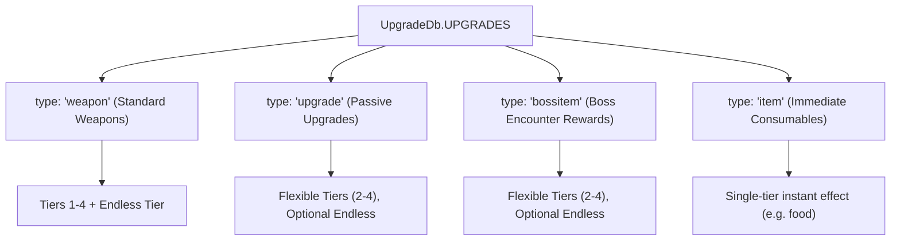
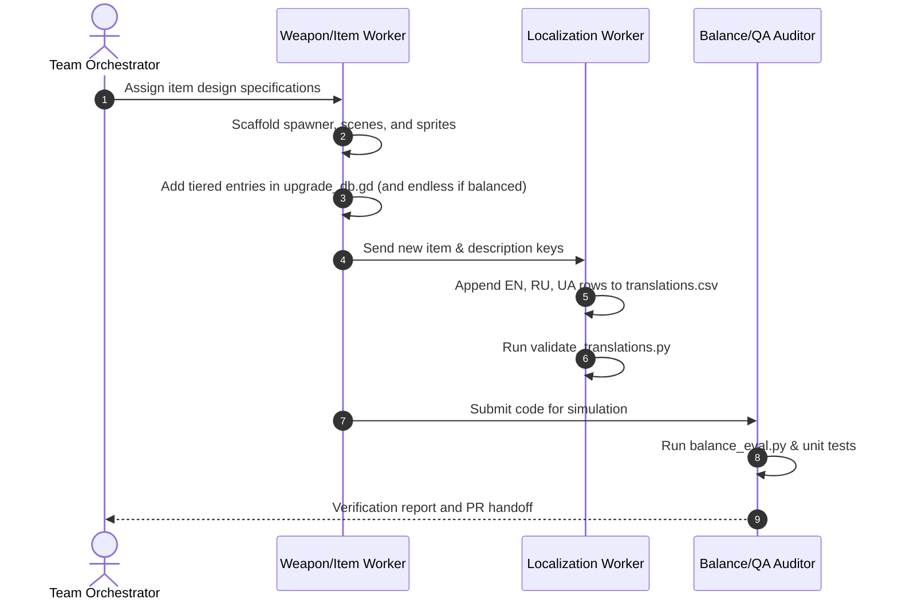

# Inritus — Character & Item Design Guidelines

> **Target Audience:** Autonomous subagents, developer contributors, and multi-agent teams executing batch item/character creation (e.g. via `/teamwork-preview`).  
> **Game Title:** Inritus (v1.0.4) | **Engine:** Godot 4.6  
> **Key Singletons:** `UpgradeDb`, `GlobalEvents`, `SettingsManager`, `StatsManager`, `MusicController`

---

## 1. Executive Philosophy & Pillars

*Inritus* is a hybrid of **Vampire Survivors horde-clearing** and **Risk of Rain progressive scaling**. The core design philosophy centers on **focused elegance, clear build archetypes, and horizontal variety** rather than infinite complexity.

### Core Pillars
1. **Restraint over Feature Creep (Rule 19 / YAGNI):**  
   Never introduce multi-tiered managers, speculative reflection wrappers, or complex subsystem loops for a basic item. Use the established spawner, signal, and dictionary pipelines.
2. **Horizontal Diversity over Vertical Bloat:**  
   New items should open distinct tactical niches (e.g., kiting DoT, high-risk retaliation, health-threshold burst, hitscan chain) rather than just power-creeping existing stats.
3. **Symmetrical Parity:**  
   Every character and item follows uniform structural contracts. If a character has a scaling passive, it has **exactly one** clean scaling passive. Items follow sequential prerequisite chains (`item1` $\to \dots \to$ `itemN`), with tier depth (e.g. 2, 3, or 4 tiers) and optional endless scaling decided based on balance and design intent.

---

## 2. Character Design Blueprint

Characters in *Inritus* are defined in [`res://Utility/global_events.gd`](file:///d:/Школа/Сезон%206/Group%20project/Vampire%20survivors%20clone%20100%/Utility/global_events.gd) within the `CHARACTERS: Dictionary` constant.

### The "One Core Scaling Passive" Law
Every character has:
1. **One Signature Starting Weapon:** Defines early-run attack rhythm and positioning.
2. **Exactly One Clean Scaling Passive:** Scales linearly from Level 1 to `scaling_max_level` (default Level 20).
3. **Optional Starting Stat Bias (`base_stats`):** Minor starting offsets (e.g. +1 Armor or -5% Speed).

### Canonical Character Profiles & The Punished Resolution
| Character | Starting Weapon | Base Stats (`base_stats`) | Scaling Passive (`scaling_stats` @ Lvl 20) | Archetype / Tactical Niche |
|---|---|---|---|---|
| **Mage** | `icespear1` | `{}` | `spell_cooldown: -0.15` (-15% CDR) | High-cadence spellcaster, rapid projectile barrage. |
| **Plague Doctor** | `poisonbottle1` | `{}` | `spell_size: +0.50` (+50% Size) | Massive zone denial, lingering area control. |
| **Occultist** | `ritualcircle1` | `{}` | `lifesteal: +0.02` (+2% Lifesteal) | Active offensive sustain, aggressive close-range presence. |
| **The Punished** | `whip1` | `{"armor": 3, "maxhp": 100}` | `reflected_damage: +40` (+40 Flat Retaliation) | Tanky counter-attacker; converts incoming aggression into lethal retaliatory strikes. |

> [!NOTE]
> **Resolution of The Punished Design:**  
> The previous dilemma—where The Punished risked having dual passives (Thorns + Regen) or suicidal gameplay without sustain—is resolved through the v2 item ecosystem:
> 1. **Baseline Durability:** High starting armor (`armor: 3`) and elevated health (`maxhp: 100`, $+25\%$ over standard 80 HP) provide the physical bulk to absorb hits safely.
> 2. **Single Clean Scaling Passive:** Exactly one scaling passive (`reflected_damage: 40` at Level 20) strictly honors the "One Core Scaling Passive" Law and Rule 19 (YAGNI).
> 3. **Item Pool Synergy:** Instead of baking complex sustain or AoE reflection into his character kit, The Punished naturally completes his build loop using the expanded item roster: Warding Brooch (protective barrier at high HP), Frenzy Charm (retaliatory attack speed surge at low HP), Impact Buckler (emergency shockwave), and Thorn Ring (+reflected damage).

### Character Registry Schema
```gdscript
"character_id": {
    "displayname": "char_character_id",                 # Translation key
    "icon": "res://Textures/Player/player_sprite.png",   # Sprite sheet
    "icon_color": Color(r, g, b),                       # Recoloring tint
    "starting_weapon": "weapon_id1",                    # Tier 1 weapon key from UpgradeDb
    "details": "char_character_id_desc",                # Translation key for lore/stats
    "base_stats": {                                     # Flat modifiers applied at Level 1
        # e.g., "armor": 1
    },
    "scaling_stats": {                                  # Goal value reached at scaling_max_level
        # e.g., "spell_cooldown": -0.15
    },
    "scaling_max_level": 20,                            # Level cap for passive scaling
    "shader_config": {                                  # Optional shader parameter overrides
        "mix_hue": true,
        "mix_saturation": false
    }
}
```

### Character Scaling Mathematics
Character scaling in [`res://Player/player.gd`](file:///d:/Школа/Сезон%206/Group%20project/Vampire%20survivors%20clone%20100%/Player/player.gd) computes fractional progress toward `scaling_max_level`:
$$\text{progress} = \frac{\min(\text{level}, \text{max\_lvl}) - 1}{\text{max\_lvl} - 1}$$
$$\text{active\_bonus} = \text{scaling\_stats}[\text{stat}] \times \text{progress}$$

### Character Stat Budgets (Levels 1 $\to$ 20)
| Stat Target | Safe Range | Benchmark Example | Notes |
|---|---|---|---|
| **Spell Cooldown (CDR)** | `-0.15` to `-0.20` | Mage (`-0.15`) | Multiplies weapon timers; too high breaks attack cycles. |
| **Spell Size** | `+0.40` to `+0.50` | Plague Doctor (`+0.50`) | Multiplies projectile/AOE scale. |
| **Lifesteal** | `+0.015` to `+0.02` (1.5–2%) | Occultist (`+0.02`) | Proc coefficients dampen multi-hit weapons. |
| **Armor** | `+2` to `+4` | Defense archetype | Subject to diminishing returns formula. |
| **Movement Speed** | `+0.15` to `+0.25` | Mobility archetype | Base is 75.0 px/s. |

### Visual Tinting Guidelines
Player sprites utilize `recolor.gdshader`:
- The shader uses Hue blend mode (`mix_hue = true`) to preserve underlying sprite contrast and shading.
- **Pure White Guard:** If `icon_color` is `Color(1, 1, 1)` (e.g. Mage), `mix_hue` is disabled to prevent color washing.
- For desaturated/dark characters (e.g. The Punished), pass `"shader_config": {"mix_hue": true, "mix_saturation": true}` with `Color(0.2, 0.2, 0.2)`.

---

## 3. Item & Upgrade Classification Architecture

All game upgrades are registered in [`res://Utility/upgrade_db.gd`](file:///d:/Школа/Сезон%206/Group%20project/Vampire%20survivors%20clone%20100%/Utility/upgrade_db.gd) inside `UPGRADES: Dictionary`.

### The 4 Item Types


1. **`weapon`:** Active offensive system managed by `<name>_spawner.gd` under `%Weapons`. Follows standard 4 tiers + Endless tier to keep weapon progressions uniform.
2. **`upgrade`:** Passive enhancement (stat modifier or triggered mechanic). Tier count is flexible based on balance (e.g. `ringofaffinity` and `ringofrejuvenation` have 2 tiers; `armor`, `speed`, `tome`, `scroll`, `thornring`, `occult_medallion` have 4 tiers). Subject to max upgrade slots.
3. **`bossitem`:** Powerful boss reward offered only upon boss defeat (`boss_levelup()`). Can be a boss weapon (`glasslash`, `vampireknives` — 4 tiers + endless), high-tier relic (`ring` — 2 tiers + endless), or companion (`relicdrone` — currently 2 tiers, missing endless tier due to unpolished backlog).
4. **`item`:** Instant consumable pickups like `food` (+20 HP flat heal). Not stored in inventory; no tiers, no endless.

### Tier Depth & Endless Scaling: When to Cap vs. When to Loop

It is **not mandatory** to have 4 tiers before endless scaling, nor is endless scaling required for every item. Tier depth and endless availability depend on gameplay balancing and polish status:

- **Tier Depth Selection:**
  - **4 Tiers:** Standard for weapons and broad stat passives (`armor`, `speed`, `tome`, `scroll`, `willowisp`) where incremental growth across early, mid, and late game feels rewarding.
  - **2 to 3 Tiers:** Ideal for specialized passives or high-impact utility (`ringofaffinity` for grab range, `ringofrejuvenation` for HP%, `ring` for +projectile, `relicdrone` for companion) where 4 tiers would either over-saturate the upgrade pool or create runaway power spikes too early.
  - **Single Tier:** Used for consumables (`food`) or standalone one-off effects.

- **When Items SHOULD Have Endless Scaling (`<name>_endless`):**
  - Use endless scaling when an item provides a **linear, non-disruptive stat sink** that remains healthy across minutes 15–20 without breaking game stability:
    - $+1$ flat damage (weapons)
    - $+2\%$ spell size or cooldown reduction
    - $+1$ flat armor
    - $+5\%$ XP grab radius or $+5\%$ max HP
    - $+0.2$ damage multiplier or $+1$ flat damage for single-node companions like `relicdrone`
  - Prerequisites for endless tiers must always point to the final capped tier: `"prerequisite": ["<base_name><max_level>"]`.

- **When Items SHOULD NOT Have Endless Scaling (Genuinely Hard-Capped):**
  - **Protection charges / Invulnerability shields:** e.g., health-threshold shield items (absorbing 1 hit after 10s). Endless scaling on invulnerability or barrier frequency trivializes boss encounters.
  - **Cheat-death / Panic buttons:** Emergency explosions on low health or revive mechanics must have a definitive hard cap or fixed cooldown to preserve death threat and tension.
  - **Non-stackable utility / One-offs:** Items like `food` (+20 HP instant heal) or items that unlock binary gameplay states.

- **Unpolished Content Note (Relic Drone & Will-o'-Wisp):**
  - `relicdrone` (caps at Level 2) and `willowisp` (caps at Level 4) currently do not have endless tiers in `UpgradeDb.gd`. This is **historical unpolished content / backlog debt**, not an architectural prohibition.
  - For companions like `relicdrone`, the drone is a single persistent node floating beside the player—endless tiers can scale cleanly by increasing its rocket damage (`damage_mult` or flat damage) rather than spawning extra drones. Future agents implementing endless tiers for them can safely hook into their damage calculations.

### Prerequisite Integrity Contract
For any multi-tier item:
- Tier 1: `"prerequisite": []`
- Tier $K$ ($K > 1$): `"prerequisite": ["<base_name>" + str(K - 1)]`
- Endless tier (if applicable): `"prerequisite": ["<base_name>" + str(max_level)]`, `"type": "endless"`

### Endless Tier Stacking Formulas
When `type == "endless"`, `player.gd` tracks stacks in `collected_endless[base_name]` and applies recursive scaling:
```gdscript
match base_name:
    "speed": movement_speed_percent_total += 0.02 * count
    "tome": spell_size += 0.02 * count
    "scroll": spell_cooldown += 0.02 * count
    "armor": armor += 1 * count
    "ringofaffinity": xp_range_percent_total += 0.05 * count
    "ring": additional_attacks += 0.05 * count
    "thornring": reflected_damage += 5 * count
    "ringofrejuvenation": max_hp_percent_total += 0.05 * count
```

> [!WARNING]
> **Endless Scaling Guardrails:**  
> Never give percentage damage or CDR over +2% per endless stack. High endless scaling destabilizes runs after minute 15 when player XP intake spikes.

---

## 4. Combat Mathematics & Player Formulas

### 1. Armor & Damage Reduction
Armor uses hyperbolic diminishing returns:
$$\text{DR} = \frac{\text{armor}}{\text{armor} + 40.0}$$
$$\text{Actual Damage} = \text{Incoming Damage} \times (1.0 - \text{DR})$$

- Armor = 10 $\to$ 20.0% DR
- Armor = 20 $\to$ 33.3% DR
- Armor = 40 $\to$ 50.0% DR
- Prevents players from achieving true 100% invulnerability while keeping armor upgrades meaningful.

### 2. Attack Cooldown & Safety Floor
Weapons determine their firing interval as:
$$t_{\text{wait}} = \max\left(0.05, t_{\text{base}} \times (1.0 - \text{player.spell\_cooldown}) \times \text{cooldown\_multiplier}\right)$$

- **Cooldown Safety Floor ($t_{\text{wait}} \ge 0.05\text{s}$):**  
  Under no circumstances may a weapon's firing interval or timer wait time drop below $0.05\text{s}$ (equivalent to a hard ceiling of 20 activations per second).
- **Rationale & Engine Stability:**  
  Godot timers throw engine-level errors if `wait_time <= 0.0`. Even with micro-delays (< 0.016s / 1 frame at 60 FPS), weapon spawners flood the physics pipeline and node tree with unbounded projectile instances, causing catastrophic FPS collapses or audio channel starvation.
- **Combined Stacking Guardrail:**  
  When high CDR (e.g. Mage passive $-15\%$, Tome/Scroll passives, endless scroll stacks) stacks with low-health attack speed surges (e.g. Frenzy Charm $+30\%$ attack speed / $\times 0.7$ wait time), the $\max(0.05, \dots)$ safety floor guarantees engine responsiveness and deterministic physics.
- **Mandatory Spawner Contract:**  
  All `<weapon>_spawner.gd` and projectile timer scripts must wrap their wait time calculation in `max(0.05, ...)`.

### 3. Additional Attacks / Burst Ammo
Additional attacks support fractional values (e.g. endless ring stacks) using a Bernoulli trial:
```gdscript
var extra_attacks = int(player.additional_attacks)
if randf() < (player.additional_attacks - extra_attacks):
    extra_attacks += 1
ammo = base_ammo + extra_attacks
```

### 4. Universal Proc Coefficients & On-Hit Mechanics

Proc coefficients (inspired by *Risk of Rain 2*) govern how individual weapon hit events scale secondary item effects (lifesteal, on-hit procs, debuff application, chain reactions). Without proc coefficients, high-fire-rate and broad-AOE weapons disproportionately dominate on-hit accessories.

#### Mathematical Proc Contracts:
1. **On-Hit Trigger Probability:**  
   For any accessory with a base trigger percentage $P_{\text{base}}$:
   $$P_{\text{trigger}} = P_{\text{base}} \times \text{proc\_coefficient}$$
   Evaluated in GDScript as:
   ```gdscript
   if randf() < (base_chance * proc_coefficient):
       trigger_effect()
   ```

2. **Guaranteed Scaling (Lifesteal & Magnitude):**  
   For guaranteed on-hit triggers, the magnitude or healing is scaled linearly:
   $$\text{Heal} = \text{Damage} \times \text{Lifesteal} \times \text{proc\_coefficient}$$
   $$\text{Duration} = \text{Base Duration} \times \text{proc\_coefficient}$$

3. **Zero-Proc Feedback Loop Prevention Rule (Strict Contract):**  
   Any attack, projectile, explosion, or chain damage spawned as a secondary proc from an item (e.g. Relic Rocket, chain lightning accessory, retaliation shockwaves, Will-o'-Wisp explosions) **MUST explicitly set `proc_coefficient = 0.0`** (or $\le 0.1$ with strict chain dampening).  
   - *Rationale:* If Proc A can trigger Proc B, and Proc B has a proc coefficient $> 0$, enemies clustered in swarms trigger infinite recursive cascades ($A \to B \to A$), crashing the frame rate and trivializing combat.

#### Standard Proc Coefficient Baseline by Archetype:
| Archetype | Benchmark Weapons | Proc Coeff | Balance Rationale |
|---|---|---|---|
| **Heavy Single Target / Precision Projectile** | `icespear`, `javelin`, `lightningrod` | `1.0` | High commitment, low frequency; full value on every hit. |
| **Direct Melee / Frontal Slash** | `whip`, `glasslash` | `1.0` | Close-range danger; rewards positioning. |
| **Piercing / Fan Projectiles** | `tornado`, `vampireknives` | `0.5` | Multiple hits per cast; halved to prevent runaway proc volume. |
| **Persistent AOE Hazard / Gas / Aura** | `poison_gas`, `ritualcircle` | `0.1` – `0.2` | High tick frequency in dense swarms; prevents infinite sustain. |
| **On-Kill Secondary Explosion** | `willowisp` | `0.1` | Dampens chain reaction explosions from clearing the entire screen. |
| **Item-Spawned Munitions / Procs** | `RelicRocket`, procs | `0.0` | Strict loop prevention: procs never proc items. |

### 5. Retaliation & Attacker Node Integrity
Mechanics that reflect damage (e.g., Thorn Ring) hook into `_on_hurt_box_hurt` and require the attacker node:
```gdscript
if reflected_damage > 0 and attacker_node and attacker_node.has_method("_on_hurt_box_hurt"):
    attacker_node._on_hurt_box_hurt(reflected_damage, Vector2.ZERO, 0, "Thorn Ring", self)
```

### 6. Decentralized Signal-Driven Conditional Buffs (`health_ratio_changed`)

Conditional buffs and threshold-based accessories (e.g., Glass Talisman dealt damage bonus at $\ge 95\%$ HP, Frenzy Charm attack speed at $< 30\%$ HP, Impact Buckler kinetic blast at $< 20\%$ HP) must adhere strictly to Rule 19 (YAGNI) and decentralized signal architecture.

#### Architecture Rules:
1. **The Anti-Pattern (Centralized Polling):**  
   Never implement central state machines, polling loops in `_process` or `_physics_process`, or monolithic `if/elif` ladders in `player.gd` checking health thresholds every frame. Polling consumes unnecessary CPU cycles and tightly couples unrelated item mechanics to the player core script.
2. **The Decentralized Contract:**  
   `Player` exposes a dedicated signal:
   ```gdscript
   signal health_ratio_changed(current_ratio: float, old_ratio: float)
   ```
   - Emitted whenever `hp` or `maxhp` changes (clamped to $[0.0, 1.0]$).
   - Items or upgrade handlers listen to `player.health_ratio_changed`.
3. **Local State & Hysteresis Handling:**  
   Each conditional item maintains its own local state (`is_active: bool`, `cooldown_ready: bool`):
   - **Glass Talisman ($\ge 95\%$ HP):** Toggles active state when crossing 0.95.
   - **Frenzy Charm ($< 30\%$ HP):** Toggles active state when crossing 0.30.
   - **Impact Buckler ($< 20\%$ HP Emergency Trigger):** Fires when `current < 0.20 and old >= 0.20` and cooldown is ready.
   - *State Transition Integrity:* By checking boundary transitions (`current < threshold and old >= threshold`), audio cues, shockwaves, and particle triggers fire exactly once upon crossing the threshold rather than every damage tick.

---

### 7. Terraria-Inspired Internal Cooldown (ICD) & Immunity Architecture

To reconcile rapid multi-hit combat, overlapping persistent hazards, and burst projectiles without weapons "eating" each other's damage, *Inritus* implements a 4-tier internal cooldown and immunity model directly inspired by *Terraria*:

#### The 4 Immunity & ICD Tiers:

| Tier | Type | Target Entity | Scope / Tracking | Gameplay Behavior & Contracts |
|---|---|---|---|---|
| **Tier 1** | **Global Immunity** (Anti-Shotgun Buffer) | **Player Only** | Global player `HurtBox` | Brief invulnerability ($0.2\text{s} - 0.4\text{s}$) upon taking damage. Prevents 50 swarm enemies from dealing simultaneous lethal damage in a single 16ms physics tick. **STRICT CONTRACT: Enemies must NEVER use Global Immunity against player attacks.** |
| **Tier 2** | **Local / Per-Weapon Immunity** | **Enemies & Swarms** | Per weapon family (`killer_source`) | Cooldown is tracked per weapon ID. If Weapon A (e.g. `whip`) hits an enemy, that enemy enters cooldown *only against Weapon A*. Weapon B (`icespear`, `tornado`) can strike that same enemy on the exact same frame without interference. |
| **Tier 3** | **Static / Per-Projectile Instance Immunity** | **Enemies & Swarms** | Individual projectile instance | Managed via `hit_once_array` inside the projectile or hit list. A piercing projectile (e.g. `javelin` passing through a line of enemies) damages each target once (or at most once per traversal interval), preventing multi-frame single-target melting while allowing other projectiles of the same weapon to hit freely. |
| **Tier 4** | **Category / Hazard-Group Immunity** (Cloud & Aura Capping) | **Enemies & Swarms** | Shared hazard category (e.g. `hazard_poison`, `hazard_ritual`) | Persistent hazard fields sharing a category share a target tick interval (e.g. max 4 ticks/s). **Stacking Prevention:** Overlapping 3 Poison Gas clouds on a boss does not cause $3\times$ tick melting. **No Weapon Lockout:** Category immunity is strictly isolated—an enemy taking Poison Gas ticks **NEVER** prevents `icespear`, `whip`, or other weapons from damaging that target! |

#### Accessory ICD Autonomy:
- **Local Item Cooldowns:** Triggered accessories (e.g. Impact Buckler emergency blast: 60s/40s/20s, Warding Brooch recharge: 10s out of combat) track autonomous timers (`Time.get_ticks_msec()`). Triggering Item A never locks out, delays, or resets Item B.
- **Defensive Desync:** Triggering an emergency defensive item (Impact Buckler) activates the player's Tier 1 Shared Defensive Buffer, physically clearing immediate space while preventing simultaneous multi-item charge consumption.

#### The "No Eaten Hits" Anti-Lockout Law:
> [!CAUTION]
> **The Piercing & Hazard Lockout Bug (Terraria Historical Flaw):**  
> In early action engines, giving enemies global immunity frames caused rapid-ticking weapons (like Poison Gas or piercing beams) to disable the enemy's hurtbox, causing slow, heavy projectiles (like Ice Spear) to pass through the enemy dealing zero damage.  
> Under *Inritus* guidelines:
> 1. Enemy hurtboxes must never use `HurtBoxType = 0` (Global Cooldown) against player attacks.
> 2. Persistent AOEs must use **Category Immunity** (pulsing hitboxes with isolated category tags) rather than disabling the enemy's entire hurtbox.
> 3. Piercing projectiles must use **Per-Projectile Instance tracking** (`hit_once_array`), so no attack can ever "eat" or block another weapon's damage.

---

### 8. Enemy Tenacity & Crowd Control Hierarchy

Crowd control (knockback, stagger, freeze/slow, and displacement) must respect a strict 3-tier tenacity hierarchy across enemy categories to preserve encounter pacing and prevent boss exploits:

| Hierarchy Tier | Target Systems | Tenacity (Displacement Resistance) | Allowed CC Mechanics | Forbidden CC Mechanics |
|---|---|---|---|---|
| **Tier 1: Swarm** | `SwarmManager` (Easy & Normal pools) | **`0%` (Tenacity = 0.0)** | 100% displacement from knockback, mass radial shockwaves (Impact Buckler), gravity pulls, freezes, full slows. | None. |
| **Tier 2: Elite** | `EnemyBody` nodes (Hard pool: Cyclops, Juggernaut) | **`60%`–`75%`** | Short directional knockback, **Stagger** (brief 0.3s–0.5s movement/attack interruption), status slows up to 40%. | Long-distance flinging, perma-freeze, continuous vortex lock. |
| **Tier 3: Boss** | `boss.gd`, `dr_franklin.gd` (Super pool) | **`100%` (Immune)** | Soft utility debuffs (slow capped at max 20% movement speed reduction), visual markers, damage amplification curses. | **All knockback, displacement, pulls, teleports, and hard staggers are strictly prohibited.** |

#### Boss Displacement Immunity Contract:
- Bosses must never be displaced by player weapon knockbacks, explosions, or panic buttons (Impact Buckler shockwave).
- Mechanics that apply displacement must explicitly check:
  ```gdscript
  if enemy.is_in_group("boss") or (enemy.get("is_boss") == true) or (enemy is EnemyBody and "Boss" in enemy.name):
      return # Bypass displacement entirely
  ```
- *Rationale:* Displacing bosses breaks telegraph alignment (e.g. Dr. Franklin's directional beam), pushes bosses outside camera boundaries, and invalidates choreographed bullet-hell encounter phases.


---

## 5. Architectural Implementation Patterns

When creating new items or weapons, select the appropriate established pattern:

| Category | Pattern | Implementation Details |
|---|---|---|
| **Stat Passive** | Pure Dictionary Entry | Only requires `stat_modifiers` in `UPGRADES` dictionary. Handled automatically by `apply_stat_modifiers()`. |
| **Standard Projectile** | Spawner + Scene | `<name>_spawner.gd` under `%Weapons`, spawns `<name>.tscn` added to `player.get_parent()`. |
| **Persistent AOE** | PhasedAnimator | Two-stage lifecycle (`Start -> Loop -> End`) with smooth tween fade-out (e.g. Poison Gas, Ritual Circle). |
| **Melee / Flexible Line2D** | 3-Slice Shader | Uses `whip_3slice.gdshader` to preserve handle/tip while stretching the whip body. |
| **Autonomous Companion** | Direct Player Child | Instantiated directly under `Player` (e.g. Relic Drone), autonomously orbits and targets. |
| **Debuff / Wave Spawner** | Pulse Spawner | Periodically searches nearby enemies/swarms and applies status effects (e.g. Occult Medallion). |
| **On-Kill Proc** | Global Signal Hook | Hooks into `GlobalEvents.enemy_died`. Must damp chain reaction chance when `_killer == own_name` (e.g. Will-o'-Wisp dampens to 10%). |
| **On-Hurt / Retaliation** | HurtBox Attacker Hook | Hooks into `_on_hurt_box_hurt(damage, ..., attacker_node)`. |
| **Conditional / Threshold Buff** | Signal Listener (`health_ratio_changed`) | Autonomous item component listens to health ratio transitions; toggles local modifiers without polling. |

---

## 6. Technical Contracts (Engine Rules)

Any agent implementing weapons or items must follow these non-negotiable rules:

1. **Collision Layer 3 (Bit 2, Value 4):**  
   All attack scenes must set `collision_layer = 4` and `collision_mask = 0`. Swarms ignore nodes not on Layer 3.
2. **Node Group `"attack"`:**  
   The root `Area2D` must belong to the `"attack"` group.
3. **Child Node Name `"CollisionShape2D"`:**  
   `SwarmManager` manually inspects shapes by searching for a child explicitly named `"CollisionShape2D"`.
4. **Exposed Properties:**  
   Every damaging area must expose `damage: float` and `knockback_amount: float`.
5. **Sprite Padding Standards:**  
   UI icons must have zero transparent padding (trimmed tightly to 32x32) to prevent misalignment in the upgrade selection cards.
6. **RFC 4180 Localization (Rule 5):**  
   Every item key must be added to `translations/translations.csv` with exactly 4 columns: `keys,en,ru,ua`. No empty cells, no missing keys.

---

## 7. Batch Implementation Runbook for Autonomous Teams

When executing batch creation in `/teamwork-preview`:



### Verification Checklist Before Marking Task Complete:
- [ ] Run `python .agents/skills/localization-validator/validate_translations.py` $\to$ Returns clean status code `0`.
- [ ] Run `python .agents/skills/game-balance-eval/balance_eval.py --difficulty normal` $\to$ TTK metrics within $10\text{s}-30\text{s}$ bounds.
- [ ] Run `godot --headless -s addons/gut/gut_cmdln.gd` $\to$ All automated unit tests pass.
- [ ] Verified Layer 3 collision (`collision_layer = 4`) and `"CollisionShape2D"` child node name for all attack scenes.
- [ ] Registered proper tier progression (`item1` through `item<N>`, plus `item_endless` only if intentionally designed for endless scaling) in `UpgradeDb.gd`.

---

## 8. Long-Term Architectural Horizons & Backlog Roadmap

The following architectural initiatives represent planned long-term horizons to expand *Inritus* beyond early access while maintaining strict YAGNI adherence in current builds:

### 1. Pre-Run Weapon Loadouts (Risk of Rain 2 Style)
- **Concept:** Allow characters to unlock and select alternate starting primary weapons prior to starting a run (e.g. Mage selecting between Ice Spear or Lightning Rod; Plague Doctor selecting between Poison Bottle or Ritual Circle).
- **Architectural Guardrails:**
  - Loadouts alter ONLY the starting weapon (`starting_weapon`).
  - Base stats and the single scaling passive remain identical, preventing character balance fragmentation.
  - Selected loadout is saved in `SettingsManager` or a persistent profile.

### 2. Draft Economy (1 Reroll per 3 Levels)
- **Concept:** Introduce a structured level-up draft economy allowing players to reroll upgrade options.
- **Pacing Rules:**
  - Players start with 0 rerolls and earn 1 reroll charge for every 3 character levels achieved (e.g., at Levels 3, 6, 9, 12, ...).
  - Prevents early-game build bricking while preventing high-level runs from rolling infinite rerolls to fish for endless stacks.
  - Reroll charges are displayed on the level-up GUI card header.

### 3. Environmental Wall Collision Rules & Closed Maps
- **Concept:** Transition from infinite plane arenas to structured dungeon/map layouts (Enter the Gungeon / Soul Knight style) with solid boundary walls and obstacles.
- **Collision & Routing Contracts:**
  - **Layer 1 (World / Solid Obstacles):** Tilemap walls on Layer 1.
  - **Projectile Navigation:**
    - Standard projectiles (`icespear`, `relicrocket`) terminate upon impacting Layer 1 wall geometry.
    - Melee sweeps (`whip`) and ethereal auras (`ritualcircle`) pierce walls.
    - Bouncing projectiles (`javelin`) reflect across surface normals.
  - **Swarm Pathfinding:**
    - `SwarmManager` MultiMesh instances cannot use individual Godot NavigationAgents (CPU prohibitive for 1,000+ units).
    - Swarms must navigate using coarse flow-field / vector fields or cell-based potential fields generated per map chunk.

