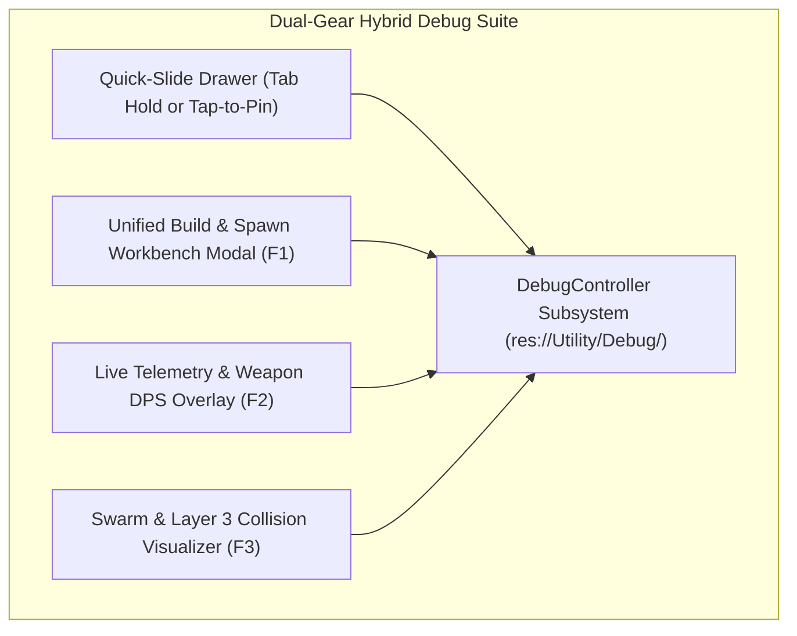

# Inritus — Developer Debugging Suite & Dedicated Testing Rooms

> **Status:** Implemented & Verified (v1.1 — Active QA Polish Backlog in Part III)  
> **Target Audience:** Game Designers, Systems & Boss AI Programmers, Technical Artists, Audio Designers, and QA / Balance Engineers  
> **Core Constraint:** Preserve zero-friction quick access (`Tab` drawer + `DebugButtons.tres` theme isolation per Rule 6) alongside fast-loading, isolated diagnostic test rooms (`res://Tools/TestRooms/`) built on the shared [`DebugController`](file:///d:/Школа/Сезон%206/Group%20project/Vampire%20survivors%20clone%20100%/Utility/Debug/debug_controller.gd) spine.

---

## 1. Executive Summary & Architecture Overview

In a horde-survival game with exponential scaling like *Inritus*, **testing velocity is the primary bottleneck to game balance and polish**. While **Rule 19 (YAGNI)** strictly governs *production gameplay systems*, developer tooling is a force multiplier split into two complementary tiers:

1. **Part I — In-Run Debugging Suite (`res://Utility/Debug/`):** Mutates a live survival run inside [`World/world.tscn`](file:///d:/Школа/Сезон%206/Group%20project/Vampire%20survivors%20clone%20100%/World/world.tscn) via 4 integrated gears (`Tab` Quick Drawer, `F1` Unified Workbench, `F2` Telemetry & DPS HUD, `F3` Swarm & Layer-3 Hitbox Visualizer, plus `F4`/`Mouse5` Freeze & `.` Single-Frame Step).
2. **Part II — Dedicated Testing Rooms (`res://Tools/TestRooms/`):** Standalone scenes runnable in under `100ms` via `F6` or the universal **`F5` Test Room Switcher**, bypassing `world.tscn`'s `2s–4s` instantiation hitch ([`docs/tech_debt.md`](tech_debt.md)) to inspect shaders, animations, spatial weapon metrics, boss state machines, SwarmManager benchmarks, 3-locale UI bounds, and audio polyphony.
3. **Part III — Post-Implementation QA Audit & Polish Backlog:** Tracks active bugs, layout fixes, and UX refinements surfaced during the Nov 17 hands-on review.

### Resolved Design & Architectural Decisions
* **Production Decoupling & Release Safety:** Debug UI generation and callbacks are extracted out of `player.gd` and `gui.gd` into `res://Utility/Debug/`, gated behind `OS.is_debug_build()` / `SettingsManager.is_debug_enabled()`.
* **Freeze Keybind & `Mouse5` Unification:** The legacy ad-hoc `FreezeeverythingNOW!!!` action was removed; simulation freeze and single-frame stepping are unified in `DebugController.handle_key_event`, binding `F4` and `Mouse5` (`MOUSE_BUTTON_XBUTTON2`) to `toggle_freeze()` and `.` to single physics-frame stepping while frozen.
* **Universal Entry Point (`F5` Switcher):** `F5` opens the `TestRoomSwitcher` modal across all test rooms, the live survival world, and the Title Screen (when debug is enabled), keeping the `Tab` Quick Drawer uncluttered.
* **Movement Key Isolation:** `W` and `S` remain strictly reserved for player movement across all test rooms (e.g., wall toggling uses `O` in Combat Proving Ground and SFX burst uses `P`/`X` in UI/Audio Soundboard).

---

# Part I: In-Run Developer Debugging Suite (`res://Utility/Debug/`)

## 2. Legacy Audit & Remediations Addressed

Prior to `res://Utility/Debug/`, debugging was scattered across [`World/world.tscn`](file:///d:/Школа/Сезон%206/Group%20project/Vampire%20survivors%20clone%20100%/World/world.tscn), [`Player/debugmenu.gd`](file:///d:/Школа/Сезон%206/Group%20project/Vampire%20survivors%20clone%20100%/Player/debugmenu.gd), [`Player/gui.gd`](file:///d:/Школа/Сезон%206/Group%20project/Vampire%20survivors%20clone%20100%/Player/gui.gd), and [`Player/player.gd`](file:///d:/Школа/Сезон%206/Group%20project/Vampire%20survivors%20clone%20100%/Player/player.gd) with 6 major friction points:
1. **`remove_upgrade()` State Leaks:** `uid.rstrip("0123456789")` failed on `_endless` suffixes and special items (`relicdrone`, `willowisp`, health items). Refactored via `remove_upgrade_to_level()` and `reset_all_upgrades()` recalculating from `collected_upgrades` and `collected_endless`.
2. **Single-Click Modal Closure & Endless Stacking Block:** Replaced legacy `GiveItemMenu`/`RemoveItemMenu`/`SpawnBossMenu` popups with the persistent `F1` Workbench supporting direct tier toggling and endless stack stepping.
3. **Timer Jumps Skipping Bosses:** Synchronized `+1m (Sync)` / `+5m (Sync)` jumps emit `changetime` and allow checking crossed `boss_spawn_interval` milestones.
4. **Self-Damage Passing `null` Attacker:** Updated `💔 Hit Self` to supply an attacker reference so *Thorn Ring*, *The Punished* passive reflection, and *Warding Brooch* spillover can be tested directly.
5. **No Enemy Clear:** Added `Clear Foes` and `Magnet Gems` controls to wipe active nodes + `SwarmManager.swarm_data` or vacuum floor pickups.
6. **Stats Pollution ("Tainted Run" Protection):** Any debug action flags `StatsManager.is_run_tainted = true` (`[DEBUG]` HUD indicator), preventing test runs from overwriting persistent personal bests unless `allow_tainted_stats` is toggled on.

### Module Structure
```text
res://Utility/Debug/
├── debug_controller.gd       # Central coordinator; owns time_scale, presets, and debug actions
├── debug_drawer.tscn/.gd     # Upgraded SlidingMenu (Hold-to-Peek + Tap-to-Pin + Compact Accordion)
├── debug_workbench.tscn/.gd  # Unified Modal: Inventory Matrix, Enemy Sandbox, World & Time Controls
├── debug_telemetry.tscn/.gd  # Draggable/Collapsible HUD: Live Stats, Buff Timers, Per-Weapon DPS Meter
├── debug_visualizer.gd       # Node2D CanvasItem _draw() overlay for SwarmManager & Layer 3 Hitboxes
└── target_dummy.tscn/.gd     # Immortal DPS Dummy & Retaliation Dummy (`EnemyBody` subclass)
```

---

## 3. The 4 In-Run Debugging Gears



### 3.1 Gear 1: The Upgraded Quick-Slide Drawer (`Tab` / Mobile Gesture)
Styled with `res://Themes/DebugButtons.tres` (`160px` width, neon-green panel isolated from global `NinePatchUI.tres`):
* **Hold-to-Peek vs. Tap-to-Pin:** Holding `Tab` (`> 180ms`) opens on press and closes on release; quick tapping `Tab` (`< 180ms`) or clicking `[📌 Pin]` locks it open. On mobile touchscreens, a 3-finger tap or long-press on `lblTimer` toggles the drawer.
* **Frame Freeze & Step (`F4` / `Mouse5`, `.`):** Freezes `get_tree().paused`; pressing `.` advances exactly 1 physics frame (`await get_tree().physics_frame`) and re-pauses.
* **Quick Controls Layout:**
  ```text
  ┌────────────────────────────────────┐
  │  🛠️ DEBUG QUICK MENU      [📌 Pin] │
  ├─────────────────┬──────────────────┤
  │ [🛡️ Godmode:OFF]│ [👾 Spawns: ON]  │
  │ [🧹 Clear Foes] │ [🧲 Magnet Gems] │
  ├─────────────────┴──────────────────┤
  │  SPEED: [0.2x][0.5x][1x][2x][4x]   │
  ├─────────────────┬──────────────────┤
  │ [⬆️ +1 Level]   │ [✨ +1000 XP]    │
  │ [🎒 Workbench…] │ [👹 Spawn Menu…] │
  ├─────────────────┴──────────────────┤
  │  HP THRESHOLD QUICK-SET:           │
  │  [100%] [94%] [29%] [19%] [🔄 CDs] │
  ├─────────────────┬──────────────────┤
  │ [💔 Hit Self]   │ [💀 Kill Player] │
  │ [⏱️ +1m (Sync)] │ [⏱️ +5m (Sync)]  │
  │ [📊 DPS HUD:ON] │ [🎯 Hitboxes:OFF]│
  ├─────────────────┼──────────────────┤
  │ [🎵 Next Track] │ [🔇 Mute Music]  │
  │ [🔄 Restart]    │ [🚪 End Run]     │
  └─────────────────┴──────────────────┘
  ```
* **HP Threshold Strip (`100%`, `94%`, `29%`, `19%`, `🔄 CDs`):** Jumps directly across *Glass Talisman* ($\ge 95\%$), *Warding Brooch* ($\ge 90\%$), *Frenzy Charm* ($< 30\%$), and *Impact Buckler* ($< 20\%$) thresholds, while `🔄 CDs` resets brooch recharge, buckler ICD, and weapon timers.

### 3.2 Gear 2: Unified "Build & Sandbox Workbench" Modal (`F1`)
Tabbed modal window (`debug_workbench.tscn`) that stays open while editing and includes a live search/command filter bar:
1. **Tab 1 — Inventory & Build Matrix:**
   * Displays all **Weapons**, **Passive Upgrades**, and **Boss Items** from `UpgradeDb.UPGRADES` with direct `[Off] [1] [2] [3] [4]` tier pills and `[-] 0 [+] [+5]` endless stack steppers.
   * Mid-run **Character Switcher** (`Mage`, `Plague Doctor`, `Occultist`, `The Punished`) recalculating stats and `recolor.gdshader`.
   * **Loadout Presets (`user://debug_presets.cfg`):** Save/load custom builds plus 1-click *"Minute 5 Early"*, *"Minute 10 Mid"*, and *"Minute 15 Endgame Stress"* benchmark presets.
2. **Tab 2 — Combat Sandbox & Target Dummy Spawner:**
   * **Immortal DPS Dummy** (`target_dummy.gd`): Infinite HP, toggleable knockback immunity, overhead readout (`Last Hit`, `Rolling 5s DPS`, `Active Debuffs`).
   * **Retaliation Dummy:** Periodically pokes player (`5 / 15 / 30` raw damage every `2s`) to test Armor DR, *Warding Brooch*, *Lifesteal*, and *Reflected Damage*.
   * **Wave & Swarm Injector:** Spawn `+1 / +10 / +100 / +500` units from `spawns_easy`, `spawns_normal`, `spawns_hard`, or `spawns_super` in Ring, Tight Cluster, or Surround formations.
3. **Tab 3 — Live Stat & Difficulty Overrides:**
   * Live mid-run sliders for `GlobalEvents` difficulty modifiers (`enemy_spawn_modifier`, `enemy_hp_modifier`, `boss_hp_modifier`, `player_damage_modifier`, `xp_gain_modifier`) and direct `player` stat overrides (e.g., verifying the $0.05\text{s}$ Cooldown Safety Floor at extreme CDR).

### 3.3 Gear 3: Live Telemetry & Per-Weapon DPS Overlay (`F2`)
Semi-transparent HUD (`mouse_filter = MOUSE_FILTER_IGNORE`, updating every `0.25s`):
* Shows FPS/frame time, `Engine.time_scale`, active RNG seed, enemy counts (`Swarm` vs. `Elites` vs. `Boss`), floor loot + magnet roll odds, computed player stats (DR%, effective speed, CDR%, extra projectile Bernoulli remainder), and active health-item states.
* **Rolling 5s Per-Weapon DPS Meter:** Hooks `GlobalEvents.player_dealt_damage` and `GlobalEvents.enemy_died` into a 5-second ring buffer with `[Reset Meter]` and `[Export CSV to user://]` actions for cross-checking against `.agents/skills/game-balance-eval/balance_eval.py`.

### 3.4 Gear 4: Visual Collision, Swarm & Rule Validator Overlay (`F3`)
World-space `Node2D._draw()` overlay because `SwarmManager` bypasses Godot's physics engine:
* Draws `40x40 px` `spatial_grid` hash cells, highlighted queried cells, and per-unit `SwarmEnemy` collision circles color-coded by HP percentage (with purple rings for `"curse"` debuffs).
* Draws `GrabArea`, `CollectArea`, Player `HurtBox` (flashing white during `0.3s` `DisableTimer` i-frames), and Boss HitBoxes/Telegraphs.
* **Live Rule 16 & Rule 17 Swarm Linter:** Flags any node in group `"attack"` missing `collision_layer & 4 != 0` (Layer 3), missing child `"CollisionShape2D"`, or using an unsupported shape type (`CapsuleShape2D`, etc.) with a pulsing world-space warning badge.

---

# Part II: Dedicated Testing Levels & Diagnostic Utilities (`res://Tools/TestRooms/`)

## 4. Test Rooms Overview & Shared Spine

| Room / Utility | Scene Path | Primary Purpose |
|---|---|---|
| **Shared Spine** | `res://Tools/TestRooms/test_room_base.gd` | Compact top/bottom HUD (`DebugButtons.tres`), `F5` Switcher hook, `[H]` Keybind Legend, camera & pixel-grid helpers |
| **Level 1: Assets Lab** | `res://Tools/TestRooms/test_room_assets.tscn` | Sprite & `PhasedAnimator` single-frame stepper, draggable `Line2D` 3-slice whip rig, Shader Lab, Rule 12 Icon Trim Auditor |
| **Level 2: Combat Proving Ground** | `res://Tools/TestRooms/test_room_combat.tscn` | `32px` floor grid + `50/100/180/250px` range rings, 4 quadrant test stations, toggleable Layer-1 solid walls |
| **Level 3: Boss & Swarm Lab** | `res://Tools/TestRooms/test_room_boss_swarm.tscn` | Isolated boss state choreography (`Ancient Amoeba`, `Dr. Franklin`), auto-pause after telegraph (`N`), `N = 500..5000` CSV benchmark |
| **Level 4: UI, Locale & Audio** | `res://Tools/TestRooms/test_room_ui_audio.tscn` | Side-by-side `en`/`ru`/`ua` card overflow wall, `focus_neighbor_*` graph visualizer, `MusicController` & SFX burst deck |
| **Diorama Studio** | `res://TitleScreen/HowToPlay/diorama_studio.tscn` | Standalone `640x360` How-To-Play JSON motion recorder (registered in `F5` Switcher) |

### Universal Test-Room Keybinds
*(Gated behind `SettingsManager.is_debug_enabled()` and suppressed while typing in `LineEdit`/`TextEdit`)*

| Keybind | Universal Action |
|---|---|
| `F5` / `Esc` | Open/close **Test Room Switcher** modal (jump between Assets, Combat, Boss/Swarm, UI/Audio, Diorama Studio, World, Title Screen) |
| `H` | Toggle translucent **Keybind Cheat Sheet** card for the current room |
| `R` | **Reset Room** to clean initial state |
| `Backspace` | Return directly to Title Screen (`menu.tscn`) |
| `Tab`, `F1`–`F3` | Standard `DebugController` overlays (`Tab` Drawer, `F1` Workbench, `F2` Telemetry, `F3` Hitbox Visualizer) |
| `F4` / `Mouse5`, `.` | Toggle freeze (`F4` / `Mouse5`) and step 1 physics frame (`.`) |

---

## 5. Individual Test Room Specifications

### 5.1 Level 1: Texture, Animation & Shader Gallery (`test_room_assets.tscn`)
* **Stations:**
  1. **Sprite Sheet & `PhasedAnimator` Stepper:** Inspects `Player/Attack/`, `Enemy/Minions/`, `Enemy/Boss/`, and `PhasedAnimator` scenes (`poison_gas.tscn`, `ritualcircle.tscn`, `willowisp_explosion.tscn`, `impact_buckler_shockwave.tscn`) with `frame`, `Phase` (`START`/`LOOP`/`FINISH`), `row_index`, dimensions, and pivot crosshair.
  2. **Interactive `Line2D` 3-Slice Whip Rig:** Draggable control points for `whip.tscn` / `glasslash.tscn` with `start_margin`, `end_margin`, `texture_scale`, `tile_middle`, `hide_caps`, and `1x`–`16x` pixel-loupe zoom to inspect `tech_debt.md` inner-arc pixel pinching.
  3. **Shader Uniform & Backdrop Lab:** Previews `recolor.gdshader`, `elite_graphics.gdshader` (`trail_mode` `0`/`1`/`2` with synthetic `motion_offset` oscillator), and `SwarmManager` MultiMesh preview over 4 backdrops (Checkerboard, Dark `#111318`, Arena Green, White).
  4. **Rule 12 Icon Trim Auditor:** Scans every `UpgradeDb.UPGRADES` icon via `Image.get_used_rect()`, flagging `> 0px` transparent edge padding inside `item_option.tscn` and `item_container.tscn`.
* **Keybinds:** `1`–`4` Switch Tab | `[`/`]` Cycle Asset | `Space` Play/Pause | `,`/`.` Step Frame | `P` Trigger `PhasedAnimator.advance(true)` | `Up`/`Down` Cycle `row_index`/`trail_mode` | `B` Cycle Backdrop | `G` Toggle UV/Pivot/UsedRect Gizmos | `+`/`-`/Wheel Zoom (`1x`–`16x`) | `A` Run Icon Audit.

### 5.2 Level 2: Combat Proving Ground (`test_room_combat.tscn`)
* **Floor Calibration:** `32px` grid + concentric range rings (`50px`, `100px`, `180px`, `250px`).
* **4 Quadrant Stations:**
  * **Station 1 (North) — Single-Target DPS:** Immortal `TargetDummy` + pixel ruler + knockback toggle.
  * **Station 2 (East) — Pierce & AoE Matrix:** Line of 8 dummies spaced `28px` apart (pierce cap check) + `3x3` tight cluster (AoE / Terraria ICD verification).
  * **Station 3 (South) — Retaliation & HP Cage:** Retaliation `TargetDummy` (`5 / 15 / 30` dmg pulses) + floor pads/hotkeys snapping HP to `100%`, `95%`, `90%`, `29%`, `19%`.
  * **Station 4 (West) — Swarm Pen & Prototype Wall Lab:** Auto-replenishing pen (`N <= 100` kobolds) + toggleable Layer-1 solid test walls (`Standard` / `Corridor` / `Off`) for testing closed-map wall collision and pathing.
* **Keybinds:** `1`–`4` Warp Station (`0` Center) | `Q`/`E` Cycle Weapon | `Up`/`Down` Step Tier (`1..4..Endless`) | `T` Spawn Dummy at Cursor (`Alt+T` Clear) | `Shift+T` Toggle/Cycle Retaliation (`5/15/30`) | `K` Toggle Knockback | `M` Spawn `+50` Swarm (`Shift+M` Clear) | `O` Toggle Solid Test Walls | `C` Clear Projectiles & Reset DPS | `0` Reset Cooldowns & Item Charges.

### 5.3 Level 3: Boss Choreography & Swarm Stress Lab (`test_room_boss_swarm.tscn`)
* **Boss Choreography Stage:** Spawns isolated **Ancient Amoeba** (`boss.gd`) or **Dr. Franklin** (`dr_franklin.gd`) with `BossUI` + overhead state/timer/HitBox readout, supporting forced state jumps and `"Hold After Telegraph"` (`N`).
* **Automated Swarm Benchmark Harness:** Fixed sweep (`N = 500 -> 1,500 -> 3,000 -> 5,000` units for `5.0s` per tier) logging `avg_fps`, `frame_ms`, `min_fps`, `physics_ms`, and `collision_pairs` to `user://swarm_benchmark.csv` (comparable against the `0.904 ms/frame` 3,000-unit baseline in [`docs/swarm_optimization.md`](swarm_optimization.md)).
* **Keybinds:** `1` / `2` Spawn Ancient Amoeba / Dr. Franklin (`Shift` keeps existing boss) | `Z`/`X`/`C`/`V` Force State (`Chase` / `Dissolve or Telegraph` / `Execute` / `Recover`) | `N` Auto-Pause After Next Telegraph | `G` Quick Godmode | `B` Start/Abort Automated Benchmark | `+`/`-` Add/Remove `500` Swarms.

### 5.4 Level 4: UI, Localization & Audio Soundboard (`test_room_ui_audio.tscn`)
* **Stations:** Live 3-locale split viewer (`en`/`ru`/`ua` simultaneously on `640x360` flagging text overflows), Rule 14 `focus_neighbor_*` directional arrow graph + active `gui_get_focus_owner()` display, and `MusicController` crossfade deck + SFX polyphony burst tester (`1` / `10` / `20`–`30` concurrent streams).
* **Keybinds:** `L` Cycle Locale | `Shift+L` Toggle 3-Locale Split View | `[`/`]` Cycle `UpgradeDb` Card | `N` Toggle Focus-Neighbor Vector Graph | `M` Cycle `MusicController` Track Pool | `P` / `X` Trigger SFX Polyphony Burst.

---

# Part III: Post-Implementation QA Audit & Polish Backlog

> Consolidated directly from the Nov 17 hands-on QA review (`docs/todo.md` `# Debug suite comments`).

### Shared Top Bar (`TestRoomBase`)
- [ ] Add dynamic spacers for better top bar readability.
- [ ] Move room name and other unclickable status text off the top bar into the top-left corner beneath the bar to eliminate horizontal top-bar overflow.
- [ ] Replace indistinguishable gray separators on beige panels with higher-contrast dividers.

### Build Workbench (`F1`) — Weapons Section
- [ ] Remove the `"(F1)"` text from the close button and switch it to the new-style close button using the Palitura font.
- [ ] Add a `"=0"` reset button directly next to endless upgrade stacks (avoiding the workaround of removing and re-adding the item).
- [ ] Auto-hide the bottom-left latest action status text (e.g., `"Reset all equipped items"`) 5 seconds after updating.
- [ ] Add subtle horizontal separator lines across rows so items align visually with their endless counters across the center column gap.

### Build Workbench (`F1`) — Sandbox Section
- [ ] Fix Boss Spawner so it spawns bosses immediately rather than queuing them; replace individual boss buttons with a scalable selector (dropdown/list) for future boss counts (`10+`).
- [ ] Fix Swarm Spawner failing to spawn enemies when triggered inside the Combat Proving Grounds.

### Build Workbench (`F1`) — World Section
- [ ] Fix mid-run Character Switcher leaving the previous character's starting weapon unlocked/equipped.
- [ ] Add a direct player Level override control.
- [ ] Fix Difficulty preset buttons not updating actual runtime difficulty parameters.
- [ ] Trigger or preview `Advance Background` and `Camera Shake` feedback visibly even while the modal has the game tree paused.

### Combat Proving Grounds (`test_room_combat`)
- [ ] Increase spacing between the 8-dummy pierce line and the `3x3` AoE cluster so attacks do not cross-target between stations.
- [ ] Investigate adding a dedicated group-targeting tester/editor.
- [ ] Clarify/fix the visual meaning of the concentric floor rings vs. the grid overlay, and align the Retaliation Dummy with the rings.
- [ ] Prevent the Retaliation Dummy from taking direct weapon damage or being targeted by direct auto-aim attacks.

### Texture, Animation & Shader Gallery (`test_room_assets`)
- [ ] Fix animation pause (`Space`) pausing the entire room/preventing unpausing, and fix inability to pause after an animation finishes.
- [ ] Add an explicit animation Restart control.
- [ ] Fix broken texture switching and add a grid-style texture selector.
- [ ] Fix the Whip 3-slice rig (`whip_3slice.gdshader`) using the entire texture incorrectly and crunching pixels along the line.
- [ ] Improve Shader Lab clarity: add movement/ghosting trail preview for `elite_graphics.gdshader` and clarify/fix what `"Swarm MultiMesh (3x3)"` demonstrates.
- [ ] Enhance Rule 12 Icon Audit usability: consider displaying duplicate/placeholder textures, and document/provide an actionable fix workflow when padding is detected.

### UI, Localization & Audio Soundboard (`test_room_ui_audio`)
- [ ] Fix the 3-locale split viewer regression where all three cards display only the currently active locale's text.
- [ ] Clarify the purpose/label of the SFX Burst button (`10` concurrent sounds).
- [ ] Strip internal project rule mentions (`"Rule 5"`, `"Rule 14"`) from visible UI labels.
- [ ] Add timeline skimming/scrubbing to the music player deck.
- [ ] Fix input layering where the locales viewer intercepts mouse clicks over the `F5` Room Selector popup.

### Boss & Stress Lab (`test_room_boss_swarm`)
- [ ] Remove the immediate auto-spawned Ancient Amoeba on room entry.
- [ ] Have the automated Swarm Benchmark despawn all active enemies/bosses and strip all player items before running, then clear remaining swarm enemies upon completion.
- [ ] Replace separate per-boss spawn buttons with a scalable selector.

### Diorama Studio (`diorama_studio`)
- [ ] Replace mock visuals and behaviors (`%PlayerDummy` / hardcoded visual mimics) so the studio reuses real in-game weapon, enemy, and shader behaviors.
