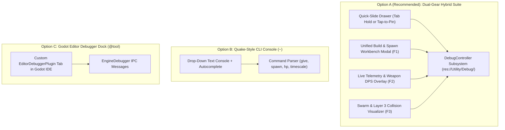
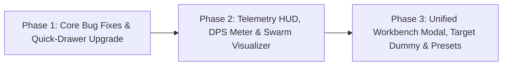

# Inritus — Developer & Designer Debugging Suite Expansion Plan

> **Status:** Draft Proposal (v1.0)  
> **Target Audience:** Game Designers, Systems Programmers, Technical Artists, and QA / Balance Engineers  
> **Core Constraint:** Preserve the zero-friction quick access of the existing right-side `DebugMenu` (`res://Player/debugmenu.gd`) while fixing its underlying state bugs and expanding it into a "mildly overengineered" testing workbench that makes iteration effortless.

---

## 1. Executive Summary & Philosophy

In a horde-survival game with exponential scaling like *Inritus*, **testing velocity is the primary bottleneck to game balance and polish**. Currently, verifying a single late-game interaction—such as how *The Punished* at 18% HP with *Frenzy Charm 3*, *Impact Buckler 3*, *Thorn Ring 4*, and 10 stacks of *Endless Scroll* performs against a Minute 15 *Dr. Franklin* and 1,500 *SwarmManager* kobolds—requires dozens of manual menu clicks, waiting on timers, or temporary code edits.

While **Rule 19 (YAGNI)** strictly governs *production gameplay systems* to prevent speculative bloat, **developer tooling is a force multiplier**. A mildly overengineered, ergonomic debugging suite is explicitly justified provided it adheres to three architectural guardrails:
1. **Zero-Friction Muscle Memory:** Keep the beloved `Tab` slide-out drawer (`%DebugMenu`) and its independent `DebugButtons.tres` theme (Rule 6) for instant 1-click actions during active movement.
2. **Production Decoupling (Rule 8 & Rule 19 Hygiene):** Extract the 150+ lines of debug button callbacks currently scattered across [`player.gd`](file:///d:/Школа/Сезон%206/Group%20project/Vampire%20survivors%20clone%20100%/Player/player.gd#L1015-L1139) and [`gui.gd`](file:///d:/Школа/Сезон%206/Group%20project/Vampire%20survivors%20clone%20100%/Player/gui.gd#L364-L419) into a dedicated, self-contained `res://Utility/Debug/` module.
3. **Release Safety:** Gate all debug inputs and overlays behind `OS.is_debug_build()` (or a secret developer unlock flag in `SettingsManager`) so shipped builds incur zero runtime overhead and cannot be accidentally triggered by players pressing `Tab` or Mouse Button 9.

---

## 2. Audit of the Current Debugging System

Before expanding the toolset, we must audit what currently exists in [`World/world.tscn`](file:///d:/Школа/Сезон%206/Group%20project/Vampire%20survivors%20clone%20100%/World/world.tscn#L738-L931), [`Player/debugmenu.gd`](file:///d:/Школа/Сезон%206/Group%20project/Vampire%20survivors%20clone%20100%/Player/debugmenu.gd), [`Player/gui.gd`](file:///d:/Школа/Сезон%206/Group%20project/Vampire%20survivors%20clone%20100%/Player/gui.gd), and [`Player/player.gd`](file:///d:/Школа/Сезон%206/Group%20project/Vampire%20survivors%20clone%20100%/Player/player.gd).

### 2.1 What Works Great (Must Keep)
- **Hold-to-Slide Quick Drawer (`Tab` / `debugMenu`):** Holding `Tab` slides `%DebugMenu` in from the right edge in `0.5s` (`SlidingMenu`) without pausing the game. Developers can toggle Godmode, add levels, or disable spawns mid-kite in under a second.
- **Instant Frame Freeze (`FreezeeverythingNOW!!!` / Mouse Button 9):** Immediately toggles `get_tree().paused` (`gui.gd:455`), allowing instant visual inspection of chaotic frames.
- **Dedicated Theme Isolation (`res://Themes/DebugButtons.tres`):** Uses a compact font and distinct neon-green panel styling that remains unaffected by global `NinePatchUI.tres` changes (Rule 6).

### 2.2 Critical Bugs & Friction Points in the Current Implementation

| Issue | Location | Root Cause & Testing Impact |
|---|---|---|
| **1. `remove_upgrade()` State Leaks & Endless Failure** | [`player.gd:1034-1097`](file:///d:/Школа/Сезон%206/Group%20project/Vampire%20survivors%20clone%20100%/Player/player.gd#L1034-L1097), [`gui.gd:624`](file:///d:/Школа/Сезон%206/Group%20project/Vampire%20survivors%20clone%20100%/Player/gui.gd#L624) | `uid.rstrip("0123456789")` fails on `_endless` suffixes, and `remove_upgrade()` only checks `type == "weapon"` or `"upgrade"`. It **never** decrements `collected_endless`, never frees `relic_drone_node`, and never resets `willowisp_level`, `glass_talisman_level`, `warding_brooch_level`, `frenzy_charm_level`, or `impact_buckler_level`. Once granted, these items cannot be removed without restarting the run. |
| **2. Single-Click Modal Closure & No Endless Stacking** | [`gui.gd:594-598`](file:///d:/Школа/Сезон%206/Group%20project/Vampire%20survivors%20clone%20100%/Player/gui.gd#L594-L598), [`player.gd:1024`](file:///d:/Школа/Сезон%206/Group%20project/Vampire%20survivors%20clone%20100%/Player/player.gd#L1024) | Clicking any item level in `GiveItemMenu` immediately closes the modal and unpauses the game. Building a 6-weapon + 8-upgrade loadout takes **28+ clicks across 14 menu openings**. Worse, `grant_upgrade_with_prereqs()` returns early if `upgrade_id in collected_upgrades`, making it **impossible to grant more than 1 stack of any `_endless` upgrade** via the debug menu. |
| **3. Timer Jump Skips Boss Warnings & Spawns** | [`player.gd:1129-1134`](file:///d:/Школа/Сезон%206/Group%20project/Vampire%20survivors%20clone%20100%/Player/player.gd#L1129-L1134), [`enemy_spawner.gd:109-118`](file:///d:/Школа/Сезон%206/Group%20project/Vampire%20survivors%20clone%20100%/Utility/enemy_spawner.gd#L109-L118) | `+1m` and `+5m` add `60` or `300` raw seconds to `GlobalEvents.time`. Because `EnemySpawner` checks `GlobalEvents.time % boss_spawn_interval == 0` only on exact 1s ticks, jumping `+5m` from `00:12` lands on `05:12`, completely skipping the `04:00` warning and `05:00` boss spawn. |
| **4. Self-Damage Ignores Armor & Reflection** | [`player.gd:1102-1103`](file:///d:/Школа/Сезон%206/Group%20project/Vampire%20survivors%20clone%20100%/Player/player.gd#L1102-L1103) | `_on_hurt_box_hurt(10, 0, 0)` passes `attacker_node = null` (so *Thorn Ring* and *The Punished* reflection cannot be tested) and deals a fixed 10 raw damage mitigated by armor, making it tedious to hit exact HP thresholds ($\ge 95\%$, $\ge 90\%$, $< 30\%$, $< 20\%$). |
| **5. Toggle Spawns Leaves Screen Cluttered** | [`player.gd:1111-1115`](file:///d:/Школа/Сезон%206/Group%20project/Vampire%20survivors%20clone%20100%/Player/player.gd#L1111-L1115) | Disabling spawns stops future waves, but leaves hundreds of active `SwarmManager` instances and elites attacking the player. There is no "Clear Active Enemies" button. |
| **6. Hold-Only Ergonomics & Music Button Bloat** | [`gui.gd:426-434`](file:///d:/Школа/Сезон%206/Group%20project/Vampire%20survivors%20clone%20100%/Player/gui.gd#L426-L434), [`world.tscn:868-899`](file:///d:/Школа/Сезон%206/Group%20project/Vampire%20survivors%20clone%20100%/World/world.tscn#L868-L899) | Holding `Tab` continuously is tiring when clicking "+1m" or "Damage Self" multiple times. Meanwhile, 4 of the 18 buttons (22% of the grid) are dedicated solely to music track skipping/pausing. |

---

## 3. Multi-Perspective Requirements Analysis

To ensure the expanded debugging system serves the entire team, we evaluate requirements from four distinct disciplines:

### 3.1 Perspective A: The Game & Balance Designer ("The Tweaker")
* **Primary Goal:** Validate TTK (Time-to-Kill), weapon synergies, draft probabilities, HP-threshold items, and difficulty curves across minutes 0–20 without playing a full 20-minute run every time.
* **Key Pain Points:** Cannot easily see *which* weapon is doing the most damage in a 6-weapon build; cannot jump straight to a "Minute 12 Mid-Game Loadout"; cannot set exact HP percentages to test *Glass Talisman* ($\ge 95\%$) vs. *Frenzy Charm* ($< 30\%$) vs. *Impact Buckler* ($< 20\%$).
* **What Makes Testing Easy:**
  1. **Live Per-Weapon DPS & Proc Meter:** Real-time rolling 5s DPS, total damage dealt, kill count, and proc healing breakdown per weapon/item.
  2. **1-Click HP Threshold Presets:** Instant buttons for `100% HP`, `94% (Break Glass Talisman)`, `29% (Trigger Frenzy Charm)`, `19% (Trigger Impact Buckler)`, and `Reset Item Cooldowns`.
  3. **Build Presets & Time-Snapshot Bookmarks:** Save/load JSON build presets (or auto-generate a balanced "Minute 5 / 10 / 15 Benchmark Loadout") and control `Engine.time_scale` (`0.25x` to `8.0x`) for rapid wave simulation.

### 3.2 Perspective B: The Systems & Combat Programmer ("The Bug Hunter")
* **Primary Goal:** Verify collision layers, `SwarmManager` spatial hashing, status effect timers, signal payloads, and frame-time budgets under heavy load ($N = 3,000$ enemies).
* **Key Pain Points:** `SwarmManager` enemies are rendered via `MultiMeshInstance2D` and **do not have `Area2D` or `CollisionShape2D` nodes**—Godot's built-in "Visible Collision Shapes" debug option is 100% blind to swarm enemies! Furthermore, weapons missing Layer 3 (value 4) or a child literally named `"CollisionShape2D"` silently fail to hit swarms (Rules 16 & 17).
* **What Makes Testing Easy:**
  1. **Custom Swarm & Hitbox Visualizer (`F3`):** Renders `SwarmManager` enemy radii, spatial grid cells (`spatial_grid`), debuff indicators (e.g., *Occult Medallion* curse), and player weapon Layer 3 hitboxes—automatically flashing a bright red warning label over any node in group `"attack"` that violates Rule 16 or Rule 17!
  2. **Target Dummy & Swarm Stress Spawner:** Spawn stationary or moving **Combat Dummies** (with floating real-time DPS numbers and optional contact/ranged counter-attacks to test `reflected_damage`), or instantly inject $+100 / +500 / +1,000$ swarm units to profile `SwarmManager` frame times.
  3. **Live Player & World Inspector:** Real-time readout of computed player variables (`spell_cooldown`, effective weapon wait times checking the $0.05\text{s}$ floor, `armor` DR%, `additional_attacks` Bernoulli remainder, active RNG seed).

### 3.3 Perspective C: The Technical Artist & Audio Designer ("The Feel Specialist")
* **Primary Goal:** Inspect sprite animations, `PhasedAnimator` transitions (`Start -> Loop -> End` per Rule 11), `Line2D` 3-slice whip stretching (Rule 13), shader parameters (`recolor.gdshader`, `elite_graphics.gdshader`), camera shake, and audio polyphony.
* **Key Pain Points:** Fast animations (`0.2s` whip slash, `Will o' Wisp` explosions) are hard to inspect at `1.0x` speed; camera zoom is locked to settings limits; background stage progression only triggers every 5 levels.
* **What Makes Testing Easy:**
  1. **Slow-Motion & Frame-Stepping (`0.1x`, `0.25x`, Pause + Step 1 Frame):** Inspect `PhasedAnimator` AOE lifecycles and `Line2D` vertex pinching frame-by-frame.
  2. **Visual & Environment Controls:** Free Camera Zoom slider (`0.25x` macro zoom out to see off-screen spawn rings up to `4.0x` pixel-art close-up), 1-click `Advance Background Stage`, and `Trigger Camera Shake` test buttons.
  3. **Audio & VFX Telemetry:** Display active audio stream count and current `MusicController` crossfade state.

### 3.4 Perspective D: QA, Mobile Tester & Release Engineer ("The Gatekeeper")
* **Primary Goal:** Reproduce bugs deterministically, test on Android/mobile touchscreens, and ensure debug tools never leak into player-facing builds or corrupt `translations.csv` / `StatsManager`.
* **Key Pain Points:** On Android builds, there is no `Tab` key or Mouse Button 9 to open the debug menu! Also, debug runs currently write into `StatsManager` (`register_end_run`, `update_best_run`), polluting persistent player statistics during testing.
* **What Makes Testing Easy:**
  1. **Mobile Debug Gesture:** In debug builds (or when Developer Mode is enabled), a 3-finger tap or long-press on the `lblTimer` clock opens/pins the `DebugMenu` on Android/iOS.
  2. **Stats Sandbox Lock ("Tainted Run" Flag):** Using any debug action automatically marks the current run as `[DEBUG]` on the HUD timer and prevents `StatsManager` from overwriting legitimate personal bests (with a toggle to force-test `StatsManager` saving when specifically testing persistence).
  3. **Localization Bypass for Dev UI:** While player-facing UI strictly follows Rule 5 (`translations.csv`), internal developer telemetry labels and property inspectors can use clean, self-documenting English developer strings or auto-fallback keys so adding a debug slider doesn't require editing 4-column CSV rows every 5 minutes.

---

## 4. Architectural Options Comparison (Rule 18)

In accordance with **Rule 18 (Alternate Solutions)**, we evaluate three architectural paradigms for expanding the debugging tools before detailing our recommended hybrid design.



| Criterion | **Option A: Dual-Gear Hybrid Suite (Recommended)** | **Option B: Quake-Style Drop-Down CLI (`~`)** | **Option C: Godot Editor DebuggerPlugin Dock** |
|---|---|---|---|
| **Quick-Access Ergonomics** | **Best.** Keeps the beloved `Tab` slide-out drawer for 0.2s actions, adds Tap-to-Pin, and provides rich visual modals + HUD overlays. | **Fast for typists, slow for sliders.** Great for macro commands, poor for scrubbing time scale or visually browsing items. | **Requires window switching** (or dual monitors). Cannot be used smoothly in fullscreen single-monitor playtests. |
| **Designer & Artist Friendliness** | **High.** Visual icons, `+`/`-` tier buttons, interactive sliders, and color-coded on-screen gizmos. | **Low.** Requires memorizing item IDs (`ringofrejuvenation2` vs `ring2`) and command syntax. | **Medium.** Familiar Godot inspector feel, but detached from the game canvas. |
| **Mobile / Controller Support** | **Full.** Works on Android touchscreens and gamepads via UI buttons. | **Poor.** Virtual keyboard blocks 50% of the mobile screen. | **None on standalone exports.** Only works when connected to the desktop Godot Editor. |
| **Implementation Complexity** | **Medium (Mildly Overengineered, High ROI).** Modular scene + script under `res://Utility/Debug/`. | **Low–Medium.** Requires lexer, autocomplete popup, and command registry. | **High.** Requires `@tool` scripts, `EditorPlugin`, and `EngineDebugger` serialization packets. |

> [!TIP]
> **Why Option A + a Lightweight Command Bar Wins:**  
> Option A directly honors your preference for the current quick-access `DebugMenu` while solving every limitation of the current modal menus. To capture the best feature of Option B (macro automation and fast search), we include a **Quick Search / Command Filter Bar** at the top of the Unified Workbench modal so programmers can type `whip 4` or `preset tank` when desired, without forcing designers into a terminal.

---

## 5. Detailed Design of the Recommended Solution

### 5.1 Module Architecture & Decoupling (`res://Utility/Debug/`)

Currently, `gui.gd` and `player.gd` are bloated with debug UI generation and button signal wiring. We will extract all debug logic into a clean, self-contained directory:

```text
res://Utility/Debug/
├── debug_controller.gd       # Central coordinator; owns time_scale, presets, and debug actions
├── debug_drawer.tscn/.gd     # Upgraded SlidingMenu (Hold-to-Peek + Tap-to-Pin + Compact Accordion)
├── debug_workbench.tscn/.gd  # Unified Modal: Inventory Matrix, Enemy Sandbox, World & Time Controls
├── debug_telemetry.tscn/.gd  # Draggable/Collapsible HUD: Live Stats, Buff Timers, Per-Weapon DPS Meter
└── debug_visualizer.gd       # Node2D CanvasItem _draw() overlay for SwarmManager & Layer 3 Hitboxes
```

- **Zero Production Clutter:** `player.gd` and `gui.gd` have all `_on_btn_*` debug callbacks and `GiveItemMenu`/`RemoveItemMenu`/`SpawnBossMenu` node trees removed. Instead, `DebugController` attaches itself to `World` only when `OS.is_debug_build() or SettingsManager.dev_mode_enabled` is true.
- **Fixing `player.remove_upgrade()` Properly:** We will refactor `player.remove_upgrade(upgrade_id)` and `player.reset_all_upgrades()` so that removing or downgrading *any* item (including `_endless`, `relicdrone`, `willowisp`, `glasstalisman`, `wardingbrooch`, `frenzycharm`, and `impactbuckler`) cleanly recalculates state from `collected_upgrades` and `collected_endless` (single source of truth!).

---

### 5.2 Gear 1: The Upgraded Quick-Slide Drawer (`Tab` Menu)

We keep the right-side neon-green drawer (`DebugButtons.tres`, `160px` width) and upgrade its interaction model and button layout:

#### 1. Smart "Hold-to-Peek, Tap-to-Pin" Input Logic
- **Hold `Tab` (> 180ms):** Opens the drawer immediately on press and closes it automatically when `Tab` is released—preserving 100% of your existing muscle memory!
- **Quick Tap `Tab` (< 180ms) or Click `[📌 Pin]`:** Locks the drawer open so you can click multiple buttons or scrub sliders without holding down a key. Pressing `Tab` again unpins and closes it.
- **Frame Freeze & Step (`Mouse Button 9` / `F4`):** Toggles tree pause; while paused, clicking `[Step 1 Frame]` (or pressing `.`) unpauses for exactly 1 physics frame (`await get_tree().physics_frame`) and re-pauses!

#### 2. Streamlined Quick-Action Layout
Instead of 4 music buttons cluttering the grid, the Quick Drawer is organized into high-frequency testing actions:

```text
┌────────────────────────────────────┐
│  🛠️ DEBUG QUICK MENU      [📌 Pin] │
├─────────────────┬──────────────────┤
│ [🛡️ Godmode:OFF]│ [👾 Spawns: ON]  │
│ [🧹 Clear Foes] │ [🧲 Magnet Gems] │
├─────────────────┴──────────────────┤
│  SPEED: [0.2x][0.5x][1x][2x][4x]   │
├─────────────────┬──────────────────┤
│ [⬆️ +1 Level]   │ [✨ +1000 XP]    │
│ [🎒 Workbench…] │ [👹 Spawn Menu…] │
├─────────────────┴──────────────────┤
│  HP THRESHOLD QUICK-SET:           │
│  [100%] [94%] [29%] [19%] [🔄 CDs] │
├─────────────────┬──────────────────┤
│ [💔 Hit Self]   │ [💀 Kill Player] │
│ [⏱️ +1m (Sync)] │ [⏱️ +5m (Sync)]  │
│ [📊 DPS HUD:ON] │ [🎯 Hitboxes:OFF]│
├─────────────────┼──────────────────┤
│ [🎵 Next Track] │ [🔇 Mute Music]  │
│ [🔄 Restart]    │ [🚪 End Run]     │
└─────────────────┴──────────────────┘
```

#### Key Upgrades in the Quick Drawer:
- **Speed Bar (`0.2x` / `0.5x` / `1x` / `2x` / `4x`):** One-click `Engine.time_scale` buttons. Testing a 5-minute boss cycle takes 75 seconds at `4x`, while inspecting a whip hitbox takes 1 click at `0.2x`.
- **HP Threshold Strip (`100%`, `94%`, `29%`, `19%`, `🔄 CDs`):**
  - `100%`: Full heal + activates *Glass Talisman* ($\ge 95\%$) and *Warding Brooch* ($\ge 90\%$).
  - `94%`: Drops HP just below *Glass Talisman* threshold while keeping *Warding Brooch* eligible.
  - `29%`: Sets HP to $29\%$ to immediately activate *Frenzy Charm* ($< 30\%$) without triggering *Impact Buckler*.
  - `19%`: Crosses the $< 20\%$ threshold from above to immediately fire *Impact Buckler*'s radial shockwave!
  - `🔄 CDs`: Resets `warding_brooch_timer = 10.0` (grants charge immediately) and sets `impact_buckler_cooldown = 0.0` + resets all weapon spawner timers so you can re-test long-cooldown effects (60s Buckler) back-to-back in 1 second!
- **Attacker-Simulated `💔 Hit Self`:** Instead of passing `null`, `Hit Self` passes the nearest alive enemy (or a mock enemy reference at `player.global_position + Vector2(24, 0)`) into `_on_hurt_box_hurt(10, ...)`, allowing instant verification of *Thorn Ring*, *The Punished*'s retaliation passive, and *Warding Brooch* spillover!
- **Synchronized `+1m (Sync)` / `+5m (Sync)`:** Advances `GlobalEvents.time`, immediately emits `changetime`, updates background tiles if needed, and checks if a `boss_spawn_interval` boundary (e.g., Minute 5, 10, 15) was crossed during the jump—offering a toggle for *"Spawn Bosses on Time Jump"*.
- **`🧹 Clear Foes` & `🧲 Magnet Gems`:** Instantly wipes all active node enemies + `SwarmManager.swarm_data` (without dropping 1,000 gems unless requested) or vacuums all floor loot.

---

### 5.3 Gear 2: The Unified "Build & Sandbox Workbench" Modal (`F1`)

Clicking `[🎒 Workbench…]` or `[👹 Spawn Menu…]` opens a single, tabbed modal window (`debug_workbench.tscn`) that **stays open while you edit** and supports live search.

#### Tab 1: Inventory & Build Matrix (Replaces `GiveItemMenu` & `RemoveItemMenu`)
Instead of drilling into sub-menus that close after one click, all items in `UpgradeDb.UPGRADES` are displayed in a clean 3-section matrix (**Weapons**, **Passive Upgrades**, **Boss Items**):

- **Direct Tier Pill Buttons:** Each item row displays its icon, localized name, and direct tier buttons:
  `[Ice Spear]  [Off] [1] [2] [3] [4]  Endless: [-] 0 [+] [+5]`
- **Instant Upgrade / Downgrade:** Clicking `[3]` when you don't own Ice Spear automatically grants `icespear1 -> icespear2 -> icespear3`. Clicking `[1]` when you own `[4]` immediately downgrades it to Level 1. Clicking `[Off]` removes it completely.
- **Endless Stack Stepper:** Directly increment or decrement `collected_endless[base_name]` by $\pm 1$, $+5$, or $+10$ stacks with one click!
- **Character Switcher Mid-Run:** Hot-swap `GlobalEvents.selected_character` (`Mage`, `Plague Doctor`, `Occultist`, `The Punished`) on the fly and re-run `apply_stat_modifiers()` + shader recolor without leaving the arena.
- **Loadout Presets & "Auto-Benchmark" Builds:**
  - Save your current inventory + level + game time to `user://debug_presets.cfg` under a custom name.
  - Built-in 1-click presets:
    - *"Minute 5 Early Build"* (Lvl 8, Tier 2 starter + 2 weapons + 2 passives)
    - *"Minute 10 Mid Build"* (Lvl 16, two Tier 4 weapons + Boss Relic + 4 passives)
    - *"Minute 15 Endgame Stress"* (Lvl 30, 6 maxed weapons + 8 maxed passives + 10 endless stacks)

#### Tab 2: Combat Sandbox & Target Dummy Spawner (Upgrading `SpawnBossMenu`)
- **Target Dummy Spawner:**
  - **Immortal DPS Dummy:** Stationary or slow-orbiting dummy enemy (`EnemyBody` subclass) with infinite HP, immune or vulnerable to knockback (toggleable), displaying a floating overhead label with:
    - `Last Hit: 24.5 dmg`
    - `Rolling 5s DPS: 142.0/s`
    - `Active Debuffs: Curse (3.2s)`
  - **Retaliation Dummy:** Periodically pokes the player for configurable raw damage (`5 / 15 / 30 dmg` every `2s`) to test armor reduction, *Warding Brooch* barrier recharge, *Lifesteal* sustain, and *Reflected Damage* loops hands-free.
- **Wave & Swarm Injector:**
  - Spawn specific counts (`+1`, `+10`, `+100`, `+500`) of any enemy from `spawns_easy`, `spawns_normal`, `spawns_hard` (Cyclops, Juggernaut), or `spawns_super` (Ancient Amoeba, Dr. Franklin).
  - Formation selector: **Random Off-Screen Ring**, **Tight Cluster in Front of Player** (for testing AoE / Pierce like *Ice Spear* and *Poison Gas*), or **Surround Circle**.

#### Tab 3: Live Stat & Difficulty Overrides
- **Custom Difficulty Sliders Mid-Run:** Adjust `GlobalEvents` modifiers (`enemy_spawn_modifier`, `enemy_hp_modifier`, `boss_hp_modifier`, `player_damage_modifier`, `xp_gain_modifier`) live during a run without returning to the Title Screen.
- **Direct Stat Override Sliders:** Temporarily override `player.movement_speed`, `player.spell_cooldown`, `player.spell_size`, `player.armor`, or `player.additional_attacks` to test extreme edge cases (e.g., verifying that `spell_cooldown = 0.99` respects the $0.05\text{s}$ Cooldown Safety Floor across all 12 weapons!).

---

### 5.4 Gear 3: Live Telemetry & Per-Weapon DPS Overlay (`F2`)

A lightweight, semi-transparent panel anchored to the top-left (below the collected item icons) or top-right that updates every `0.25s` without stealing mouse clicks (`mouse_filter = MOUSE_FILTER_IGNORE`):

```text
┌──────────────────────────────────────────────────────────┐
│ 📊 TELEMETRY [F2]                [Tainted Run: Stats OFF]│
├──────────────────────────────────────────────────────────┤
│ FPS: 60.0 (16.6ms) | Scale: 1.0x | Seed: 84920194        │
│ Enemies: 412 Swarm (MultiMesh) + 4 Elites + 1 Boss       │
│ Floor Loot: 84 Gems (Magnet Roll Chance: 0.42%)          │
├──────────────────────────────────────────────────────────┤
│ PLAYER EFFECTIVE STATS:                                  │
│ HP: 72.0 / 100 (72%) | Regen: 0.50/s | Lifesteal: 2.0%   │
│ Armor: 15 (27.3% DR) | Speed: 90.0 px/s (+20%)           │
│ CDR: -22.0% | Size: +30.0% | Extra Proj: +1.15 (15% +2)  │
│ Dmg Mult: 1.00x | Reflected Dmg: 40.0                    │
├──────────────────────────────────────────────────────────┤
│ ITEM STATES:                                             │
│ 🛡️ Brooch: CHARGING (6.4s / 10s) | 💥 Buckler: READY     │
│ 🔥 Frenzy: INACTIVE (Needs <30%) | 💎 Talisman: INACTIVE │
├──────────────────────────────────────────────────────────┤
│ WEAPON DPS METER (Rolling 5s / Total Share):             │
│ 1. Poison Bottle  185.4 DPS  (42.1k tot | 48%)           │
│ 2. Leather Whip    98.2 DPS  (21.0k tot | 24%)           │
│ 3. Will o' Wisp    64.0 DPS  (14.2k tot | 16%)           │
│ 4. Thorn/Reflect   45.0 DPS  (10.5k tot | 12%)           │
└──────────────────────────────────────────────────────────┘
```

#### How the Per-Weapon DPS Meter Works Cleanly:
- Hooks into `GlobalEvents.player_dealt_damage(amount, target_node, proc_coefficient)` and `GlobalEvents.enemy_died(pos, max_hp, killer_source)`.
- By passing an optional `source_name: String = "unknown"` (or inferring from the active attacker group/script) when emitting `player_dealt_damage`, `DebugTelemetry` records a rolling ring buffer of `(timestamp, source, amount)` over the last 5.0 seconds.
- Provides a `[Reset Meter]` and `[Export CSV to user://]` button so balance designers can compare automated simulation math (`game-balance-eval` skill) against actual in-engine combat numbers!

---

### 5.5 Gear 4: Visual Collision, Swarm & Rule Validator Overlay (`F3`)

Because `SwarmManager` bypasses Godot's physics engine and renders via `MultiMeshInstance2D`, standard Godot collision debugging is useless for 95% of enemies on screen. `debug_visualizer.gd` solves this with a single `Node2D` overlay drawn in world space:

1. **Swarm MultiMesh Collision Circles & Spatial Grid:**
   - Draws the `spatial_grid` hash cells (`48x48` or `2 * max_enemy_radius` grid lines in faint cyan) and highlights cells currently queried by player weapons.
   - Draws a thin circle (`radius = 12.0`) around each `SwarmEnemy` in `swarm_data`, color-coded green (full HP) $\to$ yellow $\to$ red (low HP), with a purple ring if `has_debuff("curse")` is active.
2. **Player & Boss Telegraph Geometry:**
   - Draws `GrabArea` (XP pickup radius), `CollectArea`, Player `HurtBox` (flashing white during its `0.3s` `DisableTimer` invulnerability window!), and Boss HitBoxes/Telegraphs (highlighting when Dr. Franklin's contact hitbox disables during beam firing).
3. **Automated Rule 16 & Rule 17 Compliance Linter (Live in World Space!):**
   - Every frame when `F3` is active, `debug_visualizer.gd` iterates `get_tree().get_nodes_in_group("attack")`:
     - If an attack node is **not on Collision Layer 3** (`(node.collision_layer & 4) == 0`), or
     - If it lacks a child explicitly named `"CollisionShape2D"`, or
     - If its `CollisionShape2D.disabled` is true when it shouldn't be,
     - It draws a pulsing **⚠️ RULE 16/17 VIOLATION: SWARM BLIND** badge directly above the projectile/AOE in world space! This turns a silent, frustrating bug into an instant 1-second visual catch.

---

## 6. Phased Implementation Roadmap

To keep implementation modular and verifiable at every step, we break the rollout into **3 Phases**:



### Phase 1: Foundation, Bug Fixes & Quick-Drawer Upgrade (High Priority)
1. **Fix `player.remove_upgrade()` & State Reset:**
   - Refactor `player.gd` so removing upgrades cleanly handles `_endless` stacks (`collected_endless`), `relic_drone_node`, and all special item level variables (`willowisp_level`, `glass_talisman_level`, `warding_brooch_level`, `frenzy_charm_level`, `impact_buckler_level`).
2. **Extract `res://Utility/Debug/debug_controller.gd`:**
   - Move debug button callbacks out of `player.gd` and `gui.gd`.
   - Implement the `"Tainted Run"` flag so debug actions do not corrupt `StatsManager` best-run records.
3. **Upgrade `DebugMenu` (`debugmenu.gd` + `world.tscn`):**
   - Add **Hold-to-Peek vs. Tap-to-Pin** (`< 180ms` tap pins the menu open; mobile 3-finger tap / timer long-press support).
   - Add **Game Speed strip** (`0.2x`, `0.5x`, `1x`, `2x`, `4x`), **HP Threshold Quick-Set strip** (`100%`, `94%`, `29%`, `19%`, `Reset CDs`), **Clear Foes**, **Magnet Gems**, **Attacker-Simulated Self-Damage**, and **Synchronized Time Jumps**.

### Phase 2: Live Telemetry, Per-Weapon DPS Meter & Swarm Visualizer
1. **Create `debug_telemetry.tscn/.gd` (`F2` Toggle):**
   - Live readout of effective player stats, health-item state machine timers, swarm/node counts, and floor loot magnet probability.
   - Extend `GlobalEvents.player_dealt_damage` (or weapon hit hooks) with source attribution to power the **Rolling 5s Per-Weapon DPS Meter**.
2. **Create `debug_visualizer.gd` (`F3` Toggle):**
   - World-space `_draw()` overlay for `SwarmManager` radii, `spatial_grid` cells, debuff rings, player `HurtBox` invulnerability frames, and the live **Rule 16/17 Swarm Collision Linter**.

### Phase 3: Unified Build Workbench, Target Dummy & Loadout Presets
1. **Create `debug_workbench.tscn/.gd` (`F1` Toggle):**
   - Replace the legacy 2-step `GiveItemMenu`, `RemoveItemMenu`, and `SpawnBossMenu` with the Unified Tabbed Workbench.
   - Build the **Inventory Matrix** with direct `[Off] [1] [2] [3] [4]` tier buttons and `[-1] [+1] [+5]` Endless stack controls that stay open while editing.
   - Add mid-run **Character Switcher** and **Custom Difficulty Sliders**.
2. **Implement Combat Sandbox & Target Dummies:**
   - Create `res://Utility/Debug/target_dummy.tscn/.gd` (Immortal DPS Dummy & Retaliation Dummy) and the Wave/Formation Spawner.
   - Add `user://debug_presets.cfg` serialization for saving and loading custom build presets.

---

## 7. Open Design Decisions for Review

Before we begin implementing Phase 1, please let us know your preferences on the following:
1. **Shortcut Keys:** Are `Tab` (Hold-to-Peek / Tap-to-Pin Quick Drawer), `F1` (Unified Workbench Modal), `F2` (Telemetry & DPS Overlay), and `F3` (Swarm & Hitbox Visualizer) comfortable for your workflow?
2. **Release Build Behavior:** Should the debug tools be strictly compiled/gated via `OS.is_debug_build()`, or would you also like a hidden unlock in exported release builds (similar to typing `"frames"` in the settings menu for the Ray Tracing Easter egg)?
3. **Rollout Scope:** Would you like to implement **all 3 Phases** together, or start with **Phase 1 + Phase 2** first?
