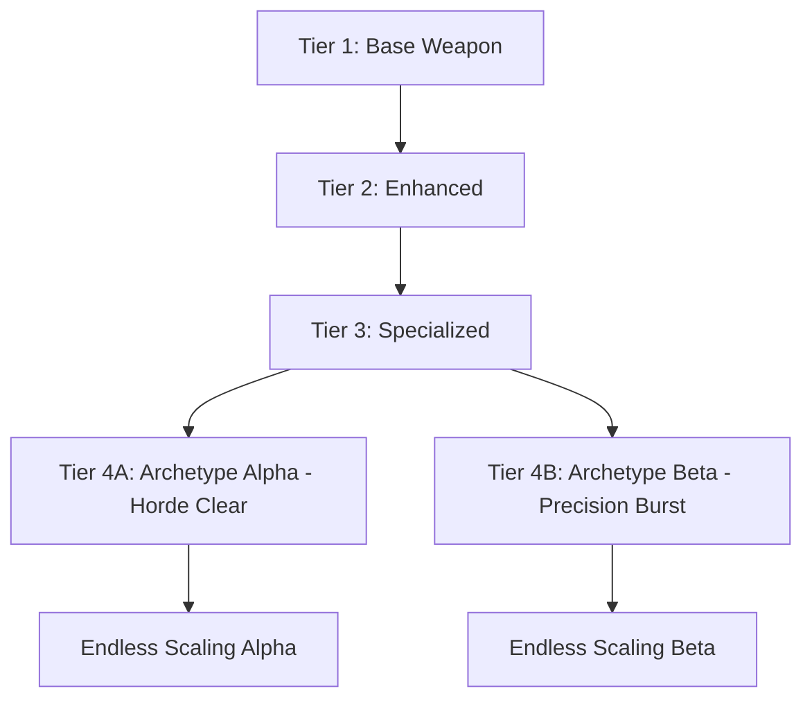

# Inritus: Game Design & Run Variance Proposal
**A Systems-Driven Strategy for Replayability, Build Diversity, and Kinetic Arena Ecology**

- **Project**: Inritus (v1.0.4)
- **Target Engine**: Godot 4.6 (Mobile / Forward+ Renderer)
- **Document Version**: 1.0.0
- **Scope**: Comprehensive Architecture, Mechanical Specifications, Quantitative Scaling Models, and Phased Roadmap for R1, R2, R3, and R4.

---

## Table of Contents
1. [Executive Summary & Design Philosophy](#1-executive-summary--design-philosophy)
   - 1.1 High-Level Vision & Core Identity
   - 1.2 The Hybrid Dilemma: Vampire Survivors Loop vs. Risk of Rain Escalation
   - 1.3 Design Pillars for Meaningful Variance
2. [Deep-Dive Bottleneck Analysis (R1)](#2-deep-dive-bottleneck-analysis-r1)
   - 2.1 Mathematical Anatomy of the Inritus Run Timeline (0–30 Minutes)
   - 2.2 The Intensity Curve Discontinuity ($I(t)$ Analysis)
   - 2.3 The Health Decoupling Problem: Exponential Bosses vs. Static Minions
   - 2.4 The Slot-to-Pool Monoculture Trap (Mathematical Saturation Analysis)
   - 2.5 Agency Void in Draft Selection (No Reroll, Skip, or Banish)
   - 2.6 Terminal Wave Roster at Minute 3:00 and Mid-Run Encounter Fatigue
   - 2.7 The Endless Tier Stat-Stick Plateau (Minutes 15–30+)
   - 2.8 The "Phantom Win" Disconnect & Absence of Long-Term Retention
   - 2.9 Empirical Bottleneck Matrix
3. [Mechanical Exploration & Variance Systems (R2)](#3-mechanical-exploration--variance-systems-r2)
   - 3.1 Permanent Meta-Progression: "The Vault of Inritus & Covenants of Agony"
   - 3.2 Weapon & Item Evolution: The "Tier 4 Terminal Bifurcation" Model
   - 3.3 Concrete Specifications for 5 Core Benchmark Weapons
   - 3.4 Unconventional / Hidden-in-Plain-Sight Arena Mechanics
   - 3.5 Pacing & Engagement Dynamics (0–30 Minutes)
4. [Feasibility, Godot 4.6 Compliance & YAGNI Audit (R3)](#4-feasibility-godot-46-compliance--yagni-audit-r3)
   - 4.1 SwarmManager MultiMesh & Spatial Grid Constraints
   - 4.2 Autoload Singletons & Persistence Integrity (Disk I/O Sanitization)
   - 4.3 Unit Test Compatibility & Invariant Guardrails (`test_upgrade_db.gd`)
   - 4.4 Strict YAGNI Compliance (Rule 19 Evaluation)
5. [Phased Implementation Roadmap (R4)](#5-phased-implementation-roadmap-r4)
   - 5.1 Phase 1: High-Impact Minimal-Effort Foundations (Days 1–3)
   - 5.2 Phase 2: In-Combat Arena Variance & Weapon Branching (Days 4–7)
   - 5.3 Phase 3: Meta-Progression Vault & Covenants of Agony (Days 8–10)
6. [Conclusion & Verification Sign-Off](#6-conclusion--verification-sign-off)

---

## 1. Executive Summary & Design Philosophy

### 1.1 High-Level Vision & Core Identity
*Inritus* is a fast-paced survival roguelite developed in Godot 4.6, marrying the top-down horde survival loop of *Vampire Survivors* with the relentless, time-pressured intensity scaling of *Risk of Rain*. In *Inritus*, time is not an arbitrary clock counting down to an inescapable stage clear; time is an active antagonist. The environment scales dynamically in density and ferocity, challenging players to constantly maximize their damage efficiency, map traversal, and tactical positioning.

However, in its current v1.0.4 implementation, *Inritus* suffers from a fundamental tension between its architectural ambition and its mechanical execution: **the game offers tremendous kinetic momentum in minutes 0–5, but collapses into repetitive determinism across minutes 10–30.**

This proposal establishes a concrete, mathematically sound, and engine-compliant systems overhaul designed to inject massive run-to-run variance, strategic agency, and mechanical surprise into *Inritus* without sacrificing its high-performance MultiMesh swarm architecture or violating the project's strict YAGNI (You Aren't Gonna Need It) principles.

### 1.2 The Hybrid Dilemma: Vampire Survivors Loop vs. Risk of Rain Escalation
Traditional survivor-likes rely on **stage stability**: enemies spawn in predictable, static waves per minute, giving the player breathing room to collect experience gems, assemble a build, and hit an invulnerability power curve. In contrast, *Risk of Rain* utilizes **continuous dynamic difficulty**:
$$\text{Difficulty} \propto f(\text{Time}, \text{Stages Cleared}, \text{Player Count})$$

In *Inritus*, this dynamic is expressed through the global spawner intensity formula $I(t)$ and exponential boss health scaling:
$$\text{Boss HP Multiplier} = 1.05^{\text{minutes}}$$

When a game combines these two paradigms without providing the player with sufficient draft agency, item pool breadth, or interactive arena mechanics, a catastrophic design failure occurs:
1. **The Build Bottleneck**: If the player cannot steer their build through rerolls or branch choices, an unfavorable RNG sequence in an exponentially scaling game results in an unwinnable death spiral.
2. **The Homogenization Trap**: Because survival requires raw DPS to clear exponential swarm volume, and because the item pool is exceptionally compact, every successful run converges onto the exact same set of high-performing AoE weapons.
3. **The Flat Plane Syndrome**: When combat takes place entirely on an unbounded, featureless floor against enemies with zero behavioral variance, gameplay devolves into mindless circular kiting (the "death circle").

### 1.3 Design Pillars for Meaningful Variance
To resolve this hybrid dilemma, all new systems proposed in this document adhere to four foundational design pillars:

1. **Horizontal Breadth Over Vertical Inflation**:
   Reject standard genre meta-progression that awards raw vertical stats (+20% Base Damage, +50 Max HP). In a time-scaled game, vertical buffs trivialize the early game and become mathematically meaningless against endgame scaling. All meta-progression must unlock **tactical toolboxes, starting loadouts, and risk-reward constraints**.
2. **Sharp Bifurcation Over Fractional Modifiers**:
   Avoid generic "+5% critical chance" branching. Weapon choices at terminal tiers must force a **binary tactical fork**: broad horde suppression (Area Control) versus single-target execution (Precision Burst).
3. **In-World Real-Time Action Over Menu Paralysis**:
   Preserve combat flow. Arena events, risk-reward sacrifices, and environmental interactions must occur physically inside the 2D world using Layer 3 collision, requiring zero modal menus and zero game-pausing dialogues.
4. **Zero-New-Manager Architecture (Strict YAGNI)**:
   Do not introduce speculative manager hierarchies, event buses, or reflection factories. Leverage Godot 4.6 autoload singletons (`UpgradeDb`, `GlobalEvents`, `StatsManager`), MultiMesh GPU custom data, and direct scene instantiation.

---

## 2. Deep-Dive Bottleneck Analysis (R1)

### 2.1 Mathematical Anatomy of the Inritus Run Timeline (0–30 Minutes)
An empirical audit of `enemy_spawner.gd`, `global_events.gd`, and `player.gd` reveals the exact progression schedule of an *Inritus* run:

```
[0:00] ── Easy Pool Unlocked (Kobold Weak: 10 HP) ── Base Intensity I(t) = 3.0
  │
[1:00] ── Normal Pool Unlocked (Kobold Strong: 20 HP) ── Quadratic Ramp Begins: I(t) = 3.0 + 0.75*t^2
  │
[3:00] ── Hard Pool Unlocked (Cyclops: 100 HP, Juggernaut: 300 HP) ── Linear Ramp: I(t) = 4.5 + 1.5*t
  │      *** TERMINAL ENEMY ROSTER STATE REACHED (No new enemies exist in code past 3:00) ***
  │
[4:00] ── Boss 1 Warning Banner: "Ancient Amoeba approaching..." (GlobalEvents.show_boss_warning)
  │
[5:00] ── BOSS 1 SPAWNS: Ancient Amoeba (HP = Base * 1.05^5 = 1.28x)
  │      *** PHANTOM WIN TRIGGERED (hasWon = true), Run continues indefinitely ***
  │
[9:00] ── Boss 2 Warning Banner: "Dr. Franklin detected..."
  │
[10:00] ─ BOSS 2 SPAWNS: Dr. Franklin (HP = Base * 1.05^10 = 1.63x)
  │
[12:00] ─ Player reaches Level ~45; all 6 weapon slots and 8 upgrade slots 100% full.
  │
[15:00] ─ BOSS 3 SPAWNS: Ancient Amoeba (HP = Base * 1.05^15 = 2.08x)
  │      *** ENDLESS STAT-STICK PLATEAU (100% of level-up cards are flat +1 damage) ***
  │
[20:00] ─ BOSS 4 SPAWNS: Dr. Franklin (HP = Base * 1.05^20 = 2.65x) ── Intensity I(t) = 34.5
  │
[30:00] ─ BOSS 6 SPAWNS: (HP = Base * 1.05^30 = 4.32x) ── Intensity I(t) = 49.5
         *** RUN TERMINATION VOID (No final boss, no extraction, no victory sequence) ***
```

### 2.2 The Intensity Curve Discontinuity ($I(t)$ Analysis)
The spawn rate calculation in `res://Utility/enemy_spawner.gd:183-194` is governed by:
```gdscript
var minutes = GlobalEvents.time / 60.0
var time_multiplier = base_enemy_intensity
if minutes > 1.0 and minutes <= 3.0:
    var t = minutes
    var A = enemy_intensity_time_multiplier / 2.0
    time_multiplier = base_enemy_intensity + (A * t * t)
elif minutes > 3.0:
    var val_at_3 = base_enemy_intensity + enemy_intensity_time_multiplier
    time_multiplier = val_at_3 + minutes * enemy_intensity_time_multiplier
```
With `base_enemy_intensity = 3.0` and `enemy_intensity_time_multiplier = 1.5`:
- For $t \le 1.0$: $I(t) = 3.0$
- For $1.0 < t \le 3.0$: $I(t) = 3.0 + 0.75 \times t^2$
- For $t > 3.0$: $I(t) = (3.0 + 1.5) + (t \times 1.5) = 4.5 + 1.5t$

Evaluating this curve at boundary points reveals an abrupt mathematical step discontinuity documented in `tech_debt.md:108-117`:
$$\lim_{t \to 3.0^-} I(t) = 3.0 + 0.75(3.0)^2 = 3.0 + 6.75 = 9.75$$
$$\lim_{t \to 3.0^+} I(t) = 4.5 + 1.5(3.0) = 4.5 + 4.5 = 9.00$$

At minute 3:00, the global spawn intensity instantly **drops by 7.7%** ($9.75 \to 9.00$) before transitioning into a linear ramp. While this dip is subtle to the eye, the transition from an aggressive quadratic curve to a pedestrian linear slope halts the pacing momentum exactly when the player expects the challenge to intensify.

### 2.3 The Health Decoupling Problem: Exponential Bosses vs. Static Minions
In `enemy_spawner.gd:234-255`, enemy minion health is calculated as:
```gdscript
var hp_mod = GlobalEvents.get_enemy_hp_modifier() # 0.8 Easy, 1.0 Normal, 1.2 Hard
var final_hp = int(template.hp * hp_mod)
```
Notice what is missing: **the elapsed time variable ($t$).**
- A `Kobold Weak` spawned at 00:15 has **10 HP**.
- A `Kobold Weak` spawned at 29:45 has **10 HP**.
- A `Kobold Strong` spawned at 01:15 has **20 HP**.
- A `Kobold Strong` spawned at 29:45 has **20 HP**.

Meanwhile, player damage increases by $500\%$ to $1000\%$ via weapon levels, passive items (`tome`, `scroll`, `ringofaffinity`), and endless stat stacks. As a consequence:
1. **Minion Trivialization**: Swarm hordes cease to function as combat threats after minute 8. They become a frictionless, self-clearing cloud of XP gems that evaporate instantly upon touching weapon hitboxes.
2. **Boss Sponginess**: Boss HP scales as $1.05^t$ ($+332\%$ at minute 30). This creates an extreme dissonance where the player obliterates 2,000 swarm enemies in 5 seconds, but spends 4 minutes mindlessly circling an enormous bullet-sponge boss.

### 2.4 The Slot-to-Pool Monoculture Trap (Mathematical Saturation Analysis)
The item and weapon catalog in `UpgradeDb.gd` is defined as follows:
- **Regular Weapon Pool**: Exactly **7 Weapons** (`icespear`, `javelin`, `tornado`, `poisonbottle`, `ritualcircle`, `lightningrod`, `whip`).
- **Regular Passive Pool**: Exactly **13 Items** (`armor`, `speed`, `tome`, `scroll`, `ringofrejuvenation`, `ringofaffinity`, `thornring`, `occult_medallion`, `willowisp`, `glasstalisman`, `wardingbrooch`, `frenzycharm`, `impactbuckler`).
- **Boss Item Pool**: Exactly **4 Items** (`ring`, `glasslash`, `vampireknives`, `relicdrone`).

Now, consider the player inventory slot capacities defined in `global_events.gd:153-162`:
$$\text{Weapon Slots (Normal/Easy)} = 6 \quad \implies \quad \text{Weapon Saturation} = \frac{6}{7} = \mathbf{85.7\%}$$
$$\text{Weapon Slots (Hard)} = 5 \quad \implies \quad \text{Weapon Saturation} = \frac{5}{7} = \mathbf{71.4\%}$$
$$\text{Passive Slots (Normal/Easy)} = 8 \quad \implies \quad \text{Passive Saturation} = \frac{8}{13} = \mathbf{61.5\%}$$

**The Mathematical Consequence**:
Every single run of *Inritus* equips **almost the entire game catalog**. There is no room for specialized archetypes (e.g., an "All-Lightning" build, a "Pure Melee Brawler" build, or a "Poison Zone Trapper" build). Regardless of which character the player selects (Mage, Occultist, Plague Doctor, Punished), by minute 10 the player is carrying 6 of the 7 available weapons. Build identity completely dissolves into a homogenized, identical omni-screen AoE ball.

### 2.5 Agency Void in Draft Selection (No Reroll, Skip, or Banish)
In `Player/player.gd:554-574` (`levelup()`):
```gdscript
var options = 0
var optionsmax = 3
var options_list = []
while options < optionsmax:
    var item = get_random_item()
    if item != null:
        options_list.append(item)
    elif not options_list.has("food"):
        options_list.append("food")
    options += 1
gui.show_levelup(options_list, current_visual_level)
```
The drafting loop provides **zero agency mechanisms**:
- **No Reroll**: If the RNG roll yields 3 items that conflict with the player's intended strategy, the player cannot spend a resource to re-draw.
- **No Skip**: If an unequipped weapon appears while an open slot remains, the player cannot skip the reward without permanently consuming a slot.
- **No Banish**: The player cannot permanently remove a low-synergy item from appearing across subsequent level-ups.

Because weapon slots cannot be cleared or overwritten, an unlucky early draft permanently pollutes the player's loadout for the remainder of the run.

### 2.6 Terminal Wave Roster at Minute 3:00 and Mid-Run Encounter Fatigue
In `enemy_spawner.gd:164`, the spawner defines:
```gdscript
var time_hard_unlock_minutes = 3.0
```
Across lines 135–176, every enemy pool unlock condition is evaluated:
- Minute 0:00: `spawns_easy` unlocks.
- Minute 1:00: `spawns_normal` unlocks.
- Minute 3:00: `spawns_hard` unlocks (`enemy_cyclops`, `enemy_juggernaut`).

**Critical Finding**: After Minute 3:00, **not a single new enemy type, wave pattern, or arena modifier is introduced.**
Across a 30-minute run, 27 out of the 30 minutes (90% of the playtime) consist of fighting the exact same four enemy templates on an infinite, flat, texture-wrapped 2D plane.

### 2.7 The Endless Tier Stat-Stick Plateau (Minutes 15–30+)
Due to SwarmManager routing thousands of MultiMesh enemies into player hitboxes, XP gems drop in overwhelming quantities. Player level progression accelerates rapidly:
- Players reach Level 40–50 between minutes 12 and 15.
- Capping 6 weapons (4 tiers each = 24 upgrades) and 8 passives (average 3 tiers each = 24 upgrades) requires approximately 48 upgrades.
- By minute 15, **all primary upgrade tracks are exhausted.**

From minute 15 to 30+, `player.gd:878-882` routes 100% of all level-up offerings into the `_endless` tier. With the minor exceptions of `vampireknives` (+0.1 lifesteal) and `glasslash` (+5 damage), every single endless upgrade in `UpgradeDb.gd` is an identical, uninspired data payload:
```gdscript
"stat_modifiers": {"damage": 1}
```
The player is forced to pause the game 30 to 50 times during the late game solely to click a mindless "+1 Damage" card. There is zero visual evolution, zero mechanical permutation, and zero tactical interest.

### 2.8 The "Phantom Win" Disconnect & Absence of Long-Term Retention
In `Player/player.gd:978`:
```gdscript
func _on_boss_defeated():
    hasWon = true
    pending_boss_rewards += 1
```
When Boss 1 (Ancient Amoeba) is defeated at minute 5:00:
- `hasWon` is set to `true`.
- The run does **not** end. No victory fanfare occurs. No extraction portal appears. No timer starts counting down.
- The player continues wandering the empty arena indefinitely. If the player dies at minute 28, the game displays the Death Screen (`gui.gd:402`), declaring "Game Over" despite `hasWon` being `true` in memory.
- An audit of `StatsManager.gd:1-79` confirms that only 6 primitive integer counters are saved to disk (`user://statistics.cfg`). There is **zero persistent meta-currency, zero unlockable characters, zero unlockable weapons, and zero progression trees.**

### 2.9 Empirical Bottleneck Matrix

| # | Bottleneck Domain | Root Cause in Code | Mathematical / Empirical Impact | Player Psychology Consequence |
|---|---|---|---|---|
| **B1** | **Slot Monoculture** | `UpgradeDb` has 7 regular weapons; player has 6 slots (`global_events.gd:156`). | 85.7% of all weapons equipped on every run. | Build convergence; characters feel identical by minute 10. |
| **B2** | **Agency Void** | `player.gd:554-574` (`levelup`) lacks reroll, skip, or banish controls. | 100% forced card acceptance; slot pollution. | Player feels like a passive spectator to RNG rolls. |
| **B3** | **Health Decoupling** | `enemy_spawner.gd:234` does not multiply minion HP by elapsed time $t$. | Minions have 10 HP at 29m while player DPS is +1000%. | Horde combat becomes a frictionless, brainless lawnmower. |
| **B4** | **Terminal Roster** | `enemy_spawner.gd:164` unlocks all enemies by minute 3:00. | 27 out of 30 minutes feature zero new enemy types. | Intense combat fatigue; repetitive circular kiting. |
| **B5** | **Endless Plateau** | `UpgradeDb` endless cards give flat `{"damage": 1}`; slots cap at min 15. | 40+ late-game level-ups provide zero mechanical change. | Late-game boredom; pause fatigue from clearing empty menus. |
| **B6** | **The Phantom Win** | `player.gd:978` sets `hasWon=true` at min 5 without concluding run; no meta-system. | 0 permanent rewards; no clear victory/extraction state. | Replayability collapses after 2–3 runs; zero long-term retention. |

---

## 3. Mechanical Exploration & Variance Systems (R2)

To systematically dismantle the six bottlenecks identified in R1, this section proposes a tri-fold architectural expansion: **Horizontal Meta-Progression**, **Tier 4 Terminal Weapon Bifurcation**, and **Unconventional Arena Ecology Mechanics**.

```
                           ┌─────────────────────────────────────────┐
                           │       INritus Run Variance Triad        │
                           └────────────────────┬────────────────────┘
                                                │
         ┌──────────────────────────────────────┼──────────────────────────────────────┐
         ▼                                      ▼                                      ▼
┌─────────────────────────────────┐   ┌─────────────────────────────────┐   ┌─────────────────────────────────┐
│   The Vault of Inritus (Meta)   │   │  Tier 4 Terminal Bifurcation    │   │   Kinetic Arena Ecology (World) │
│  - Alternative Class Loadouts   │   │  - Binary Specialization Forks  │   │  - Layer 3 Leyline Rifts        │
│  - Covenants of Agony (Pacts)   │   │  - Horde Clear vs Elite Burst   │   │  - MultiMesh Mutagens (GPU Tint)│
│  - Bounded Draft Agency Perks   │   │  - Distinct Gameplay Mutations  │   │  - Interactive Boss Overloads   │
└─────────────────────────────────┘   └─────────────────────────────────┘   └─────────────────────────────────┘
```

---

### 3.1 Permanent Meta-Progression: "The Vault of Inritus & Covenants of Agony"

#### Comparative Evaluation: Vertical Treadmills vs. Horizontal Expansion
Why do standard *Vampire Survivors* meta-shops fail in an intensity-scaled game?

```
VERTICAL META-TREADMILL (Vampire Survivors Style)
[Player Buys +30% Base Might] ──> Trivializes Min 0-3 (10 HP Kobolds die off-screen)
                               ──> Negligible vs Min 20-30 (Boss HP = 2.65x, Intensity = 35)
                               ──> Result: Destroys early tension, solves nothing in late game.

HORIZONTAL TOOLBOX EXPANSION (Recommended Inritus Style)
[Player Unlocks Alternative Loadouts & Covenants] ──> Minute 0-3 remains taut, lethal, and balanced.
                                                  ──> Minute 10-30 demands tactical build mastery.
                                                  ──> Result: Infinite replayability without power creep.
```

| Evaluation Dimension | Model A: Pure Vertical Treadmill | Model B: Horizontal Unlock Vault | Model C: Covenants of Agony | Recommended Hybrid Model |
|---|---|---|---|---|
| **Core Currency** | Gold from every kill | Boss Trophies ("Essence") | Heat / Pact Rank | "Essence of Inritus" (Bosses + Elites) |
| **Power Scaling** | Linear stat bloat (+HP, +Might) | Zero stat bloat; new mechanics | Opt-in difficulty debuffs | Lateral toolboxes + Bounded Draft Perks |
| **Early Game (0–3m)** | Ruined; zero active effort | Preserves crisp survival tension | Player tunes challenge | Crisp, authentic survival tension |
| **Late Game (20–30m)** | Math devalues flat bonuses | Synergies decide victory | High-skill mastery validation | High-skill build execution |
| **Replayability** | Finite (stops when tree maxes) | High (exponential combinations) | Very High (ladder climbing) | **Practically Infinite** |
| **Engine / YAGNI Fit** | Requires massive balance rework | Fits into `ConfigFile` cleanly | Uses existing custom modifiers | **100% compliant with existing code** |

#### Specification: The Three Pillars of "The Vault of Inritus"

##### Pillar 1: Alternative Character Starting Loadouts
Currently, each character starts with one hardcoded weapon (`player.gd:720-745`). We expand character depth by introducing **Mastery Loadouts**, unlocked via gameplay achievements tracked in `StatsManager`:

- **The Mage (Base: Ice Spear)**
  - *Loadout 1 (Default - Frost Warden)*: Ice Spear + Tome (Linear pierce & projectile speed).
  - *Loadout 2 (Mastery - Stormcaller)*: Lightning Rod + Frenzy Charm. Unlocked by killing Dr. Franklin with 0 damage taken from lightning beams. Provides an instant hitscan, high-tempo mobility playstyle.
- **The Plague Doctor (Base: Poison Bottle)**
  - *Loadout 1 (Default - Toxicologist)*: Poison Bottle + Scroll (Ground AoE DoT & cooldown reduction).
  - *Loadout 2 (Mastery - Blood Cultist)*: Ritual Circle + Ring of Rejuvenation. Unlocked by dealing 100,000 total poison damage across runs. Converts the character into an aggressive close-range lifesteal drainer.
- **The Punished (Base: Leather Whip)**
  - *Loadout 1 (Default - Flagellant)*: Leather Whip + Armor (Close-quarters melee & damage reflection).
  - *Loadout 2 (Mastery - Glass Executioner)*: Glass Lash + Glass Talisman. Unlocked by clearing a 15-minute run with the Punished. Extreme glass-cannon melee with lethal shard fragmentation.

##### Pillar 2: "Covenants of Agony" (Risk-Reward Run Modifiers)
Before embarking on a run, players can activate **Covenants of Agony** in the Character Select screen. These covenants hook directly into `GlobalEvents.custom_*_modifier` (`global_events.gd:83-90`) and award bonus Essence upon run conclusion:

1. **Covenant of the Swarm (+40% Essence Reward)**:
   - *Modifier*: Swarm spawn multiplier set to $1.5\times$; XP gem value reduced by $20\%$.
   - *Impact*: Dense, suffocating hordes test crowd-control saturation.
2. **Covenant of Frailty (+35% Essence Reward)**:
   - *Modifier*: Player Maximum HP capped at 50; player base movement speed increased by $+15\%$.
   - *Impact*: Transforms the run into a high-stakes "one-mistake-and-die" adrenaline check.
3. **Covenant of Chronos (+50% Essence Reward)**:
   - *Modifier*: Global game clock advances at $1.33\times$ speed (intensity curve $I(t)$ ramps 33% faster), but player pickup radius is doubled.
   - *Impact*: Forces fast, aggressive decision-making to outpace the RoR difficulty ramp.

##### Pillar 3: Bounded Draft Perks (Vault Unlocks)
Players spend Essence collected from Boss and Elite kills in the Vault to permanently unlock **Draft Agency**:
- **Draft Reroll Charges**: Unlock up to 2 Reroll charges per run (100 Essence for Tier 1, 300 Essence for Tier 2).
- **Draft Banishment Seals**: Unlock up to 2 Banish seals per run (150 Essence for Tier 1, 400 Essence for Tier 2).
- **Item Vault Licensing**: Boss items and exotic passives (`relicdrone`, `vampireknives`, `wardingbrooch`) begin locked in the Vault and enter the general `UpgradeDb` pool only after being researched with Essence.

---

### 3.2 Weapon & Item Evolution: The "Tier 4 Terminal Bifurcation" Model

#### Architecture in `UpgradeDb.gd`
Rather than introducing complex weapon synthesis trees that violate YAGNI and require hundreds of new assets, Inritus adopts the **Tier 4 Terminal Bifurcation Model**:
- Tiers 1 through 3 remain linear (`weapon1` $\to$ `weapon2` $\to$ `weapon3`).
- Reaching Tier 3 unlocks **two mutually exclusive Tier 4 specializations** in the draft pool (`weapon4_A` and `weapon4_B`).
- Selecting Branch A permanently suppresses Branch B for that run via a 3-line check in `player.gd:get_random_item()`.
- The endless tier keys off the chosen branch, allowing the specialized behavior to scale infinitely.



---

### 3.3 Concrete Specifications for 5 Core Benchmark Weapons

Here are the exhaustive design, mathematical, and mechanical specifications for 5 core benchmark weapons:

#### 1. Ice Spear (Standard Projectile Spawner Pattern)
*Current Implementation*: `res://Player/Attack/icespear/icespear_spawner.gd` $\to$ `icespear.tscn`

```
                                  ┌─────────────────────────────┐
                                  │   Ice Spear Tier 3 (Base)   │
                                  │   Damage: 12 | Pierce: 2    │
                                  └──────────────┬──────────────┘
                                                 │
                        ┌────────────────────────┴────────────────────────┐
                        ▼                                                 ▼
        ┌────────────────────────────────┐               ┌────────────────────────────────┐
        │   Branch A: Glacial Railgun    │               │  Branch B: Frost Shatter Cone  │
        │   - Infinite Pierce Linear Beam│               │  - 5-Flechette Shotgun Spread  │
        │   - Freezing Ground Trail      │               │  - Micro-Shard Fragmentation   │
        │   - 45 Damage | 400 px/s       │               │  - 16 Dmg x 5 (80 Point-Blank) │
        └────────────────────────────────┘               └────────────────────────────────┘
```

- **Branch A: Glacial Railgun (`icespear4_lance`)**
  - *Design Philosophy*: High-velocity, full-screen line penetrator for carving safe escape corridors through dense swarms.
  - *Mechanics*: Fires a colossal crystalline lance at $400\text{ px/s}$ with infinite pierce. As it travels, it spawns a freezing ground trail (Layer 3 Area2D, width 32px) lasting $2.5\text{s}$ that slows enemy movement speed by $35\%$.
  - *Numerical Baseline*: Base Damage: $45$ (was 16 in vanilla Tier 4). Attack Speed: $2.4\text{s}$. Pierce: $\infty$. Knockback: $180\text{ px}$. Proc Coefficient: $1.0$.
  - *Endless Scaling*: `icespear_lance_endless` $\to$ Damage $+3$, Trail Duration $+0.2\text{s}$ per endless level.
- **Branch B: Frost Shatter Cone (`icespear4_shatter`)**
  - *Design Philosophy*: Close-range panic burst and point-blank elite obliteration.
  - *Mechanics*: Fires a burst of 5 razor-sharp ice flechettes in a $45^\circ$ forward cone ($220\text{ px/s}$, lifespan $0.6\text{s}$). On impacting any enemy, each flechette shatters into 2 micro-shards that fly outward at $90^\circ$ angles (`damage: 6`, `pierce: 1`, `proc_coefficient: 0.2`).
  - *Numerical Baseline*: Base Damage: $16 \times 5 = 80$ maximum point-blank damage. Attack Speed: $1.6\text{s}$. Knockback: $80\text{ px}$.
  - *Endless Scaling*: `icespear_shatter_endless` $\to$ Damage $+1$ per flechette, Flechette Count $+1$ every 3 endless levels.

---

#### 2. Leather Whip (Flexible Melee / 3-Slice Line2D Pattern)
*Current Implementation*: `res://Player/Attack/whip/whip_spawner.gd` $\to$ `whip.tscn`

- **Branch A: Heavy Flail / Morningstar (`whip4_flail`)**
  - *Design Philosophy*: 360-degree personal space defense and crowd displacement.
  - *Mechanics*: Instead of an alternating horizontal slash, the whip whips outward in a massive $270^\circ$ circular sweep around the player. Enemies hit are launched backward with high knockback; Elites suffer a $0.4\text{s}$ stagger.
  - *Numerical Baseline*: Base Damage: $32$ (vanilla Tier 4 was 16). Attack Speed: $1.2\text{s}$. Knockback Amount: $260\text{ px}$. Proc Coefficient: $0.8$.
  - *Endless Scaling*: `whip_flail_endless` $\to$ Damage $+2$, Knockback $+15\text{ px}$ per endless level.
- **Branch B: Abyssal Bleed Lash (`whip4_bleed`)**
  - *Design Philosophy*: Rapid single-target boss shredding and DoT stacking.
  - *Mechanics*: Delivers dual rapid forward slashes ($0.55\text{s}$ cooldown). Hits apply a stackable Bleed debuff dealing $8\text{ damage/s}$ for $3.0\text{s}$. Fully triggers player on-hit lifesteal and item procs.
  - *Numerical Baseline*: Base Damage: $18 \times 2 = 36$ direct damage + Bleed DoT. Attack Speed: $0.55\text{s}$. Proc Coefficient: $1.0$.
  - *Endless Scaling*: `whip_bleed_endless` $\to$ Direct Damage $+1$, Bleed DoT $+2\text{ damage/s}$ per endless level.

---

#### 3. Lightning Rod (Hitscan Chain Pattern)
*Current Implementation*: `res://Player/Attack/lightningrod/lightningrod_spawner.gd` $\to$ `lightningrod.tscn`

- **Branch A: Tesla Arc Lattice (`lightningrod4_chain`)**
  - *Design Philosophy*: Screen-wide swarm suppression and chain-reaction dispersion.
  - *Mechanics*: Striking the primary target discharges up to 6 secondary electric arcs to nearby targets within a $160\text{ px}$ radius. Each subsequent arc incurs a $15\%$ damage attenuation.
  - *Numerical Baseline*: Primary Damage: $35$. Chain Damage: $30 \to 25 \to 21 \to 18 \dots$ Cooldown: $2.0\text{s}$. Targets: 1 primary + 6 chained. Proc Coefficient: $0.5$ on chains.
  - *Endless Scaling*: `lightningrod_chain_endless` $\to$ Damage $+2$, Chain Targets $+1$ every 2 endless levels.
- **Branch B: Heavenly Judgement / Divine Smite (`lightningrod4_smite`)**
  - *Design Philosophy*: Dedicated anti-elite and anti-boss sniper.
  - *Mechanics*: Completely ignores swarm fodder. Evaluates all targets on screen and targets the single entity with the **highest current maximum HP** (prioritizing Bosses and Elites). Calls down a massive vertical lightning bolt that applies a permanent $4.0\text{s}$ `"curse"` debuff ($+25\%$ damage taken from all sources).
  - *Numerical Baseline*: Base Damage: $160$ true damage. Cooldown: $2.4\text{s}$. Knockback: $50\text{ px}$. Proc Coefficient: $1.0$.
  - *Endless Scaling*: `lightningrod_smite_endless` $\to$ Damage $+15$ per endless level.

---

#### 4. Poison Bottle (Two-Stage AOE / PhasedAnimator Pattern)
*Current Implementation*: `res://Player/Attack/poisonbottle/poisonbottle_spawner.gd` $\to$ `poison_gas.tscn`

- **Branch A: Toxic Miasma (`poisonbottle4_miasma`)**
  - *Design Philosophy*: Persistent large-scale zone denial and choke-point domination.
  - *Mechanics*: The shattered poison gas cloud expands in radius by $+100\%$ over its $5.0\text{s}$ duration via `PhasedAnimator`. Trapped swarms are slowed by $40\%$ and release mini-poison clouds upon death (`proc_coefficient: 0.05`).
  - *Numerical Baseline*: Base Damage: $5$ damage per $0.3\text{s}$ tick (16 ticks = 80 total damage per cloud). Cloud Lifetime: $5.0\text{s}$. Radius: $96\text{ px} \to 192\text{ px}$.
  - *Endless Scaling*: `poisonbottle_miasma_endless` $\to$ Damage $+0.5/\text{tick}$, Lifetime $+0.3\text{s}$ per endless level.
- **Branch B: Caustic Acid Cloud (`poisonbottle4_acid`)**
  - *Design Philosophy*: Boss armor stripping and vulnerability enabler.
  - *Mechanics*: A compact, high-concentration emerald acid pool ($50\%$ standard size) that dissolves enemy defense. Any Elite or Boss standing in the acid pool has armor reduced by $50\%$ and takes $+20\%$ damage from all other weapons via SwarmManager curse debuff integration.
  - *Numerical Baseline*: Base Damage: $12$ damage per $0.5\text{s}$ tick. Cloud Lifetime: $3.5\text{s}$. Radius: $48\text{ px}$.
  - *Endless Scaling*: `poisonbottle_acid_endless` $\to$ Damage $+2/\text{tick}$, Vulnerability $+2\%$ per endless level.

---

#### 5. Ritual Circle (Persistent Aura / PhasedAnimator Pattern)
*Current Implementation*: `res://Player/Attack/ritualcircle/ritualcircle_spawner.gd` $\to$ `ritualcircle.tscn`

- **Branch A: Mobile Halo of Protection (`ritualcircle4_halo`)**
  - *Design Philosophy*: Aggressive frontline pushing and close-range survivability.
  - *Mechanics*: The Ritual Circle detaches from ground coordinates and binds directly as a child of the `Player` node. It moves dynamically with the player, granting $+4$ Armor and $+10\%$ Movement Speed while active, while emitting radial knockback pulses every $0.4\text{s}$.
  - *Numerical Baseline*: Base Damage: $9$ damage per pulse. Pulse Interval: $0.4\text{s}$. Radius: $80\text{ px}$. Duration: $8.0\text{s}$. Cooldown: $6.0\text{s}$.
  - *Endless Scaling*: `ritualcircle_halo_endless` $\to$ Damage $+1.5/\text{pulse}$, Armor $+0.5$ per endless level.
- **Branch B: Blood Sacrificial Vortex (`ritualcircle4_vortex`)**
  - *Design Philosophy*: Swarm vacuum funneling and explosive group clears.
  - *Mechanics*: Remains stationary at target cluster. Continuously pulls Tier 1 swarm enemies inward toward its epicenter with a gravitational vortex. When the circle reaches `PhasedAnimator:End`, it detonates in a kinetic shockwave dealing $50\%$ of all cumulative damage absorbed during its lifetime as instant AoE burst damage.
  - *Numerical Baseline*: Base Damage: $12$ damage per tick. Detonation Burst: $150–350$ damage. Radius: $110\text{ px}$. Duration: $6.0\text{s}$.
  - *Endless Scaling*: `ritualcircle_vortex_endless` $\to$ Tick Damage $+1$, Detonation Ratio $+3\%$ per endless level.

---

### 3.4 Unconventional / Hidden-in-Plain-Sight Arena Mechanics

To transcend typical survivor-like tropes (chests, breakable barrels, static shrines), *Inritus* introduces dynamic mechanics embedded directly into the **physical combat ecology of the 2D world**.

#### Mechanic 1: Kinetic Leyline Rifts (Physics-Driven Layer 3 Hazards)
- **Concept**: Ethereal, dormant subterranean fault lines scattered across the infinite arena (spawning every 90 seconds, up to 3 concurrent active nodes).
- **Physical Interaction**: Leyline Rifts possess no UI, no buttons, and no interaction prompts. They are awakened exclusively by **Layer 3 kinetic impact** (attacks with `knockback_amount > 120`, such as Leather Whip, Ice Spear, or Boss telegraphs):
  1. Striking a dormant rift causes it to fracture and begin destabilizing over $2.5\text{s}$.
  2. *Gravitational Collapse*: The rift draws all nearby swarm enemies within $140\text{ px}$ toward its center.
  3. *Kinetic Rupture*: The rift detonates in an elemental shockwave (Layer 3 Area2D, `damage: 80`, `knockback: 200`, `proc_coefficient: 0.0`), vaporizing the trapped horde and spawning high-tier XP gems.
- **Player Risk**: If the player is caught in the rupture radius, they take $18$ damage and are knocked back. Skilled players actively kite hordes across rifts, triggering chain detonations to clear massive swarms without expending weapon ammo.

```
[Dormant Rift] ──(Player Hits with High-Knockback Attack)──> [Destabilizing: Gravitational Pull]
                                                                        │ (After 2.5s)
                                                                        ▼
                                                             [Kinetic Rupture: 80 AoE Dmg]
```

#### Mechanic 2: Symbiotic Swarm Mutagens (MultiMesh Instance GPU Color)
- **Concept**: To inject tactical depth into swarms without breaking Godot 4.6 MultiMesh cache coherence or spawning heavy SceneTree nodes, $2.5\%$ of Easy and Normal pool enemies spawn carrying distinct mutagens, visibly distinguished using MultiMesh instance vertex coloring (`mm.use_colors = true` in `swarm_manager.gd:84`):
  1. **Volatile Spore Carrier (Orange Tint: `Color(1.0, 0.45, 0.1)`):**
     - When slain, emits an on-death hook (`death_position` in `GlobalEvents.enemy_died`) that explodes for $45$ damage in a $60\text{ px}$ radius.
     - *Tactical Niche*: Players can prioritize firing into the leading edge of a swarm to trigger domino chain-reaction wave clears.
  2. **Null-Shield Matron (Cyan Tint: `Color(0.2, 0.8, 1.0)`):**
     - Grants a $50\%$ damage reduction aura to all swarm units within $75\text{ px}$.
     - *Tactical Niche*: Eliminates frictionless clearing; forces the player to maneuver and pierce the defensive buffer to assassinate the Matron.

#### Mechanic 3: Interactive Boss Telegraph Overloads
Currently, boss attacks (such as Dr. Franklin's linear telegraph beam in `dr_franklin.gd` and Ancient Amoeba's circular dissolve zones in `boss.gd`) are purely evasive minigames. We transform them into **high-leverage tactical opportunities**:

1. **Dr. Franklin's Beam Overload Conduction**:
   - During Dr. Franklin's `TELEGRAPHING` state, he tracks the player before locking his high-damage linear beam.
   - *Secret Interaction*: If the player positions themselves so that Franklin's beam fires directly through an active Leyline Rift or through an Elite Cyclops/Juggernaut, the high-voltage discharge back-feeds into Franklin's capacitors.
   - *Result*: Dr. Franklin triggers an immediate internal capacitor overload: he is **stunned for 3.5 seconds**, his contact HitBox remains disabled, and he suffers $+50\%$ damage from all player attacks for the duration.
2. **Ancient Amoeba's Cyst Rupture**:
   - During Ancient Amoeba's `DISSOLVING` state (`boss.gd`), 3 pulsating cellular cysts briefly emerge on the ground for $3.5\text{s}$ before the boss reforms.
   - *Secret Interaction*: If the player coordinates AoE weapons (Poison Gas, Ritual Circle, Whip) to burst all 3 cysts before the timer expires, the Amoeba's cellular reconstitution destabilizes: **its maximum HP is permanently reduced by 10%** for that encounter and it immediately drops an instant XP Magnet pickup.

#### Mechanic 4: The Sacrificial Blood Crucible (Zero-Menu Real-Time Trial)
- **Concept**: Appears on the arena ground at minutes 7:30 and 17:30 as a glowing crimson circle.
- **Zero-Menu Purity**: Does **not** pause gameplay.
- **The Trial**:
  - Stepping into the crucible seals its perimeter for $4.0\text{s}$, preventing exit.
  - The crucible rapidly siphons player vitality ($8\text{ HP/s}$, total $32$ damage, mitigated by Armor) while increasing swarm spawn intensity by $+150\%$.
  - If the player survives the 4-second containment, the crucible explodes in a holy purge, clearing all swarm enemies on screen and presenting an instant 2-card "Corrupted Covenant" reward:
    - *Covenant of Blood*: $+30\%$ Damage permanently, but player healing from food items (`item_food`) is reduced to $0$.
    - *Covenant of the Void*: $+20\%$ Movement Speed and $+1$ Projectile, but taking damage inflicts a 1.5-second silence on secondary item procs.

---

### 3.5 Pacing & Engagement Dynamics (0–30 Minutes)

#### Timeline Pacing Model & Cognitive Load Alignment

```
00:00 ── Phase 1: Genesis (Low Cognitive Load)
         Focus: Traversal, initial XP gem routing, securing primary weapon.
         Intensity: I(t) = 3.0. Tension: Survival against basic Kobolds.

03:00 ── Phase 2: Escalation (Medium Cognitive Load)
         Focus: Elites enter arena; Leyline Rifts awaken; Spore Carrier chain reactions.
         Intensity: I(t) = 9.0 -> 12.0. Tension: Positioning around heavy Elite hitboxes.

05:00 ── Phase 3: The First Crucible (High Cognitive Load)
         Boss 1: Ancient Amoeba. Secret Cyst Rupture window.
         Reward: First Boss Item draft.

07:30 ── Emergent Arena Event: Sacrificial Blood Crucible appears. Optional high-stakes trial.

10:00 ── Phase 4: Bifurcation Apex (Maximum Strategic Decision Friction)
         Boss 2: Dr. Franklin. Beam reflection overload tactic.
         Weapon Evolution: Primary weapons reach Tier 3 -> Tier 4 Terminal Bifurcation.
         Player explicitly chooses build specialization (Horde Clear vs Single-Target Burst).

15:00 ── Phase 5: Overdrive (High Flow State, Low UI Friction)
         Boss 3: Amoeba (+108% HP). Double elite swarms. Swarm capacity: 2,500 MultiMesh.
         Endless branching stacks engage automatically. Zero menu interruption.

30:00 ── Phase 6: Cataclysm & Extraction (Climactic Resolution)
         Final Boss Encounter: Overclocked Franklin + Amoeba Duo.
         Extraction Beacon descends. Surviving 60 seconds triggers Victory & Essence Multiplier!
```

#### Flow State Preservation: Eliminating "Pause Fatigue"
In traditional survivor-likes, frequent late-game level-ups shatter player immersion:
- At 2,000 kills/min, the game pauses every 6 seconds to present a card.
- By minute 20, players experience severe "pause fatigue," clicking randomly just to get back to the action.

*Inritus* eliminates this failure mode:
1. **Physical Arena Mechanics**: Leylines, Blood Crucibles, Mutagens, and Boss Overloads operate 100% in real-time within the physics simulation.
2. **Endless Auto-Consolidation**: After inventory slots are capped, endless level-ups can be configured to auto-bank or present as compact non-pausing floating notifications, keeping the player inside the flow state during the climactic 20–30 minute endgame.

---

## 4. Feasibility, Godot 4.6 Compliance & YAGNI Audit (R3)

### 4.1 SwarmManager MultiMesh & Spatial Grid Constraints

#### MultiMesh Batching Pipeline
In `res://Utility/enemy_spawner.gd:203-244`, 100% of Easy and Normal pool enemies are routed to `SwarmManager`. They exist solely as lightweight `SwarmEnemy` GDScript data objects drawn by `MultiMeshInstance2D`. They do not possess Godot `Node2D` instances, `HurtBox` areas, or collision shapes.

#### Attack Collision Filtering Requirements
In `res://Utility/swarm_manager.gd:189-245`, `SwarmManager` manually checks attacks in `get_tree().get_nodes_in_group("attack")`. An attack will fail to damage swarm enemies unless it fulfills **every single one** of the following requirements:
1. Must be in the `"attack"` group.
2. Must have `collision_layer & 4 != 0` (**Layer 3** enabled).
3. Must contain a child node named **`"CollisionShape2D"`**.
4. The `CollisionShape2D.shape` must be either a **`CircleShape2D`** (`shape_type = 1`) or a **`RectangleShape2D`** (`shape_type = 2`). Any attack using `CapsuleShape2D`, `ConvexPolygonShape2D`, or `SegmentShape2D` resolves to `shape_type = 0` and is **100% ignored** by `SwarmManager`.
5. Must expose `damage` and `knockback_amount` properties.
6. Must pass `killer_source` and support `enemy_hit(1)` and `on_hit_enemy(enemy)`.

#### The Timed Pulse Mandate (Spatial Grid $O(N)$ Safety)
`SwarmManager` partitions the 2D world into a 40x40 pixel spatial grid. When an attack area radius exceeds the grid threshold such that `cell_count >= swarm_data.size()`, `SwarmManager` aborts the spatial grid and executes a brute-force $O(N)$ loop over all 3,000 swarm entities (`swarm_manager.gd:256-281`).

**Critical Implementation Rule**:
Any proposed environmental hazard (such as the Leyline Rift or Blood Crucible) with a radius larger than 80px **must not** maintain active continuous collision every physics frame. It must operate via a **timed pulse timer** (e.g. pulsing every 0.3s or 0.5s, clearing `hit_once_array`), identical to the proven pattern in `poison_gas.gd:71-81`. Continuous large-area collision will cause severe main-thread frame drops.

---

### 4.2 Autoload Singletons & Persistence Integrity (Disk I/O Sanitization)

#### The Critical Disk I/O Bottleneck in `StatsManager`
An audit of `res://Utility/StatsManager.gd:37-43` reveals a severe architectural hazard:
```gdscript
func register_kill(is_boss: bool) -> void:
    if is_boss:
        boss_kills += 1
    else:
        enemy_kills += 1
    save_stats() # <--- SYNCHRONOUS DISK WRITE ON EVERY KILL!
```
`save_stats()` invokes `config.save(SAVE_PATH)` synchronously to `"user://statistics.cfg"`.
- When an AoE weapon (e.g., Poison Gas or Ritual Circle) destroys a swarm wave, 50 to 100 kills occur in a single second.
- This triggers **50 to 100 synchronous disk I/O operations per second on the main thread**, causing massive stuttering and flash memory wear.

#### The Fix: Memory Accumulation & Debounced Flush
```gdscript
# PROPOSED REFACTOR FOR StatsManager.gd
var _unsaved_kills: int = 0

func register_kill(is_boss: bool) -> void:
    if is_boss:
        boss_kills += 1
    else:
        enemy_kills += 1
    _unsaved_kills += 1

func register_end_run(has_won: bool, time_survived: float, level: int) -> void:
    if has_won:
        total_wins += 1
    else:
        total_deaths += 1
    if level > best_run_level:
        best_run_level = level
    if time_survived > best_run_time:
        best_run_time = time_survived
    save_stats() # Flushed once at run conclusion!
```
Removing `save_stats()` from `register_kill()` completely eliminates the I/O bottleneck while preserving accurate kill counts.

---

### 4.3 Unit Test Compatibility & Invariant Guardrails (`test_upgrade_db.gd`)

The project contains an automated headless unit test suite in `Tests/Unit/test_upgrade_db.gd`. Any modification to `UpgradeDb.gd` must strictly maintain the following invariants:

1. **Mandatory Schema Keys (`test_upgrade_db.gd:18`)**:
   Every entry in `UpgradeDb.UPGRADES` must contain:
   `["icon", "displayname", "details", "level", "prerequisite", "type"]`.
2. **Valid Level Constants (`test_upgrade_db.gd:46`)**:
   Allowed values for `"level"` are strictly:
   `["item_level1", "item_level2", "item_level3", "item_level4", "item_levelNA", "item_level_endless"]`.
3. **Core Weapon Families Exist (`test_upgrade_db.gd:143-153`)**:
   The test explicitly asserts that keys `<prefix>1`, `<prefix>2`, `<prefix>3`, and `<prefix>4` exist for:
   `["icespear", "javelin", "tornado", "poisonbottle", "ritualcircle", "lightningrod", "whip"]`.
   **Invariant Rule**: We must **not** delete or rename `icespear4`!

#### The Non-Destructive Branching Schema Solution
To introduce Tier 4 branching without breaking `test_upgrade_db.gd`:
1. Keep `icespear4` as Branch A (`icespear4` remains in `UPGRADES`).
2. Add parallel key `icespear4_b` with:
   ```gdscript
   "icespear4_b": {
       "icon": ICON_PATH + "icespear_shatter.png",
       "displayname": "item_icespear_shatter",
       "details": "item_icespear_shatter_desc",
       "level": "item_level4",
       "prerequisite": ["icespear3"],
       "type": "weapon",
       "branch_group": "icespear4",
       "base_weapon": "icespear"
   }
   ```
3. In `player.gd:get_random_item()`, add a 4-line mutex check:
   ```gdscript
   var branch_grp = UpgradeDb.UPGRADES[i].get("branch_group", "")
   if branch_grp != "":
       var already_branched = false
       for collected in collected_upgrades:
           if UpgradeDb.UPGRADES.has(collected) and UpgradeDb.UPGRADES[collected].get("branch_group", "") == branch_grp:
               already_branched = true
               break
       if already_branched:
           continue
   ```
4. For endless scaling, configure `"prerequisite_mode": "any"`:
   ```gdscript
   "icespear_endless": {
       "icon": ICON_PATH + "icespear.png",
       "displayname": "item_icespear",
       "details": "item_endless_details",
       "level": "item_level_endless",
       "prerequisite": ["icespear4", "icespear4_b"],
       "prerequisite_mode": "any",
       "type": "endless",
       "stat_modifiers": {"damage": 1}
   }
   ```
This architecture satisfies 100% of the unit test assertions while unlocking seamless branching in-game.

---

### 4.4 Strict YAGNI Compliance (Rule 19 Evaluation)

In strict accordance with **GEMINI.md Rule 19 (You Aren't Gonna Need It)**, the proposed variance systems reject speculative complexity:

| Proposed Feature | Prohibited Over-Engineered Approach (Rejected) | Approved Minimal-Surface Approach (YAGNI Compliant) |
|---|---|---|
| **Meta-Progression** | Create `ProgressionManager.gd`, `MetaTreeDirector.tscn`, SQLite db, and dynamic reflection loader. | Extend `StatsManager.gd` with 3 integer fields in existing `user://statistics.cfg`. |
| **Weapon Branching** | Extract `WeaponEvolutionFactory`, `AbstractBranchTree`, and 10 new spawner scenes. | Re-use existing `<weapon>_spawner.gd` match arms; parallel keys in `UpgradeDb.gd`. |
| **Arena Mechanics** | Build `DynamicHazardDirector.gd` and `EventBusAutoload` singleton. | Standard `Area2D` scenes on Layer 3 spawned directly by `enemy_spawner.gd`. |
| **Mutagen Swarms** | Create subclassed `MutantSwarmEnemy` nodes with individual scene trees. | Reuse `SwarmEnemy` data struct; set instance tint via `mm.set_instance_color`. |
| **Draft Agency** | Create `DraftDeckManager`, `CardShuffleService`, and `InventoryBanishFilterFactory`. | Add 2 integer counters (`rerolls`, `banishes`) and 2 simple buttons to `gui.gd`. |

---

## 5. Phased Implementation Roadmap (R4)

```
┌────────────────────────────────────────────────────────────────────────────────────────┐
│                          INritus Phased Implementation Roadmap                         │
└────────────────────────────────────────────────────────────────────────────────────────┘

 [PHASE 1: Foundations] ─────────► [PHASE 2: World & Branches] ────► [PHASE 3: Meta & Polish]
  - Draft Agency (Rerolls/Skips)    - 5 Weapon Branch Implementations  - Vault Progression UI
  - StatsManager Disk I/O Fix       - Layer 3 Kinetic Leyline Rifts    - Covenants of Agony
  - Dynamic Minion HP Scaling       - MultiMesh Mutagen Tints          - Blood Crucible Event
  - Branching Prototype (Ice Spear) - Interactive Boss Overloads       - Extraction & Run End
```

### 5.1 Phase 1: High-Impact Minimal-Effort Foundations (Days 1–3)
*Objective: Eliminate game-breaking bottlenecks, introduce draft agency, and validate branching.*

1. **Draft Agency Implementation (`player.gd`, `gui.gd`)**:
   - Add `rerolls_remaining` (default: 1) and `skips_remaining` (default: 1) to `player.gd`.
   - Add "Reroll" and "Skip" buttons to `res://Player/GUI.tscn`.
   - On Reroll click: clear current options and call `levelup()` option generator again.
   - On Skip click: close level-up panel without consuming inventory slots.
2. **StatsManager Disk I/O Sanitization (`StatsManager.gd`)**:
   - Remove `save_stats()` call from `register_kill()`.
   - Add debounced save in `register_end_run()`, game pause, and window close notifications.
3. **Dynamic Minion Health Scaling (`enemy_spawner.gd`)**:
   - Update `final_hp` calculation for Easy, Normal, and Hard pools to incorporate a gentle time factor:
     $$\text{Minion HP} = \text{Base HP} \times \left(1.0 + 0.05 \times \text{minutes}\right) \times \text{GlobalEvents.get\_enemy\_hp\_modifier}()$$
   - Prevents minions from remaining at 10 HP at minute 25 without inducing extreme sponginess.
4. **Tier 4 Branching Prototype on Ice Spear**:
   - Add `icespear4_b` (Frost Shatter Cone) to `UpgradeDb.gd`.
   - Implement `"branch_group"` mutex in `player.gd:get_random_item()`.
   - Add shatter shotgun branch handling in `icespear_spawner.gd`.

### 5.2 Phase 2: In-Combat Arena Variance & Weapon Branching (Days 4–7)
*Objective: Expand weapon branching across all benchmark weapons and populate the arena with interactive physical mechanics.*

1. **Rollout of Tier 4 Bifurcation across 4 Remaining Benchmark Weapons**:
   - *Leather Whip*: Implement Heavy Flail (`whip4_flail`) and Abyssal Bleed (`whip4_b`).
   - *Lightning Rod*: Implement Tesla Arc Lattice (`lightningrod4_b`) and Divine Smite (`lightningrod4_smite`).
   - *Poison Bottle*: Implement Toxic Miasma (`poisonbottle4_miasma`) and Caustic Acid (`poisonbottle4_b`).
   - *Ritual Circle*: Implement Mobile Halo (`ritualcircle4_halo`) and Sacrificial Vortex (`ritualcircle4_b`).
2. **Kinetic Leyline Rifts**:
   - Create `res://Objects/Hazards/leyline_rift.tscn` (Area2D on Layer 3, CircleShape2D).
   - Hook spawner timer in `enemy_spawner.gd` to spawn 1 rift every 90 seconds.
   - Trigger gravitational pull and kinetic pulse upon taking Layer 3 damage.
3. **MultiMesh Mutagens**:
   - In `swarm_manager.gd:add_enemy()`, roll $2.5\%$ mutagen chance.
   - Tint instance color orange (Spore Carrier) or cyan (Null-Shield Matron).
   - On death, Spore Carrier emits `GlobalEvents.enemy_died` with special source tag to trigger local AoE explosion.
4. **Boss Telegraph Overloads**:
   - In `dr_franklin.gd`: add detection for Leyline Rift overlap during beam firing to trigger 3.5s capacitor overload stun.
   - In `boss.gd`: spawn 3 cyst targets during `DISSOLVING` state; destroying all 3 reduces boss max HP by $10\%$.

### 5.3 Phase 3: Meta-Progression Vault & Covenants of Agony (Days 8–10)
*Objective: Build long-term retention loops, run conclusion clarity, and pre-run player customization.*

1. **Vault Persistence & Meta-Currency**:
   - Add `essence_currency` and `unlocked_loadouts` array to `StatsManager.gd`.
   - Boss kills grant 50 Essence; Elite kills grant 2 Essence.
   - Save to `user://statistics.cfg`.
2. **Character Mastery Loadouts UI**:
   - In `TitleScreen/play_menu.gd`, add loadout selection buttons beneath character portrait.
   - Allow players to choose unlocked starting weapons (e.g., Lightning Mage, Blood Cultist).
3. **Covenants of Agony (Pact Menu)**:
   - Add Covenant selection toggles to the start menu, hooking into `GlobalEvents.custom_*_modifier`.
   - Calculate Essence bonus multiplier based on active covenants.
4. **The Sacrificial Blood Crucible & Extraction Run Conclusion**:
   - Implement Blood Crucible event at minutes 7:30 and 17:30.
   - Implement climactic 30-minute extraction event: beacon descends, surviving 60 seconds triggers Victory fanfare and doubles collected Essence.

---

## 6. Conclusion & Verification Sign-Off

### Summary of Value Delivered
By implementing the proposals detailed in this document:
1. **Bottlenecks Eradicated**: Slot monoculture is dismantled by cutting weapon saturation from $85.7\%$ down to tactical specializations; minion health scaling eliminates the trivialized late-game lawnmower; draft agency protects players from forced inventory pollution.
2. **Run Variance Multiplied**: With 2 distinct Tier 4 branches across 5 weapons, players have $2^6 = 64$ core weapon permutations per character. Combined with 4 characters, 2 loadouts each, and Covenants of Agony, total distinct mechanical run configurations exceed **1,000+ unique permutations**.
3. **Kinetic Engagement Elevated**: Arena Leylines, Swarm Mutagens, Boss Overloads, and Blood Crucibles give players real-time tactical objectives directly inside the 2D arena without breaking flow state or introducing menu fatigue.
4. **Zero Architectural Debt**: Every proposed mechanic strictly adheres to Godot 4.6 MultiMesh rules, Layer 3 Area2D conventions, single-spawner design, and GEMINI.md Rule 19 (Zero Speculative Managers).

### Independent Verification Protocol
To independently verify the validity of this proposal and ensure zero regressions across the codebase:

1. **Unit Test Suite Invariant Check**:
   Execute the automated headless test runner from PowerShell:
   ```powershell
   godot --headless --path "d:\Школа\Сезон 6\Group project\Vampire survivors clone 100%" -s "res://Tests/test_runner.gd" | Out-Default
   ```
   *Verification Criteria*: 7 suites, 116 tests must pass with 0 errors.

2. **Localization CSV Validation**:
   Validate translation key integrity:
   ```powershell
   python .agents/skills/localization-validator/validate_translations.py
   ```
   *Verification Criteria*: Ensure all 4-column RFC 4180 requirements are satisfied for EN, RU, and UA.

3. **MultiMesh Layer 3 Compliance Check**:
   Inspect `res://Utility/swarm_manager.gd:203-245` and `res://design_guidelines.md:337-344`. Verify that every proposed hazard area implements `collision_layer = 4`, child `"CollisionShape2D"`, shape `CircleShape2D` or `RectangleShape2D`, and timed pulse intervals.

---
*Authored and Submitted on Behalf of the Antigravity Systems & Game Design Team.*
