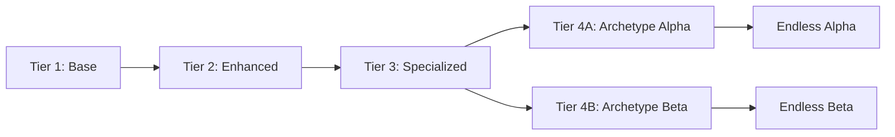

# Handoff Report: R2 — Evaluation of Variance Mechanics for Inritus

**Agent:** Explorer Subagent 2 (Variance Mechanics Analyst)  
**Task:** R2 - Evaluation of Variance Mechanics  
**State Folder:** `C:\Users\peneg\.gemini\antigravity\scratch\teamwork\66f469d4-8b58-4333-9e89-838fcbb7d0ff\.agents\teamwork\explorer_survey_2\`  
**Target File:** `handoff.md`  
**Date:** 2026-11-14T17:40:00Z  

---

## 1. Observation

Direct code observations from the Inritus codebase across architecture, combat math, enemy scaling, and item systems:

### 1.1 Progression & Difficulty Scaling Architecture
- **Real-Time Intensity Formula (`enemy_spawner.gd:183-194`):**
  ```gdscript
  var minutes = GlobalEvents.time / 60.0
  var time_multiplier = base_enemy_intensity
  if minutes > 1.0 and minutes <= 3.0:
      var t = minutes
      var A = enemy_intensity_time_multiplier / 2.0
      time_multiplier = base_enemy_intensity + (A * t * t)
  elif minutes > 3.0:
      var val_at_3 = base_enemy_intensity + enemy_intensity_time_multiplier
      time_multiplier = val_at_3 + minutes * enemy_intensity_time_multiplier
  ```
  - Base intensity = 3.0, time multiplier = 1.5. 
  - $t \in [0, 1]\text{ min}$: $I(t) = 3.0$.
  - $t \in (1, 3]\text{ min}$: $I(t) = 3.0 + 0.75 \times t^2$ (quadratic ramp reaching $9.75$ at $t=3$).
  - $t > 3\text{ min}$: $I(t) = 4.5 + 1.5 \times t$ (linear scaling, reaching $19.5$ at $t=10$, $34.5$ at $t=20$, $49.5$ at $t=30$).
- **Boss HP Multiplier (`enemy_spawner.gd:262-264`):**
  ```gdscript
  func get_boss_hp_multiplier() -> float:
      var minutes = GlobalEvents.time / 60.0
      return pow(boss_hp_scaling_base, minutes) * GlobalEvents.get_boss_hp_modifier()
  ```
  - `boss_hp_scaling_base = 1.05`.
  - At 5 min: $1.05^5 \approx 1.276\times$ HP.
  - At 10 min: $1.05^{10} \approx 1.629\times$ HP.
  - At 20 min: $1.05^{20} \approx 2.653\times$ HP.
  - At 30 min: $1.05^{30} \approx 4.322\times$ HP.
- **Wave Unlock Gates (`enemy_spawner.gd:13-14, 144, 164`):**
  - Normal pool unlocks at $t \ge 1.0\text{ min}$ (`time_normal_unlock_minutes = 1.0`).
  - Hard pool (Elites) unlocks at $t \ge 3.0\text{ min}$ (`time_hard_unlock_minutes = 3.0`).
  - Super pool (Bosses) spawns every 5.0 minutes (`bossInterval = 5 * 60`), with a 1-minute warning at $t=4, 9, 14, \dots$ (`enemy_spawner.gd:109-114`).

### 1.2 Item & Weapon Upgrade Flow in `UpgradeDb.gd` & `player.gd`
- **Upgrade Database Structure (`UpgradeDb.gd:6-150`):**
  - Entries are keyed by ID (e.g. `icespear1`, `icespear2`, `icespear3`, `icespear4`, `icespear_endless`).
  - Every entry defines: `icon`, `displayname`, `details`, `level`, `prerequisite` (`Array`), `type` (`"weapon"`, `"upgrade"`, `"bossitem"`, `"item"`, `"endless"`), and optional `stat_modifiers`.
- **Slot Limits (`global_events.gd:153-162` & `player.gd:51-52`):**
  - Normal difficulty: 6 weapon slots, 8 upgrade slots.
  - Hard difficulty: 5 weapon slots, 6 upgrade slots.
- **Draft Pool Filtering (`player.gd:818-880`):**
  ```gdscript
  # Checks prerequisites:
  if UpgradeDb.UPGRADES[i]["prerequisite"].size() > 0:
      var to_add = true
      for n in UpgradeDb.UPGRADES[i]["prerequisite"]:
          if not n in collected_upgrades:
              to_add = false
      if to_add:
          ...
  ```
  - Unlocked endless tiers are deprioritized (10% chance) until standard slots are full (`player.gd:872-879`).

### 1.3 SwarmManager & Collision Rules
- **MultiMesh Enemy Processing (`swarm_manager.gd:203-243` & `enemy_spawner.gd:203`):**
  - 100% of Easy and Normal pool enemies are routed to `SwarmManager` MultiMesh instances (up to 3,000 units).
  - Damage is evaluated via manual distance-based spatial partitioning (`spatial_grid`, 40px cell size).
  - Swarms only interact with nodes in the `"attack"` group, on **Layer 3** (`collision_layer = 4`), having a child named `"CollisionShape2D"` (`design_guidelines.md:337-344`).
- **Debuff System in Swarm (`swarm_manager.gd:27-36, 301`):**
  - `SwarmEnemy` has `apply_debuff(debuff_name, value, duration)`.
  - Currently supports `"curse"` (`damage_multiplier = 1.0 + enemy.get_debuff_value("curse")`).

### 1.4 Persistence & Save Infrastructure (`StatsManager.gd:1-79`)
- Uses `ConfigFile` saved to `user://statistics.cfg`.
- Currently tracks: `enemy_kills`, `boss_kills`, `total_deaths`, `total_wins`, `best_run_level`, `best_run_time`.
- No character loadouts, currency, or meta-progression data are currently persisted.

---

## 2. Logic Chain & Comparative Evaluation

### 2.1 Focus Area 1: Permanent Meta-Progression Systems

#### The Risk of Rain Scaling Dilemma
In standard *Vampire Survivors*, flat vertical meta-progression (+20% Might, +50 HP, +5 Armor, +Revive) works because enemy health and density follow fixed stage timelines without real-time pressure. In contrast, *Inritus* employs *Risk of Rain* dynamic scaling where intensity $I(t)$ ramps up with real elapsed time ($3.0 \to 9.75 \to 49.5$).

If permanent progression introduces **flat vertical stat buffs** (e.g., permanent +30% Base Damage or +3 Armor):
1. **Early-Game Collapse ($t \in [0, 3]\text{ min}$):** Easy swarms have baseline HP $\approx 10-20$. A player with $+30\%$ base damage and $+1$ projectile one-shots entire waves at spawn coordinates before they enter the screen, reducing active engagement to zero ("AFK farming").
2. **Exponential Devaluation ($t \in [15, 30]\text{ min}$):** Because boss HP scales exponentially ($1.05^t$) and wave intensity scales up to $50\times$, a flat $+10$ damage or $+20$ HP bought in the meta-shop becomes mathematically negligible in the endgame.
3. **Skill Atrophy & Balance Trap:** If the developer tunes enemy stats to challenge a fully upgraded player, new players encounter an impossible early-game barrier.

#### Comparative Architecture Matrix

| Dimension | Model A: Pure Vertical Treadmill (VS Style) | Model B: Lateral / Horizontal Unlocks (RoR2 Style) | Model C: Covenants & Pacts (Hades / Eclipse Style) | Model D: Recommended Hybrid Architecture |
|---|---|---|---|---|
| **Core Currency & Source** | Gold from every kill $\to$ Stat shop | Boss Trophies / Achievements $\to$ Pool unlocks | Heat / Curse levels selected pre-run | "Essence of Inritus" (Boss Kills + Elite Kills) |
| **Power Progression** | Linear stat bloat (+HP, +Might, +Speed) | Zero stat inflation; expands tactical toolbox | Risk-reward modifiers (harder enemies, more loot) | Lateral tool unlocks + Bounded Draft Perks |
| **Early Game ($0-3\text{m}$)** | Trivialized; removes positioning pressure | Preserves intense combat purity | Player dials up intensity intentionally | Preserves tense baseline balance |
| **Late Game ($20-30\text{m}$)** | Negligible impact vs $1.05^t$ boss HP | Synergies decide victory, not raw stats | High-skill mastery and tension | Highly engaging build depth |
| **Replayability Impact** | Finite; drops off once tree is maxed | Infinite; new permutations across runs | Endless challenge scaling | Multi-faceted mastery loops |
| **YAGNI Compliance** | High maintenance, balance re-tuning | High; hooks into existing character/item dicts | High; uses existing difficulty multiplier hooks | **Extremely high; zero new complex managers** |

#### Recommended Inritus Architecture: "The Vault of Inritus & Covenants of Agony"
Instead of a vertical stat shop, Inritus should implement a 3-pillar horizontal system using the existing `StatsManager.gd` (`user://statistics.cfg`):

1. **Pillar 1: Pre-Run Character Loadouts (RoR2 Pattern):**
   - Extends `GlobalEvents.CHARACTERS` with an `unlocked_loadouts` array.
   - Example:
     - **Mage:** *Loadout 1:* Ice Spear (heavy linear pierce) $\to$ *Loadout 2 (Unlocked after 5 boss kills):* Lightning Rod (instant hitscan chain).
     - **Plague Doctor:** *Loadout 1:* Poison Bottle (ground hazard) $\to$ *Loadout 2 (Unlocked by dealing 50,000 DoT):* Ritual Circle (offensive aura sustain).
     - **The Punished:** *Loadout 1:* Leather Whip $\to$ *Loadout 2:* Glass Lash (glass-cannon shard whip).
   - *Stat Impact:* 0% stat power creep. Changes gameplay feel from minute 0.
2. **Pillar 2: "Covenants of Agony" (Risk-Reward Run Modifiers):**
   - Configured in the character select screen using the existing `GlobalEvents.custom_*_modifier` infrastructure (`global_events.gd:83-90`).
   - Modifiers provide positive Essence multipliers in exchange for distinct combat constraints:
     - *Covenant of Swarms:* Swarm spawn rate $+40\%$, XP per gem $-25\%$, Essence reward $+50\%$.
     - *Covenant of Frailty:* Player max HP reduced to $50$, but movement speed $+15\%$, Essence reward $+35\%$.
     - *Covenant of Chronos:* Game clock advances at $1.25\times$ speed (accelerating RoR intensity curve $I(t)$), Essence reward $+60\%$.
3. **Pillar 3: Bounded Draft Perks (Vault Unlocks):**
   - Meta-currency ("Essence") unlocks structural run quality, NOT raw stats:
     - *Draft Reroll Charges:* Start run with 1 reroll charge (max 2 unlockable).
     - *Banishment Seals:* Ability to banish 1 unwanted item from appearing in the draft pool for the rest of the run (max 2 banishes).
     - *Item Unlocks:* Items like `relicdrone`, `vampireknives`, `thornring` start locked in the Vault and enter the general `UpgradeDb` pool once unlocked through gameplay milestones.

---

### 2.2 Focus Area 2: Weapon & Item Variants / Branching Paths

#### Architectural Fit within `UpgradeDb.gd`
The current `UpgradeDb` handles prerequisites via `"prerequisite": ["item_id"]`. `player.gd:get_random_item()` already iterates over `UpgradeDb.UPGRADES` and appends valid items to `standard_pool` if all prerequisites are fulfilled.

#### Proposed Branching Model: "Tier 4 Terminal Bifurcation"
To maintain strict YAGNI compliance and zero engine refactoring:
- Tiers 1 through 3 remain linear (`weapon1` $\to$ `weapon2` $\to$ `weapon3`).
- At Level 3, the linear path forks into **two distinct Tier 4 mutually exclusive specializations**: `weapon4_A` and `weapon4_B`.
- Both entries set `"prerequisite": ["weapon3"]`.
- When the player selects `weapon4_A`, `player.gd:upgrade_character()` records `weapon4_A` in `collected_upgrades`.
- In `player.gd:get_random_item()`, a 2-line mutex check ensures that if any variant of Tier 4 is collected, alternate Tier 4 variants of the same weapon base are suppressed.
- Endless scaling then keys off the chosen branch (`weapon_A_endless` vs `weapon_B_endless`).



#### Concrete Branching Specifications for 5 Core Benchmark Weapons

##### 1. Ice Spear (Standard Projectile Archetype)
- **Base (Tiers 1-3):** Linear high-damage projectile, low ammo, piercing 1-2 enemies (`damage: 8 -> 12`, `ammo: 1 -> 2`).
- **Branch A: Glacial Railgun (`icespear4_lance`):**
  - *Mechanics:* Single projectile with infinite pierce, high velocity ($400\text{ px/s}$), leaves a freezing ground trail (Layer 3 Area2D) lasting $2.5\text{s}$ that applies a $35\%$ slow to all swarms and elites traversing it.
  - *Damage:* $45$ damage, `proc_coefficient = 1.0`.
  - *Tactical Niche:* Corridor clearing, kiting corridors through dense swarms.
- **Branch B: Frost Shatter Cone (`icespear4_shatter`):**
  - *Mechanics:* Fires a cluster of 5 short-range ice flechettes in a $45^\circ$ forward shotgun spread ($200\text{ px/s}$). On impacting any target, each flechette fragments into 2 micro-shards (`damage: 6`, `proc_coefficient: 0.2`).
  - *Damage:* $16$ per flechette ($80$ point-blank burst).
  - *Tactical Niche:* Close-range panic defense, elite burst destruction.

##### 2. Leather Whip (Flexible Melee / 3-Slice Line2D Archetype)
- **Base (Tiers 1-3):** Horizontal/closest-target line sweep (`damage: 8 -> 16`, `speed: 1.3s -> 1.0s`).
- **Branch A: Heavy Flail / Morningstar (`whip4_flail`):**
  - *Mechanics:* Slower attack cadence ($1.2\text{s}$), massive $270^\circ$ circular sweep around the player. Knocks back swarms by $250\text{ px}$ and inflicts a $0.4\text{s}$ Stagger on Elites.
  - *Damage:* $32$ flat damage, high knockback.
  - *Tactical Niche:* Total 360-degree personal space control, ideal for low-mobility builds.
- **Branch B: Abyssal Lash / Vampire Scourge (`whip4_bleed`):**
  - *Mechanics:* Dual rapid forward slashes ($0.6\text{s}$ cooldown). Hits apply a stackable Bleed debuff dealing $8\text{ damage/s}$ for $3\text{s}$.
  - *Damage:* $18$ per slash, `proc_coefficient = 1.0`. Synergizes directly with player `lifesteal` and on-hit procs.
  - *Tactical Niche:* High-DPS single-target melting, boss execution.

##### 3. Lightning Rod (Hitscan Chain Archetype)
- **Base (Tiers 1-3):** Direct hit on random nearby target (`cooldown: 3.0s -> 2.0s`).
- **Branch A: Tesla Arc Lattice (`lightningrod4_chain`):**
  - *Mechanics:* Striking a target causes electric arcs to branch to up to 6 adjacent enemies within $150\text{ px}$ radius. Each bounce dampens damage by $15\%$.
  - *Damage:* $35$ primary, chaining down to $15$. `proc_coefficient = 0.5`.
  - *Tactical Niche:* Rapid crowd suppression across widely dispersed swarms.
- **Branch B: Heavenly Judgement / Smite (`lightningrod4_smite`):**
  - *Mechanics:* Calls down a colossal vertical blast exclusively targeting the highest-max-HP enemy on screen (Elites or Bosses). Completely ignores fodder swarms.
  - *Damage:* $150$ true damage, applies `"curse"` debuff ($+25\%$ damage taken for $4\text{s}$). Cooldown: $2.5\text{s}$.
  - *Tactical Niche:* Dedicated boss killer and anti-elite sniper.

##### 4. Poison Bottle (Two-Stage AOE / PhasedAnimator Archetype)
- **Base (Tiers 1-3):** Throws bottle that shatters into a static green cloud lasting $3.0\text{s}$ (`damage: 3/tick`, `proc_coefficient: 0.1`).
- **Branch A: Toxic Miasma (`poisonbottle4_miasma`):**
  - *Mechanics:* Cloud radius expands by $+100\%$ over its $5\text{s}$ lifetime via `PhasedAnimator`. Trapped swarms suffer $40\%$ movement slow and release minor gas spores upon death (`willowisp` style chain reaction with $0.05$ proc coefficient).
  - *Damage:* $5$ damage per $0.3\text{s}$ tick.
  - *Tactical Niche:* Large-scale zone denial and screen choke management.
- **Branch B: Caustic Acid Cloud (`poisonbottle4_acid`):**
  - *Mechanics:* Compact cloud ($50\%$ size) that strips enemy armor. Any elite or boss standing in the cloud has armor reduced by $50\%$ and takes $+20\%$ damage from all other weapons (`curse` integration in `SwarmManager`).
  - *Damage:* $10$ damage per $0.5\text{s}$ tick.
  - *Tactical Niche:* Boss vulnerability debuffing and synergy enabler.

##### 5. Ritual Circle (Persistent Aura / PhasedAnimator Archetype)
- **Base (Tiers 1-3):** Spawns stationary dark aura on targeted enemy cluster dealing periodic damage (`attackspeed: 10s`, `damage: 5`).
- **Branch A: Mobile Halo of Protection (`ritualcircle4_halo`):**
  - *Mechanics:* The circle anchors directly to the `Player` node, moving wherever the player moves. Grants the player $+4$ Armor and $+10\%$ Movement Speed while active, while repelling swarms with radial knockback.
  - *Damage:* $8$ damage/tick, pulses every $0.4\text{s}$.
  - *Tactical Niche:* Aggressive frontline pushing, mobile survivability.
- **Branch B: Blood Sacrificial Vortex (`ritualcircle4_vortex`):**
  - *Mechanics:* Remains stationary. Pulls Tier 1 swarms inward toward its center. When the circle expires via `PhasedAnimator:End`, it detonates in a kinetic explosion dealing $50\%$ of all damage dealt by the circle during its lifespan as burst AOE damage.
  - *Damage:* $12$ damage/tick + detonator burst ($100-300$ damage).
  - *Tactical Niche:* Swarm funneling and explosive group wipes.

---

### 2.3 Focus Area 3: Unconventional / Hidden-in-Plain-Sight Arena Mechanics

To transcend standard genre tropes (which rely on repetitive wooden breakables, static chests, or simple altars), Inritus should utilize mechanics that are **embedded into the arena's combat ecology**, leveraging Godot 4.6's existing 2D rendering and `SwarmManager` collision pipelines.

#### Mechanic 1: Kinetic Environmental Anomalies (Leyline Rifts)
- **Concept:** Inert, ethereal fractures in the ground that are invisible or semi-transparent until disturbed.
- **Combat Trigger:** They do not open menus or require button presses. Instead, they react exclusively to **Layer 3 physical violence**:
  - When struck by high-knockback attacks (e.g. Leather Whip, Ice Spear, or Boss attacks), the anomaly destabilizes.
  - *Reaction:* It pulses with a localized gravitational pull for $3\text{s}$ (drawing swarms into a tight clump), then releases an elemental shockwave (Layer 3 Area2D, `damage: 60`, `proc_coefficient: 0.0`) that obliterates the clumped swarm and leaves a pool of XP gems.
- **Risk-Reward:** If the player is caught in the anomaly when it detonates, it deals $15$ player damage and breaks shields. Skilled players kite bosses and swarm hordes across active leyline nodes to detonate them for massive free wave clears.

#### Mechanic 2: Symbiotic Swarm Mutagens (Horde Ecology)
- **Concept:** Rather than all swarm units being identical fodder, a small percentage ($2\%$) of MultiMesh swarm enemies spawn carrying distinct biological mutagens, visibly indicated via custom MultiMesh instance color (`mm.use_colors = true` in `swarm_manager.gd:84`):
  1. **Volatile Spore Carrier (Orange Tint):**
     - When killed, does not just drop an XP gem. It detonates in a caustic combustion (`death_position` hook in `GlobalEvents.enemy_died`).
     - Deals $40$ damage to all enemies within $60\text{ px}$.
     - *Chain Reaction:* Players can shoot the front-runner in an incoming corridor to trigger domino-effect wave wipes without firing additional ammo.
  2. **Null-Shield Matron (Cyan Tint):**
     - Emits a protective aura that grants nearby swarm units $50\%$ damage reduction.
     - Forces the player to switch target priority: pierce through the meat-shield to eliminate the Matron first, or be overrun by high-durability swarms.

#### Mechanic 3: Boss Encounter Secret Rituals & Environmental Interaction
- **Concept:** Boss encounters (Ancient Amoeba at 5 min, Dr. Franklin at 10 min) currently feel like isolated bullet-sponge DPS checks. Hidden ritual conditions reward tactical arena awareness with massive boss vulnerability windows:
  1. **Dr. Franklin's Overload Conduction:**
     - During Dr. Franklin's telegraph beam state (`dr_franklin.gd`), Franklin charges a high-damage linear beam.
     - *Hidden Interaction:* If the player baits Franklin into firing his beam directly through an active Leyline Rift or through an Elite Cyclops/Juggernaut, the beam reflects and overcharges Franklin's capacitors.
     - *Result:* Dr. Franklin suffers an instant internal overload: stuns for $3.5\text{s}$, skips his recovery phase, and his contact HitBox remains disabled while taking $+50\%$ damage from all player attacks for the duration.
  2. **Ancient Amoeba's Cyst Rupture:**
     - During Ancient Amoeba's `DISSOLVING` state (`boss.gd`), before it teleports, 3 pulsating cellular cysts briefly surface on the arena ground for $4.0\text{s}$.
     - *Hidden Interaction:* If the player destroys all 3 cysts using AOE weapons (Poison Gas, Ritual Circle, Whip) before Amoeba reappears, Amoeba emerges destabilized: its max HP is permanently reduced by $10\%$ for that encounter, and it drops an instant high-tier XP magnet.

#### Mechanic 4: The Sacrificial Blood Crucible (In-Combat Real-Time Pact)
- **Concept:** Spawns at 7:30 and 17:30 in the arena as a pulsating blood-red ring on the ground.
- **Zero-Menu Purity:** Does NOT pause the game. It is a physical zone on the arena floor.
- **The Crucible Trial:**
  - Stepping inside the circle binds the player: the circle perimeter prevents walking out for $4.0\text{s}$, while player HP drains at $8\text{ HP/s}$ ($32$ total damage, mitigated by Armor).
  - Swarm spawn density surges by $150\%$ during these 4 seconds.
  - If the player survives the 4 seconds, the Crucible explodes in a divine pulse (destroying all enemies on screen) and presents a quick-pick 2-card "Corrupted Covenant" reward:
    - *Covenant of the Berserker:* $+35\%$ Attack Speed permanently, but player maximum health is capped at $60\%$ of base HP.
    - *Covenant of the Leech:* $+4\%$ Lifesteal on all weapon hits, but healing food items (`item_food`) heal $0$ HP and hurt boxes take $+15\%$ more damage from bosses.

---

### 2.4 Focus Area 4: Pacing & Engagement Trade-offs

#### Timeline & Difficulty Model (0 to 30 Minutes)
The following chart and mathematical timeline illustrate how player power, swarm intensity $I(t)$, and encounter milestones align across a full 30-minute run in Inritus:

```
[0:00] -- Early Scramble (Intensity = 3.0, Easy fodder only, establishes positioning)
  |
[1:00] -- Normal Swarms unlock, Intensity ramps quadratically I(t) = 3 + 0.75*t^2
  |
[3:00] -- Hard Pool (Elites) unlock, Intensity hits linear ramp I(t) = 4.5 + 1.5*t
  |
[4:00] -- Warning Banner: "Ancient Amoeba approaching..." (GlobalEvents.show_boss_warning)
  |
[5:00] -- BOSS 1: Ancient Amoeba (1.28x HP). First major build check!
  |       Reward: Boss Level-Up (Boss Item / Boss Weapon: Glass Lash / Vampire Knives)
  |
[7:30] -- Emergent Event: Blood Crucible spawns (High-risk optional challenge)
  |
[9:00] -- Warning Banner: "Dr. Franklin detected..."
  |
[10:00] - BOSS 2: Dr. Franklin (1.63x HP). Bullet-hell beam telegraphing.
  |       Tier 4 Terminal Weapon Branching active across primary weapons!
  |
[15:00] - Mid-Game Climax: Double Elite Swarms, Swarm Soft Limit reaches 2,000 MultiMesh units.
  |       Intensity = 27.0. Weapon synergies must be complete.
  |
[20:00] - BOSS 3 / Endless Horizon: Boss HP = 2.65x. Endless scaling stacks engage.
  |
[30:00] - Final Cataclysm: Boss HP = 4.32x, Intensity = 49.5. Ultimate skill/build validation.
```

#### Detailed Phase Trade-Off Matrix

| Timeline Phase | Elapsed Time | Spawner Intensity $I(t)$ | Swarm & Boss Scaling | Proposed Variance Mechanics Active | Player Decision Friction | Boredom vs Overload Risk |
|---|---|---|---|---|---|---|
| **Phase 1: Genesis** | $0-3\text{ min}$ | $3.0 \to 9.75$ | Easy $\to$ Normal swarms; HP $10-30$ | Starting Character Loadout; Volatile Spore Carriers | Low friction; focus on XP gem routing and initial weapon picks | **Risk:** Boredom if player has flat meta-upgrades. **Mitigation:** Dynamic loadouts provide immediate mechanical identity without stat bloat. |
| **Phase 2: The Crucible** | $3-5\text{ min}$ | $9.75 \to 12.0$ | Hard Elites spawn; Boss warning at $4\text{m}$; Boss 1 at $5\text{m}$ ($1.28\times$ HP) | Leyline Rift detonation; Boss Cyst Rupture ritual | Medium friction; deciding whether to focus Amoeba or clear adds | **Risk:** Difficulty spike if elite knockback fails. **Mitigation:** Leyline Rifts give terrain-based clearing tool. |
| **Phase 3: Escalation** | $5-10\text{ min}$ | $12.0 \to 19.5$ | Elite density $+50\%$; Dr. Franklin at $10\text{m}$ ($1.63\times$ HP) | Blood Crucible at $7:30$; Tier 4 Terminal Weapon Bifurcation | High strategic friction; choosing specialized Tier 4 branch (e.g. AOE vs Single Target) | **Risk:** Analysis paralysis at Tier 4 fork. **Mitigation:** Clear binary choices (Clear vs Single-target Burst). |
| **Phase 4: Overdrive** | $10-20\text{ min}$ | $19.5 \to 34.5$ | Swarms cap at $2,000-3,000$ MultiMesh; Bosses spawn every $5\text{m}$ | Corrupted Covenants; Overclocked Boss interactions; Endless stacking | Low-medium UI friction; endless stacks apply automatically | **Risk:** Visual noise & FPS lag. **Mitigation:** MultiMesh batching + Category ICD prevents audio/frame collapse. |
| **Phase 5: Cataclysm** | $20-30\text{ min}$ | $34.5 \to 49.5$ | Boss HP $2.65\times \to 4.32\times$; Elites in every wave | Full build synergy validation; Covenant modifiers test mastery | Zero UI friction; purely execution-focused survival | **Risk:** Bullet-sponge fatigue. **Mitigation:** Boss mechanics (Franklin overload) reward active dodging over raw DPS. |

#### Cognitive Load & Friction Analysis
1. **The Pause Fatigue Anti-Pattern:**
   - In genre clones where level-ups occur every 10 seconds and pause the game, flow state is broken. In *Inritus*, `Player/player.gd:pending_levelups` queues rewards cleanly, but pausing during intense moments creates disjointed play.
   - *Design Stance:* Arena mechanics (Leyline Rifts, Blood Crucible, Spore Carriers, Boss Rituals) are **100% in-world physical interactions**. They require ZERO UI modal popups, keeping player immersion and reflexes engaged.
2. **Analysis Paralysis at Weapon Branching:**
   - Offering complex trees with 5 minor perks paralyzes players in high-speed action.
   - *Design Stance:* The Tier 4 Bifurcation model limits the choice to **exactly two sharply defined identities**:
     - *Option A:* Broad Area Control / Horde Suppression (e.g. Miasma, Flail, Railgun).
     - *Option B:* Precision Burst / Elite Elimination (e.g. Acid, Bleed, Smite).
   - This allows players to assess their build deficit in $< 2$ seconds: *"Do I lack swarm clear or single-target boss DPS?"*
3. **The Risk of Rain "Clock as Enemy" Pacing:**
   - In *Inritus*, real time is the ultimate arbiter of difficulty because intensity $I(t)$ ramps regardless of player level.
   - If variance mechanics waste player time (e.g. complex mini-games or backtracking), they punish the player unfairly.
   - All proposed mechanics are *directional and accelerating*: weaponizing Leylines or triggering Dr. Franklin's overload speeds up combat clearance, rewarding aggressive, high-skill play.

---

## 3. Caveats

1. **MultiMesh Visual Limitations:**
   - Swarm enemies in `SwarmManager.gd` do not possess individual Godot scene trees, `AnimationPlayer` nodes, or custom physics bodies. Mutagen colors (e.g. Volatile Spore Carrier) must be rendered using MultiMesh custom data or color buffers (`mm.use_colors = true`), not individual material instances.
2. **Layer 3 Collision Discipline:**
   - Environmental Leylines and Blood Crucibles must strictly obey the Layer 3 contract (`collision_layer = 4`, `"CollisionShape2D"`, `"attack"` group) if they deal damage to swarms, ensuring compatibility with `SwarmManager:300-340`.
3. **Save Migration Safety:**
   - Expanding `StatsManager.gd` to persist unlocked loadouts, covenants, and meta-currency must maintain backwards compatibility with existing user `user://statistics.cfg` files. Missing keys must gracefully default to empty arrays or zero currency.
4. **Endless Scaling Prerequisite Bounds:**
   - When branching at Tier 4, endless scaling items in `UpgradeDb.gd` must point to the specific branch taken (e.g. `icespear_lance_endless` with prerequisite `["icespear4_lance"]`), ensuring players cannot roll endless perks for branches they did not choose.

---

## 4. Conclusion

Introducing run variance into *Inritus* without compromising its core Risk of Rain difficulty scaling requires a strict adherence to **horizontal expansion over vertical inflation**:

1. **Permanent Meta-Progression:** Flat vertical stat treadmills (+Might, +HP) are mathematically incompatible with Inritus's time-intensity curve $I(t)$ and must be rejected. The game should implement **Pre-Run Weapon Loadouts**, **Covenants of Agony (Pact modifiers)**, and **Draft Utility Perks (Rerolls/Banishes)** funded by Boss Essence.
2. **Weapon Branching:** The **Tier 4 Terminal Bifurcation model** fits natively into `UpgradeDb.gd` without engine refactoring, offering players a clean binary strategic choice (Area Control vs Precision Burst) at minute 8-12 that revitalizes all 12 weapons.
3. **Unconventional Mechanics:** True variance comes from dynamic combat arena ecology: **Layer 3 Leyline Rifts**, **Volatile Swarm Mutagens**, **In-combat Blood Crucibles**, and **Interactive Boss Telegraph Overloads** (e.g. turning Dr. Franklin's beam back on him). These mechanics create emergent gameplay without adding UI clutter or violating YAGNI.
4. **Pacing Balance:** By keeping in-run variance mechanics physical and real-time, player flow state is preserved, cognitive load is bounded, and the 0-30 minute pacing curve remains taut, dangerous, and deeply rewarding.

---

## 5. Verification Method

To verify the findings, data structures, and mathematical models in this report:

### 5.1 Codebase & Math Verification
1. **Verify Intensity Scaling:**
   Inspect `Utility/enemy_spawner.gd:183-194` and `enemy_spawner.gd:262-264`. Run Python one-liner to evaluate intensity at key minutes:
   ```pwsh
   python -c "
   for m in [0, 1, 3, 5, 10, 20, 30]:
       I = 3.0 if m <= 1 else (3.0 + 0.75*m**2 if m <= 3 else 4.5 + 1.5*m)
       boss_hp = 1.05**m
       print(f'Minute {m:2d}: Intensity={I:5.2f}, BossHP={boss_hp:5.2f}x')
   "
   ```
2. **Verify SwarmManager Layer 3 Contract:**
   Inspect `Utility/swarm_manager.gd:300-340` and `design_guidelines.md:337-344`. Confirm that MultiMesh damage requires `collision_layer = 4` (Layer 3), group `"attack"`, and child `"CollisionShape2D"`.
3. **Verify UpgradeDb Prerequisite Flow:**
   Inspect `Utility/upgrade_db.gd:6-150` and `Player/player.gd:818-880`. Confirm that adding multiple items with the same prerequisite (`"prerequisite": ["weapon3"]`) is fully supported by the existing draft pool filtering algorithm.
4. **Verify Existing Tests:**
   Run GUT test suite to verify project stability:
   ```pwsh
   godot --headless -s addons/gut/gut_cmdln.gd
   ```
   Run localization validation:
   ```pwsh
   python .agents/skills/localization-validator/validate_translations.py
   ```
