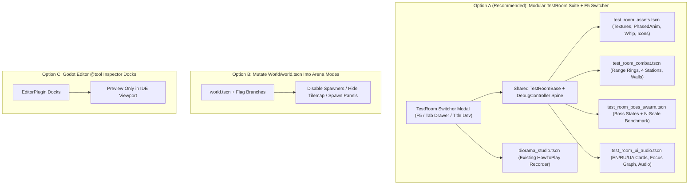
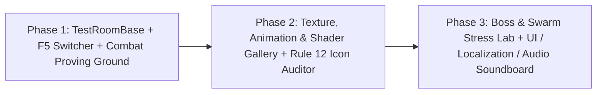

# Inritus — Dedicated Testing Levels & Diagnostic Utilities Plan

> **Status:** Implemented & Verified (v1.1)  
> **Target Audience:** Technical Artists, Game & Balance Designers, Systems / Boss AI Programmers, and UI / Localization / Audio QA  
> **Core Constraint:** Complement the in-run [`DebugController`](file:///d:/Школа/Сезон%206/Group%20project/Vampire%20survivors%20clone%20100%/Utility/Debug/debug_controller.gd) (`Tab`, `F1`–`F4`, `.`) with lightweight, fast-loading test rooms (`res://Tools/TestRooms/`) that expose dedicated spatial rigs, visual auditors, and room-specific special keybinds without duplicating production systems.

---

## 1. Executive Summary & Philosophy (`In-Run Debug` vs. `Dedicated Test Rooms`)

The newly implemented [Debug System](file:///d:/Школа/Сезон%206/Group%20project/Vampire%20survivors%20clone%20100%/docs/debug_system_expansion_plan.md) excels at mutating a live survival run inside [`World/world.tscn`](file:///d:/Школа/Сезон%206/Group%20project/Vampire%20survivors%20clone%20100%/World/world.tscn). However, many daily development and art tasks become awkward or slow when trapped inside the full survivor loop:

1. **Bypassing `world.tscn` Instantiation Overhead:** As documented in [`docs/tech_debt.md`](file:///d:/Школа/Сезон%206/Group%20project/Vampire%20survivors%20clone%20100%/docs/tech_debt.md#L37-L40), transitioning into `world.tscn` incurs a **2s–4s main-thread hitch** due to tree instantiation scale and ambient spawners. Dedicated test rooms skip the world wave director, background scroll chunks, and title preloading so they launch in **under 100ms via `F6`** (Godot's *Run Current Scene*) or an in-game **Test Room Switcher (`F5`)**.
2. **Deterministic, Distraction-Free Stages:** Inspecting a `whip_3slice.gdshader` curve pinch, verifying `PhasedAnimator` `START -> LOOP -> FINISH` frames, measuring knockback distance in pixels, or testing *Ancient Amoeba* telegraph timings works dramatically better on calibrated pixel-ruler floors, concentric range rings (`50px`, `100px`, `180px`, `250px`), and non-scrolling comparison pedestals than in the middle of an active horde run.
3. **Contextual Room Keybinds + On-Screen Cheat Sheet (`H`):** Because test rooms are isolated developer spaces rather than player gameplay, they can freely bind single keys (`1`–`4`, `Q`/`E`, `[`/`]`, `,`/`.`, `Space`, `W`, `B`, `R`) to high-frequency discipline actions without conflicting with gameplay controls. Every room displays an optional, toggleable **`[H] Keybind Legend`** bar/card so no contributor ever has to memorize shortcuts.
4. **Shared `Utility/Debug/` Spine (Rule 19 Compliance):** Every room reuses [`DebugController`](file:///d:/Школа/Сезон%206/Group%20project/Vampire%20survivors%20clone%20100%/Utility/Debug/debug_controller.gd), [`DebugTelemetry`](file:///d:/Школа/Сезон%206/Group%20project/Vampire%20survivors%20clone%20100%/Utility/Debug/debug_telemetry.gd) (`F2`), [`DebugVisualizer`](file:///d:/Школа/Сезон%206/Group%20project/Vampire%20survivors%20clone%20100%/Utility/Debug/debug_visualizer.gd) (`F3`), and [`TargetDummy`](file:///d:/Школа/Сезон%206/Group%20project/Vampire%20survivors%20clone%20100%/Utility/Debug/target_dummy.gd) (`F1`/`F4`/`.` included), keeping developer rooms strictly additive under `res://Tools/TestRooms/` with near-zero intrusion into production code.

---

## 2. Audit of Existing Testing & Staging Utilities in *Inritus*

Before designing new rooms, we examine what already exists across the repository:

| Utility | Location | What It Does Well | Gaps Requiring Dedicated Test Rooms |
|---|---|---|---|
| **Diorama Studio** | [`TitleScreen/HowToPlay/diorama_studio.tscn`](file:///d:/Школа/Сезон%206/Group%20project/Vampire%20survivors%20clone%20100%/TitleScreen/HowToPlay/diorama_studio.tscn), [`diorama_studio.gd`](file:///d:/Школа/Сезон%206/Group%20project/Vampire%20survivors%20clone%20100%/TitleScreen/HowToPlay/diorama_studio.gd) | Standalone `F6`-runnable `640x360` sandbox that captures 20 FPS visual JSON recordings for How-To-Play slides with timeline scrubbing. | Uses mock nodes (`%PlayerDummy` and hardcoded `TEX_*` asset paths) instead of live [`player.gd`](file:///d:/Школа/Сезон%206/Group%20project/Vampire%20survivors%20clone%20100%/Player/player.gd), `UpgradeDb`, `SwarmManager` MultiMesh shaders, `PhasedAnimator`, or `Line2D` 3-slice bend rigs. |
| **In-Run Debug Suite** | [`Utility/Debug/`](file:///d:/Школа/Сезон%206/Group%20project/Vampire%20survivors%20clone%20100%/Utility/Debug/debug_controller.gd), [`Player/debugmenu.gd`](file:///d:/Школа/Сезон%206/Group%20project/Vampire%20survivors%20clone%20100%/Player/debugmenu.gd) | Full live run control (`Tab`, `F1` Workbench, `F2` DPS HUD, `F3` Swarm/Layer-3 Visualizer, `F4`/`.` Freeze & Step, `TargetDummy`). | Lacks static spatial rulers/rings, side-by-side texture/shader inspection, manual sprite frame-stepping, boss state injection triggers, or 3-locale UI overflow checks. |
| **Headless CLI Test Runner** | [`Tests/test_runner.gd`](file:///d:/Школа/Сезон%206/Group%20project/Vampire%20survivors%20clone%20100%/Tests/test_runner.gd) (8 suites / 126 tests) | Fast (`~9s`), deterministic validation of `UpgradeDb` DAGs, stat math, ICDs, `DebugController`, and scene loading. | Headless runs cannot visually verify pixel crushing on `whip.tscn` (`tech_debt.md`), untrimmed transparent icon padding (Rule 12), `PhasedAnimator` visual transitions (Rule 11), or `ru`/`ua` glyph clipping on `640x360`. |

---

## 3. Multi-Perspective Requirements Analysis

### 3.1 Perspective A: Technical Artist & Animator ("The Pixel & Shader Inspector")
* **Primary Goal:** Catch visual regressions, shader parameter artifacts, animation frame pops, and UI icon cropping without playing a run until an effect unlocks.
* **Key Pain Points:**
  * [`whip.tscn`](file:///d:/Школа/Сезон%206/Group%20project/Vampire%20survivors%20clone%20100%/Player/Attack/whip/whip.tscn) and [`whip_3slice.gdshader`](file:///d:/Школа/Сезон%206/Group%20project/Vampire%20survivors%20clone%20100%/Utility/whip_3slice.gdshader) suffer from inner-arc pixel crushing under Nearest Neighbor filtering (`tech_debt.md`), and testing stretch lengths vs. curve angles requires dragging live `Line2D` vertices under zoom.
  * [`PhasedAnimator`](file:///d:/Школа/Сезон%206/Group%20project/Vampire%20survivors%20clone%20100%/Utility/phased_animator.gd) (`START -> LOOP -> FINISH`, Rule 11) in [`poison_gas.tscn`](file:///d:/Школа/Сезон%206/Group%20project/Vampire%20survivors%20clone%20100%/Player/Attack/poisonbottle/poison_gas.tscn) and [`ritualcircle.tscn`](file:///d:/Школа/Сезон%206/Group%20project/Vampire%20survivors%20clone%20100%/Player/Attack/ritualcircle/ritualcircle.tscn) spans multiple rows (`row_index`) and runs quickly in real gameplay.
  * **Rule 12** mandates tightly trimmed bounding boxes for all UI icons (`ItemOption` / `ItemContainer`), yet transparent padding mistakes currently go unnoticed until visually spotted in draft cards.
  * MultiMesh enemy shaders generated via GLSL string injection in [`swarm_manager.gd`](file:///d:/Школа/Сезон%206/Group%20project/Vampire%20survivors%20clone%20100%/Utility/swarm_manager.gd) plus [`recolor.gdshader`](file:///d:/Школа/Сезон%206/Group%20project/Vampire%20survivors%20clone%20100%/Utility/recolor.gdshader) and [`elite_graphics.gdshader`](file:///d:/Школа/Сезон%206/Group%20project/Vampire%20survivors%20clone%20100%/Utility/elite_graphics.gdshader) (modes `0`, `1`, `2`) need live uniform sliders over high-contrast checkerboard / dark / bright backdrops.

### 3.2 Perspective B: Game & Balance Designer ("The Combat Proving Ground Architect")
* **Primary Goal:** Compare weapon DPS, knockback distance, pierce saturation, HP-threshold items, and character passives cleanly on standardized targets.
* **Key Pain Points:** Testing weapon range vs. `GrabArea`, comparing Tier 1–4 upgrades back-to-back, lining up 8 targets in a row to verify pierce caps, or keeping health pinned near `95%`, `90%`, `30%`, and `20%` boundaries requires awkward setup in `world.tscn`.
* **What Makes Testing Easy:** Four distinct, marked quadrant stations inside one **Combat Proving Ground** connected by 1-key teleports (`1`–`4`), range circles every `50px`, instant weapon/tier cycling (`Q`/`E` and `Up`/`Down`), solid wall toggle (`W`) for testing future wall-collision projectiles (`docs/todo.md`), and automatic DPS/TTK reset (`C`).

### 3.3 Perspective C: Systems & Boss AI Programmer ("The Choreographer & Stress Tester")
* **Primary Goal:** Inspect boss state machines (*Ancient Amoeba* in `Enemy/Boss/boss.gd`, *Dr. Franklin* in `Enemy/Boss/dr_franklin.gd`) edge cases and profile `SwarmManager` MultiMesh performance deterministically.
* **Key Pain Points:** Waiting 5+ minutes or killing waves just to see *Ancient Amoeba*'s `DISSOLVING -> TELEGRAPHING -> REAPPEARING` transition or *Dr. Franklin*'s rectangular telegraph beam + `HitBox` disable window wastes iteration time. Likewise, manual horde spawning fluctuates, making MultiMesh frame-time regressions (`0.904 ms/frame` baseline noted in `docs/README.md`) hard to compare before/after optimization commits.
* **What Makes Testing Easy:** Direct keys to spawn either boss alone, force-trigger specific boss AI phases, pause immediately after a telegraph ends (`N`), and run an automated 4-stage `SwarmManager` stress script (`N = 500 -> 1500 -> 3000 -> 5000`) exporting min/avg/99th-percentile frame times to CSV.

### 3.4 Perspective D: UI, Localization & Audio Engineer ("The Polisher")
* **Primary Goal:** Catch Russian/Ukrainian string truncation on `640x360`, audit broken Rule 14 focus neighbors (`tech_debt.md`), and verify `MusicController` crossfades and SFX polyphony limits.
* **Key Pain Points:** Switching locales via Settings requires navigating menus repeatedly; long Russian/Ukrainian descriptions in `UpgradeDb` only break specific cards rarely rolled in drafts; SFX starvation (`swarm_manager.gd:57` voice stealing) only manifests under controlled simultaneous triggers.
* **What Makes Testing Easy:** A **UI, Localization & Audio Soundboard** room rendering `en`, `ru`, and `ua` variants side-by-side, highlighting focus-neighbor vectors in-viewport, and providing a burst SFX polyphony generator + `MusicController` crossfade deck.

---

## 4. Architectural Options Comparison (Rule 18)

Per **Rule 18 (Alternate Solutions)**, we evaluate three structural designs before detailing the recommended suite:



| Criterion | **Option A: Modular `res://Tools/TestRooms/` + `F5` Switcher (Recommended)** | **Option B: In-Place "Arena Mode" inside `World/world.tscn`** | **Option C: Godot Editor `@tool` Plugin Docks** |
|---|---|---|---|
| **Startup Speed (`F6`)** | **Instant (`< 100ms`).** No heavy `world.tscn` preload or wave table overhead. | **Slow (`2s–4s`).** Inherits the full `world.tscn` instantiation cost (`tech_debt.md`). | **Fast in IDE**, zero runtime existence in exported debug builds. |
| **Production Safety (Rule 19)** | **Clean isolation.** Production `world.gd`, `player.gd`, and menus stay untouched; only gated `F5` entry point hooks into [`DebugController`](file:///d:/Школа/Сезон%206/Group%20project/Vampire%20survivors%20clone%20100%/Utility/Debug/debug_controller.gd). | **High coupling.** Conditional branches pollute `world.gd` and background managers. | **Partial.** Risk of `@tool` script errors breaking editor reloads. |
| **Live Physics & Shader Fidelity** | **100% real runtime.** Uses actual `Player`, `SwarmManager`, `PhasedAnimator`, `NinePatchUI.tres`, and camera stretch. | **Real runtime**, but awkward for non-player rooms like UI/Localization split-views. | **Limited.** Cannot drive WASD kiting, controller focus (`ui_cancel`), or frame-time benchmarks cleanly. |
| **Maintenance Effort** | **Low–Medium.** Four focused scenes sharing one `TestRoomBase` script. | **High regression risk** whenever `world.tscn` changes. | **High.** Separate EditorPlugin maintenance burden. |

> [!TIP]
> **Why Option A Wins:** Keeping each discipline in its own small `.tscn` means technical artists can launch `test_room_assets.tscn` directly with `F6`, designers can jump straight into `test_room_combat.tscn` from the Title Screen or mid-run via `F5`, and zero speculative abstractions leak into production `World/` scripts.

---

## 5. Detailed Design: Shared Spine & Special-Keybind Rooms

### 5.1 Shared Spine: `TestRoomBase` & `F5` Switcher (`res://Tools/TestRooms/`)

```text
res://Tools/TestRooms/
├── test_room_base.gd          # Shared HUD strip, F5 switcher hook, [H] Keybind Legend, camera & grid helpers
├── test_room_assets.tscn/.gd  # Level 1: Texture, PhasedAnimator, Line2D 3-Slice, Shader & Icon Auditor
├── test_room_combat.tscn/.gd  # Level 2: Gridded Combat Proving Ground + 4 Stations + Test Walls
├── test_room_boss_swarm.tscn/.gd # Level 3: Boss State Choreographer + Automated Swarm Benchmark
└── test_room_ui_audio.tscn/.gd   # Level 4: 3-Locale UI Wall, Focus Graph & Audio Soundboard
```

Every test room shares a minimal top/bottom micro-HUD overlay (styled with `DebugButtons.tres`, staying out of the center `640x360` action area) and inherits the standard [`DebugController`](file:///d:/Школа/Сезон%206/Group%20project/Vampire%20survivors%20clone%20100%/Utility/Debug/debug_controller.gd) stack (`Tab`, `F1`, `F2`, `F3`, `F4`, `.`), plus these **universal Test-Room keybinds** (gated behind `SettingsManager.is_debug_enabled()` and suppressed whenever a `LineEdit`/`TextEdit` holds focus):

| Keybind | Universal Action Across All Test Rooms |
|---|---|
| `F5` / `Esc` | Open **Test Room Switcher** popup (jump between **Assets**, **Combat**, **Boss/Swarm**, **UI/Audio**, **Diorama Studio**, **Main World**, or **Title Screen**; pauses simulation; resumes on `Esc`; closes active modals) |
| `H` | Toggle translucent **Keybind Cheat Sheet** card listing every special hotkey active in the current room |
| `R` | **Reset Room** to clean initial state (respawns dummies, resets DPS meter, restores HP/positions, clears particles) |
| `Backspace` | Return directly to Title Screen (`menu.tscn`) from test room (or close active modal if open) |
| `Tab`, `F1`–`F3` | Existing [`DebugController`](file:///d:/Школа/Сезон%206/Group%20project/Vampire%20survivors%20clone%20100%/Utility/Debug/debug_controller.gd) tools (`Tab` Quick Drawer, `F1` Workbench, `F2` Telemetry/DPS, `F3` Swarm/Layer-3 Hitboxes) |
| `F4` / `Mouse5`, `.` | Freeze simulation toggle (`F4` / `Mouse5`) and step 1 physics frame (`.`, active when frozen/paused) |

---

### 5.2 Level 1: Texture, Animation & Shader Gallery (`test_room_assets.tscn` / `.gd`)

Designed for **Artists, Animators & Shader Developers** to inspect raw assets under exact pixel magnification and backdrop contrast without spawning enemies.

#### Built-In Stations & Utilities
1. **Sprite Sheet & `PhasedAnimator` Stepper:**
   - Auto-populates an inspection target list from [`Player/Attack/`](file:///d:/Школа/Сезон%206/Group%20project/Vampire%20survivors%20clone%20100%/Player/player.gd), [`Enemy/Minions/`](file:///d:/Школа/Сезон%206/Group%20project/Vampire%20survivors%20clone%20100%/Enemy/Base/enemy_body.gd), [`Enemy/Boss/`](file:///d:/Школа/Сезон%206/Group%20project/Vampire%20survivors%20clone%20100%/Enemy/Base/enemy_body.gd), and [`PhasedAnimator`](file:///d:/Школа/Сезон%206/Group%20project/Vampire%20survivors%20clone%20100%/Utility/phased_animator.gd) scenes (`poison_gas.tscn`, `ritualcircle.tscn`, `willowisp_explosion.tscn`, `impact_buckler_shockwave.tscn`).
   - Displays current `frame / (hframes * vframes)`, `Phase` (`START` / `LOOP` / `FINISH`), `row_index`, texture natural dimensions, and pivot crosshair (`+`).
2. **Interactive `Line2D` 3-Slice Bend Rig (`whip_3slice.gdshader`):**
   - Renders a live [`whip.tscn`](file:///d:/Школа/Сезон%206/Group%20project/Vampire%20survivors%20clone%20100%/Player/Attack/whip/whip.tscn) / [`glasslash.tscn`](file:///d:/Школа/Сезон%206/Group%20project/Vampire%20survivors%20clone%20100%/Player/Attack/glasslash/glasslash.tscn) curve with **draggable control points** (mouse click-and-drag), live sliders/toggles for `start_margin`, `end_margin`, `texture_scale`, `tile_middle`, and `hide_caps`, and a `1x`–`16x` pixel-loupe camera zoom specifically for catching the `tech_debt.md` inner-arc pixel pinching artifact.
3. **Shader Uniform & Backdrop Lab:**
   - Side-by-side preview of [`recolor.gdshader`](file:///d:/Школа/Сезон%206/Group%20project/Vampire%20survivors%20clone%20100%/Utility/recolor.gdshader) (`target_color`, `mix_hue`, `mix_saturation`, `mix_value`), [`elite_graphics.gdshader`](file:///d:/Школа/Сезон%206/Group%20project/Vampire%20survivors%20clone%20100%/Utility/elite_graphics.gdshader) (`trail_mode` `0` / `1` / `2`, synthetic `motion_offset` oscillator so trails stay testable while stationary), and a live [`SwarmManager`](file:///d:/Школа/Сезон%206/Group%20project/Vampire%20survivors%20clone%20100%/Utility/swarm_manager.gd) MultiMesh preview tile.
   - Cycles 4 calibration backdrops: **Pixel Checkerboard** (catches stray semi-transparent pixels), **Pure Dark (`#111318`)**, **Arena Ground Green**, and **Pure White**.
4. **Automated Rule 12 Icon Trim Auditor:**
   - Scans every `icon` path referenced in `UpgradeDb.UPGRADES` via `Image.get_used_rect()`, comparing trimmed pixel bounds against full image dimensions (`width x height`). Any icon with `> 0px` transparent edge padding is highlighted in a red warning border inside both live [`item_option.tscn`](file:///d:/Школа/Сезон%206/Group%20project/Vampire%20survivors%20clone%20100%/Utility/item_option.tscn) and [`item_container.tscn`](file:///d:/Школа/Сезон%206/Group%20project/Vampire%20survivors%20clone%20100%/Player/GUI/item_container.tscn) mock slots, printing the exact trim coordinates needed.

#### Special Keybinds (`test_room_assets`)
| Key | Action | Notes |
|---|---|---|
| `1` / `2` / `3` / `4` | Switch Inspection Tab (`Sprites & PhasedAnim` / `Whip 3-Slice Rig` / `Shader Lab` / `Rule 12 Icon Audit`) | Instant tab focus |
| `[` / `]` | Previous / Next sprite, scene, or whip tier asset | Cycles catalog cleanly |
| `Space` | Play / Pause current animation or shader oscillator | Also drives `PhasedAnimator` tick |
| `,` / `.` | Step `-1` / `+1` sprite frame when paused | Inspect single frames cleanly |
| `P` | Trigger `PhasedAnimator.advance(true)` (`FINISH` expiration transition) | Verifies Rule 11 graceful fade-out |
| `Up` / `Down` | Cycle `PhasedAnimator.row_index` or `elite_graphics` `trail_mode` (`0`–`2`) | Tests weapon tier color rows |
| `B` | Cycle Backdrop (`Checkerboard -> Dark -> Arena -> White`) | Exposes alpha halos / stray pixels |
| `G` | Toggle UV Grid, Pivot Crosshair, and `UsedRect` bounding box gizmos | Drawn at crisp 1px screen width |
| `+` / `-` (or Wheel) | Step Camera Loupe Zoom (`1x`, `2x`, `4x`, `8x`, `16x`) | Pixel-perfect nearest inspection |
| `A` | Run / Re-scan Rule 12 Transparent Padding Audit & print report | Outputs exact padded icon paths |

---

### 5.3 Level 2: Dedicated Combat Proving Ground (`test_room_combat.tscn` / `.gd`)

Designed for **Game & Balance Designers** who want repeatable, spatialized combat measurements with zero wave RNG.

```text
                       [ Station 1: Single-Target DPS ]
                          Immortal Dummy + Pixel Ruler
                                     |
[ Station 4: Swarm & Walls ] --------+-------- [ Station 2: Pierce & AoE Matrix ]
Replenishing Swarm Pen       (Player Spawn)     8-Dummy Line + 3x3 Tight Cluster
 + Toggleable Solid Walls            |
                       [ Station 3: Retaliation & HP Cage ]
                     Pokey Dummy (5/15/30) + HP Threshold Pads
```

#### Built-In Floor Rulers & 4 Quadrant Stations
* **Floor Calibrations:** `32px` tile grid + concentric range circles (`50px`, `100px`, `180px`, `250px`) centered on the active test station, making weapon range, `GrabArea`, aura diameter (*Ritual Circle*, *Poison Gas*), and knockback displacement immediately readable at a glance.
* **Station 1 (North) — Single-Target DPS Pedestal:** Single stationary immortal [`TargetDummy`](file:///d:/Школа/Сезон%206/Group%20project/Vampire%20survivors%20clone%20100%/Utility/Debug/target_dummy.gd) with knockback toggle (`K`) and floating 5s rolling DPS + last-hit readout.
* **Station 2 (East) — Pierce & AoE Formation Matrix:** One **Line of 8 Dummies** spaced `28px` apart (verifies exact pierce count on *Ice Spear* / *Javelin* / *Glass Lash*) plus a **3×3 Cluster** (verifies AoE falloff and Terraria ICD category immunity fixes from `docs/todo.md`).
* **Station 3 (South) — Retaliation & HP-Threshold Cage:** Paired [`TargetDummy`](file:///d:/Школа/Сезон%206/Group%20project/Vampire%20survivors%20clone%20100%/Utility/Debug/target_dummy.gd) set to `retaliate_enabled = true` (cycles `5 / 15 / 30` incoming damage pulses) surrounded by floor pads/hotkeys that snap player HP to `100%`, `95%` (*Glass Talisman*), `90%` (*Warding Brooch*), `29%` (*Frenzy Charm*), and `19%` (*Impact Buckler*).
* **Station 4 (West) — Swarm Pen & Prototype Wall Lab:** Controlled [`SwarmManager`](file:///d:/Школа/Сезон%206/Group%20project/Vampire%20survivors%20clone%20100%/Utility/swarm_manager.gd) pen that optionally auto-replenishes up to `N = 100` kobolds, alongside toggleable **`StaticBody2D` / `TileMapLayer` solid test walls** (L-corner and corridor) built specifically to test upcoming closed-map projectile collision (`todo.md`: terminate vs. pierce vs. bounce) and enemy obstacle steering.

#### Special Keybinds (`test_room_combat`)
| Key | Action | Notes |
|---|---|---|
| `1` / `2` / `3` / `4` | Warp player & camera to Station 1 / 2 / 3 / 4 (`0` returns to center pad) | Instant station jump |
| `Q` / `E` | Hot-swap active weapon across all `UpgradeDb` weapon families | Clears prior weapons cleanly via [`player.reset_all_upgrades()`](file:///d:/Школа/Сезон%206/Group%20project/Vampire%20survivors%20clone%20100%/Player/player.gd) |
| `Up` / `Down` | Step equipped weapon Tier (`1 -> 2 -> 3 -> 4 -> Endless +1/+5`) | Live comparison across tiers |
| `T` | Spawn an Immortal `TargetDummy` at mouse cursor (`Alt+T` clears custom dummies) | Quick ad-hoc spacing checks |
| `Shift+T` | Toggle retaliation on active dummies / cycle poke damage (`5 -> 15 -> 30`) | Hands-free *Thorn Ring* / *The Punished* / *Brooch* testing |
| `K` | Toggle `allow_knockback` on all active dummies | Inspect raw DPS vs. pushback displacement |
| `M` | Spawn `+50` Swarm enemies at mouse cursor (`Shift+M`: clear swarm pen) | Instant MultiMesh swarm validation |
| `O` | Toggle prototype solid Layer-1 Test Walls (`Standard` / `Corridor` / `Off`) | Obstacles toggle (`W` reserved for movement); ready for closed-map projectile & pathing development |
| `C` | Clear active projectiles & reset [`DebugTelemetry`](file:///d:/Школа/Сезон%206/Group%20project/Vampire%20survivors%20clone%20100%/Utility/Debug/debug_telemetry.gd) DPS meter | Clean stopwatch start for timed 10s DPS runs |
| `0` | Reset player cooldowns + recharge *Warding Brooch* & *Impact Buckler* immediately | Zero waiting between 60s item cooldown tests |

---

### 5.4 Level 3: Boss Choreography & Swarm Stress Lab (`test_room_boss_swarm.tscn` / `.gd`)

Designed for **Combat Engineers & Performance Profilers** debugging boss state machines and MultiMesh scaling bottlenecks.

#### Built-In Stations & Utilities
1. **Boss Choreography Stage:**
   - Spawns isolated instances of **Ancient Amoeba** (`enemy_super.tscn` / `boss.gd`) or **Dr. Franklin** (`dr_franklin.tscn` / `dr_franklin.gd`) paired automatically with [`BossUI`](file:///d:/Школа/Сезон%206/Group%20project/Vampire%20survivors%20clone%20100%/Player/boss_ui.gd) and an overhead state readout showing active state enum (`CHASE`, `DISSOLVING`, `TELEGRAPHING`, `REAPPEARING` / `RECOVERING`), phase timer countdown, telegraph world-rect/radius, and `HitBox` collision status.
   - Supports **"Hold After Telegraph"** (`N`), which freezes the boss immediately after firing/telegraphing so programmers can verify detached telegraph cleanup (`combat_multimesh_benchmarks_and_mitigations.md`) and `HitBox` re-enable timing using `F3` + `.` single-frame step.
2. **Repeatable Automated Swarm Benchmark Harness:**
   - Runs a fixed scripted sweep (`N = 500 -> 1,500 -> 3,000 -> 5,000` swarm units) at locked player weapons (`Off` or selected benchmark loadout) for `5.0s` per tier, logging `avg_fps`, `frame_ms`, `min_fps`, `physics_ms`, and `collision_pairs` to `user://swarm_benchmark.csv` so optimization branches have apples-to-apples numbers.

#### Special Keybinds (`test_room_boss_swarm`)
| Key | Action | Notes |
|---|---|---|
| `1` / `2` | Spawn *Ancient Amoeba* / *Dr. Franklin* (clears prior boss unless `Shift` held for Multi-Boss test) | Supports single & multi-boss testing |
| `Z` / `X` / `C` / `V` | Force Boss State (`Chase` / `Dissolve or Telegraph` / `Execute Beam or Teleport` / `Recover`) | Tests edge cases without waiting on AI timers |
| `N` | Toggle **"Pause After Next Boss Action"** auto-breakpoint | Catches beam/`HitBox` edge frames cleanly |
| `G` | Toggle Player Invulnerability (Quick Godmode without opening drawer) | Stay alive inside lethal boss beams |
| `B` | Start / Abort Automated Multi-Tier `SwarmManager` Benchmark (`500..5000`) | Writes `user://swarm_benchmark.csv` |
| `+` / `-` | Manually inject / despawn `500` Swarm instances around the perimeter | Ad-hoc thermal / FPS stress checks |

---

### 5.5 Level 4: UI, Localization & Audio Soundboard (`test_room_ui_audio.tscn` / `.gd`)

Designed for **UI Programmers, Translators & Audio Designers** working on `640x360` responsive layouts across `en`, `ru`, and `ua`.

#### Built-In Stations & Utilities
1. **Live 3-Locale Split Viewer & Card Wall:**
   - Instantiates real [`item_option.tscn`](file:///d:/Школа/Сезон%206/Group%20project/Vampire%20survivors%20clone%20100%/Utility/item_option.tscn), Level-Up Card columns, Character Cards, and Boss Reward headers side-by-side in **English (`en`)**, **Russian (`ru`)**, and **Ukrainian (`ua`)**, flagging any `Label` or `RichTextLabel` whose minimum/content size exceeds its container bounds.
2. **Rule 14 Focus-Neighbor & Controller Visualizer:**
   - Draws live directional arrows (`up` / `down` / `left` / `right`) between every visible `Control`'s `focus_neighbor_*` targets and displays the current `gui_get_focus_owner()` path in bold yellow—turning "haunted" focus traps (`docs/tech_debt.md`) into an obvious visual graph.
3. **Audio Polyphony & Crossfade Deck:**
   - Interactive deck driving [`MusicController`](file:///d:/Школа/Сезон%206/Group%20project/Vampire%20survivors%20clone%20100%/Utility/music_controller.gd) (`Normal -> Boss -> Extra` crossfades) plus an **SFX Burst Stress Button** (`P` / `X`) firing 1 / 10 / 30 concurrent hit/gem/explosion streams to prototype the rate-limited voice-stealing SFX pool noted in [`tech_debt.md`](file:///d:/Школа/Сезон%206/Group%20project/Vampire%20survivors%20clone%20100%/docs/tech_debt.md#L58-L63) (`S` reserved for movement).

#### Special Keybinds (`test_room_ui_audio`)
| Key | Action | Notes |
|---|---|---|
| `L` | Cycle active `TranslationServer` locale (`en -> ru -> ua`) | Live UI text refresh |
| `Shift+L` | Toggle **3-Locale Split View** (renders `en`, `ru`, `ua` cards simultaneously) | Instant overflow comparison |
| `[` / `]` | Cycle `UpgradeDb.UPGRADES` entry shown in sample [`item_option.tscn`](file:///d:/Школа/Сезон%206/Group%20project/Vampire%20survivors%20clone%20100%/Utility/item_option.tscn) cards | Checks longest Russian/Ukrainian tooltips |
| `N` | Toggle **Rule 14 Focus-Neighbor Vector Graph** (`focus_neighbor_*` arrows) | Exposes broken/missing controller grid wiring |
| `M` | Cycle [`MusicController`](file:///d:/Школа/Сезон%206/Group%20project/Vampire%20survivors%20clone%20100%/Utility/music_controller.gd) track pool & test crossfade | Verifies dual-player fade curves |
| `P` / `X` | Trigger SFX Polyphony Burst (`1` / `10` / `20` simultaneous streams) | `S` reserved for movement; stress-tests AudioServer clipping & voice caps |

---

## 6. Phased Implementation Roadmap



### Phase 1: `TestRoomBase`, `F5` Switcher & Dedicated Combat Proving Ground
1. Create `res://Tools/TestRooms/test_room_base.gd` with the compact top/bottom bar, `[H]` keybind legend toggle, and `F5` **Test Room Switcher** (with an optional debug-only button on the Title Screen when `SettingsManager.is_debug_enabled()` is true).
2. Build `test_room_combat.tscn/.gd` with `50px` range rings, `1`–`4` quadrant warps (Single Dummy, Pierce Line + 3×3 Cluster, Retaliation + HP Pads, Swarm Pen + toggleable Layer-1 Test Walls), and `Q`/`E`/`Up`/`Down`/`C`/`0` combat keybinds reusing [`TargetDummy`](file:///d:/Школа/Сезон%206/Group%20project/Vampire%20survivors%20clone%20100%/Utility/Debug/target_dummy.gd) and [`DebugController`](file:///d:/Школа/Сезон%206/Group%20project/Vampire%20survivors%20clone%20100%/Utility/Debug/debug_controller.gd).

### Phase 2: Texture, Animation & Shader Gallery (`test_room_assets`)
1. Build `test_room_assets.tscn/.gd` featuring the Sprite/`PhasedAnimator` single-frame stepper, draggable `Line2D` 3-slice whip rig (`whip_3slice.gdshader` + `1x`–`16x` pixel loupe), shader uniform playground (`recolor.gdshader`, `elite_graphics.gdshader`, `SwarmManager` atlas preview), and calibration backdrops.
2. Implement the automated **Rule 12 Icon Trim Auditor** checking every `UpgradeDb` icon via `Image.get_used_rect()` inside real `ItemOption` / `ItemContainer` frames.

### Phase 3: Boss/Swarm Stress Lab & UI/Localization/Audio Soundboard
1. Build `test_room_boss_swarm.tscn/.gd` with forced boss state transitions (`Ancient Amoeba` & `Dr. Franklin`), auto-pause breakpoint after telegraph (`N`), and repeatable `N = 500..5000` CSV swarm benchmark (`B`).
2. Build `test_room_ui_audio.tscn/.gd` with 3-locale split cards (`en`/`ru`/`ua`), Rule 14 `focus_neighbor_*` arrow visualizer (`N`), `MusicController` crossfade deck (`M`), and SFX polyphony stress burst (`P` / `X`).
3. Register existing [`DioramaStudio`](file:///d:/Школа/Сезон%206/Group%20project/Vampire%20survivors%20clone%20100%/TitleScreen/HowToPlay/diorama_studio.tscn) inside the `F5` Switcher so all dev sandboxes live under one shortcut.

---

## 7. Design Decisions & Implementation Summary

The design decisions were resolved as follows:
1. **Entry Points (Option A):** `F5` is the primary in-game shortcut for the `TestRoomSwitcher` modal across all test rooms, the live survival world, and the Title Screen (when debug is enabled). Nothing was added to the `Tab` Quick Drawer to keep it clean. All 4 test room scenes are also directly standalone runnable via `F6`.
2. **Room Keybinds & Movement Isolation:** `W` and `S` are strictly reserved for player movement and are never bound to test room actions. Wall toggling is bound to `O` (Obstacles) in the combat room, and SFX bursts are bound to `P` / `X` in the UI/audio room. `Esc` closes active modals (`F1` / `F5` / `H`) without conflicting with standard pause menu handling.
3. **Freeze Keybind & Mouse5 Unification:** The legacy `FreezeeverythingNOW!!!` ad-hoc action was removed, and simulation freeze/step was unified under `DebugController.handle_key_event`, binding both `F4` and Mouse5 (`MOUSE_BUTTON_XBUTTON2`) to `toggle_freeze()`.
4. **Implementation Scope:** All three phases were implemented and verified with 135 passing tests across 9 test suites in the headless test runner (`Tests/test_runner.gd`).
